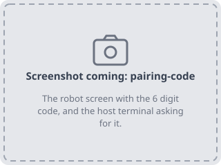

# MaiPai StackChan

Custom StackChan firmware and host software for **privacy, speed and more things the robot can do**.

The stock StackChan sends your voice to a cloud service. This replaces that. Your robot listens, thinks and talks using
models that run on your own computer, so what you say stays in your home. It also reacts faster, because the robot answers
touch, shake and "stop" by itself without waiting on a server, and it can do things the stock robot cannot: timers with a
ring, games, a camera that can name the people you enrol, a build light for your coding agent, and a local API for your own tools.

- **Private.** No cloud, no vendor account, no telemetry. The robot talks only to your host program and your Wi-Fi.
- **Fast.** Wake tone and listening cue in under 150 ms. Stop and local commands in under 300 ms with no model in the path.
  Replies start on the first sentence, not the last.
- **More capable.** Faces, a clock, timers, alarms, camera, games, a pet mood, a coding companion and two languages, all in one firmware.
- **Yours.** AGPL-3.0 source, a build you can reproduce, and updates that never install unless you say so.

> **Draft notice.** These docs are written as if v1.0.0 is finished, so the owner can review the full product. Remove this notice
> when v1.0.0 ships. Until then, treat every feature as unconfirmed on a unit.

## What it does

- **Face and look.** Two face styles, any colour or none, a clock face, night mode and an optional caption line. [Details](docs/user/face-and-look.md)
- **Voice.** Say the wake word, then talk. Follow-up questions need no wake word, and you can interrupt. [Details](docs/user/voice.md)
- **Timers and alarms.** A ring on the screen empties as time runs out. Snooze, and tones for each kind of alarm. [Details](docs/user/timers-and-alarms.md)
- **Moves and moods.** It reacts when you pick it up, shake it or pet its head. It breathes, looks around and sleeps when you ask. [Details](docs/user/moves-and-moods.md)
- **Camera (opt-in).** Snapshots, "what is this", face follow, "take my picture" and a local name list. Frames stay on the host. [Details](docs/user/camera.md)
- **Games and a pet mood.** A colour-memory game, an action game, and a mood that depends on how you care for it. [Details](docs/user/games-and-pet.md)
- **Coding companion.** The face and ring show what your coding agent is doing. A build light turns green or red. [Details](docs/user/coding-companion.md)
- **Home tools (off by default).** A local API, an event stream, MQTT, a home-automation bridge and metrics. [Details](docs/user/home-tools.md)
- **Two languages.** English and Spanish, chosen at run time with no reflash. [Details](docs/user/languages.md)
- **Updates you control.** Checking is on, installing is off until you turn it on. Images are signed, and a failed update rolls back. [Details](docs/user/updates.md)

## Two ways to run it

**Standalone (default).** The host program runs on a Mac, a Linux machine or a Raspberry Pi 5. It uses a language model you run
yourself, reached over a chat-completions style web address. Speech to text and text to speech use the addresses you set, or a built-in
local engine when you leave them blank. You need nothing else.

**With MaiPai Home (optional, faster and smarter).** [MaiPai Home](docs/user/with-maipai-home.md) is a private AI hub for your household.
Point the robot at it with one line, `brain = "home"`, and the robot gets:

- **Speed.** Home keeps its speech and chat models loaded and warm on one machine built for them, so the first word arrives sooner.
  It can run bigger, better models than a small always-on host can. A 4B class model answers in under 400 ms warm. A 27B class model on a weak host does not.
- **Memory.** It remembers across days, and it knows each person by voice and by name.
- **The household.** Calendars, briefings, announcements, song naming and rules for children and teens.

The robot is complete without Home. Switching is one line in `robot.toml` and the robot is not reflashed.

## Install

1. Install the host: `pipx install git+https://github.com/getmaipai/stackchan`. No Docker.
2. Put the firmware on the robot with the web flasher over USB, or build it with `stackchan firmware build`.
3. Run `stackchan pair`, then type the 6 digit code the robot shows.
4. Set `llm_url` in `robot.toml`, run `stackchan check`, then say the wake word.
5. Optional: `stackchan install-service` starts the host when the computer starts. Nothing runs as a silent service.

Full steps: [Getting started](docs/user/getting-started.md). Windows service support is not in v1.

## Safety note

In standalone mode this repo adds no content filter of its own. Content safety is the job of the language model you connect and
your persona prompt. The family-friendly persona is a prompt, not a guarantee.

## Docs

- Users: [Getting started](docs/user/getting-started.md), [Features](docs/user/features.md), [Settings](docs/user/settings.md),
  [Languages](docs/user/languages.md), [Privacy](docs/user/privacy.md), [Troubleshooting](docs/user/troubleshooting.md).
- Developers: `docs/dev/` (build from source, host and brains, contributing).
- Writing rules: `docs/STYLE.md`. Names still to confirm: `docs/dev/draft-names.md`. Design record: `docs/design/`.

## License

AGPL-3.0. See `LICENSE`, `NOTICE` and `THIRD-PARTY.md`.

## Contributing

Read `docs/dev/contributing.md` first. Run `bash scripts/check.sh` before you send a change.
