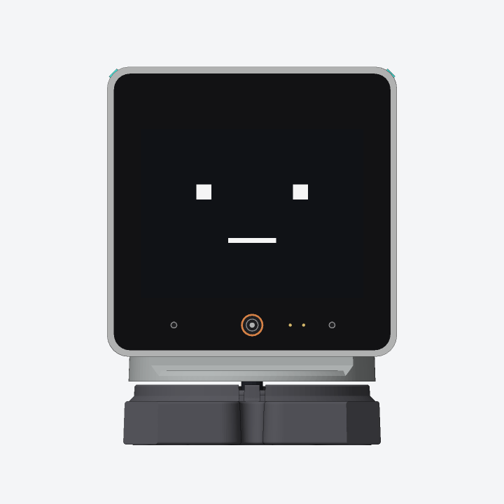

# MaiPai for StackChan

Private, local AI firmware and a small host program for the [StackChan](https://github.com/m5stack/StackChan) desk robot. Your robot talks to a model you choose: your own, a small one this program installs for you, or MaiPai Home. Nothing leaves your home unless you point it there.

## What it is

- **The robot's software** replaces the factory firmware: faces, touch, timers and alarms that work with no host, games, dances, a lock, mute and camera-off switches, and cues you cannot hide.
- **The host** (`stackchan`) runs on a Mac, a Linux machine or a Raspberry Pi 5. It does the thinking, the pages (settings, brain, status, what is on the robot) and the updates. A robot works without it for its own features.
- **The brain** is your choice at first run: MaiPai Home, your own model and speech servers, or a small local stack the host downloads.

## Try it

1. **The virtual robot, no hardware.** Open the robot in your browser or run it on this computer: [Try the virtual robot](docs/user/try-the-virtual-robot.md).
2. **Flash a robot.** A StackChan, a USB cable and the [web flasher](docs/user/web-flasher.md) (not published yet; you can [build from source](docs/dev/build-from-source.md)). Then [install the host](docs/user/install-the-host.md) and follow [Getting started](docs/user/getting-started.md).
3. **With MaiPai Home**, the free household hub: [Use MaiPai Home](docs/user/with-maipai-home.md).

## The documentation

- **For users:** [docs/user/index.md](docs/user/index.md). Set up, use, privacy, troubleshooting.
- **Playground:** [docs/playground/index.md](docs/playground/index.md). The virtual robot, the 3D viewer and the physics check.
- **For developers:** [docs/dev/index.md](docs/dev/index.md). How it fits together, building, testing, the plans.

## Where it stands

Pre-1.0. In plain words, from [the readiness page](docs/plan/release-readiness.md):

- **Works and is tested on a computer:** the host program, the settings, brain, status and library pages, pairing, the encrypted link, signed updates in the tests, the voice path, games, timers, the virtual robot and every screen as a golden frame.
- **Seen on a real robot:** the screens shown in the docs as `unit-` pictures (face, apps wall, control sheet, games, settings). Many features are built and checked only on the virtual robot.
- **Not done yet:** a signed release image and key, a published flasher, a host installer you double click, and hands-on checks on a robot for the first spoken reply, finger touch and the head's timings. Nothing here is a finished product.
- Pictures named `unit-` are real screenshots; `vu-` pictures are drawn by the robot's own screen code on a computer; the other drawings (81 of them) are placeholders.

## Independence

MaiPai for StackChan is an independent project providing custom firmware and tools for the M5Stack StackChan robot. It is not affiliated with, endorsed by, or sponsored by M5Stack or the original StackChan creators. Product names and trademarks belong to their respective owners.

## Get help and contribute

- Start with [Troubleshooting](docs/user/troubleshooting.md) and run `stackchan check`. Report bugs and ideas on the Issues tab.
- To change the code, read [docs/dev/contributing.md](docs/dev/contributing.md) and run `bash scripts/check.sh` first.
- The robot is M5Stack's: [official project](https://github.com/m5stack/StackChan).

## License

AGPL-3.0. See `LICENSE`, `NOTICE` and `THIRD-PARTY.md`. The language models are third-party and chosen by you; their answers can be wrong and are not advice. Parents decide what children can reach.
