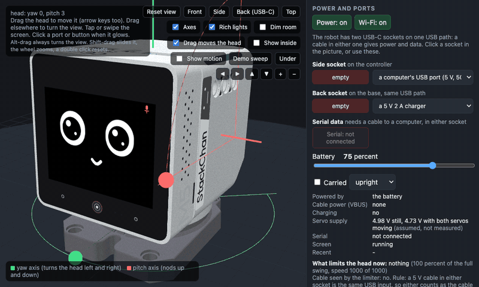

# MaiPai for StackChan

Custom firmware for the [StackChan](https://github.com/m5stack/StackChan) desk robot, plus a small host program. Private and local: your robot talks to a model you choose, and nothing leaves your home unless you point it there.

- **Works on its own.** Faces, touch, timers, alarms, games and dances run on the robot with no host and no cloud.
- **Your brain, your choice.** Use your own model, a small one the host installs for you, or MaiPai Home.
- **Safe by design.** A lock, mute and camera-off switches, and cues that cannot be hidden when the robot listens or watches.
- **Six languages**, switched at run time, no reflash.
- **Try it first** on a virtual robot in your browser, with no hardware.

## Install and use

1. Try the [virtual robot](docs/user/try-the-virtual-robot.md), or open the [playground](docs/playground/index.md).
2. Flash a robot with the [web flasher](docs/user/web-flasher.md) (not published yet; [build from source](docs/dev/build-from-source.md) works today).
3. [Install the host](docs/user/install-the-host.md), then follow [Getting started](docs/user/getting-started.md).

Docs: [For users](docs/user/index.md) · [Playground](docs/playground/index.md) · [For developers](docs/dev/index.md)

## Status

Pre-1.0. The host, settings pages, pairing, voice path, games and the virtual robot work and are tested on a computer; several screens are seen on a real robot. Still open: a signed release image, a published flasher and a double-click host installer. See [the readiness page](docs/plan/release-readiness.md).

## Independence

MaiPai for StackChan is an independent project providing custom firmware and tools for the M5Stack StackChan robot. It is not affiliated with, endorsed by, or sponsored by M5Stack or the original StackChan creators. Product names and trademarks belong to their respective owners.

## Help, contributing, license

Run `stackchan check` and read [Troubleshooting](docs/user/troubleshooting.md); report bugs on the Issues tab. To change code, read [contributing](docs/dev/contributing.md). AGPL-3.0: see `LICENSE`, `NOTICE` and `THIRD-PARTY.md`.
