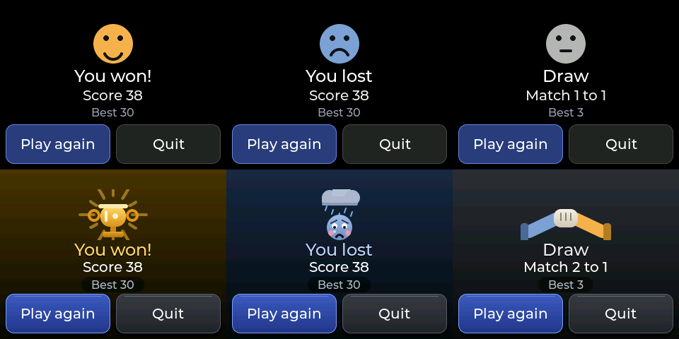

# The game-over screen: a new look

Playground track, 2026-11-19, redone twice the same day: for the display's measured cost, then after the b85 bench of the unit (see "What the b85 bench said"). Owner request: the shared game-over screen (`docs/design/game-over-screen.md`) is bland and needs a real graphical overhaul. This page criticises today's screen, designs a look for four outcomes, and gives the measured verdict against `docs/plan/games-visual-budget.md`. The prototype is patch `UX15d-game-over-look.patch`, a look level: **look 1, the new screen standing still, is the default candidate** (the owner wants the overhaul); look 2, a light motion on top of it, stays a bench level until it meets its gates on the unit. Look 0 is today's screen.

*Today's screen (top row) and the new look (bottom row) for a win, a loss and a draw.*

## What is wrong with today's screen

- **One shape for every outcome.** A 56 px disc on black. Won is amber, lost is blue, draw is gray, and nothing else tells them apart at arm's length. A child learns the color, not the moment.
- **No celebration and no comfort.** A win gets the same stillness as a loss. Nothing moves except a 160 ms pop of the disc.
- **The result word is plain.** The same 24 px white on every outcome, with no weight and no color of its own.
- **The score just appears.** A number that counts up is half the pleasure of a score.
- **A new best is one amber line** in the 16 px font. It is the best news the screen can give and it looks like a caption.
- **Flat buttons.** They are the right size (148 by 56 px) but read as boxes. There is no pressed state.
- **Twelve LVGL objects** (about 1.7 KB of internal RAM) for what one draw callback can paint.

## The design

Everything is drawn from rectangles, circles, rings, lines, arcs and text. No bitmaps, nothing per game.

| Outcome | Backdrop (top to bottom, static gradient) | Emblem | Result word |
|---|---|---|---|
| Won | warm brown to near black | A gold trophy (cup, handles, stem, base, shine) over twelve still rays, with a glint that crosses the cup once. At look 2, confetti falls in two narrow columns beside it for 1.7 s and fades. | Gold |
| Lost | dusk blue to near black | A rain cloud over a droopy, kind face: eyebrows slanting up in the middle, a small frown, pink cheeks, one tear. Rain falls from the cloud to the face. | Pale blue |
| Draw | slate to near black | Two arms, one blue and one amber, meeting in a clasp with fingers that squeezes up a few pixels once. | Light gray |
| New best | violet to near black | A gold crown with jewels over a violet ribbon, four sparkles that grow and shrink, gold and violet confetti. A new best takes the emblem from whatever the result was; the result word still says it. | White, with the gold best chip |
| Game over, Time's up | sand to near black | A finish flag (Game over) or a clock with a sweeping red hand (Time's up). Calm, no verdict. | Sand |

The same on every outcome:

- **The result word**, 24 px, with a dark shadow under it so it reads on any backdrop.
- **The score line**, 20 px, counting up from 0 to the number in the game's own text ("Score 66" counts 0 to 66 over 700 ms, starting at 400 ms, easing out). Text with no number does not count.
- **The best chip**, a pill under the score: a dark pill with the best line, or the gold pill "New best!" for a record.
- **Two buttons**, 148 by 56 px as before, with a vertical gradient, a rim, a light along the top edge, and a soft shadow (look 2). **Pressed**: flat and darker, no shadow, the label 2 px lower. `mgo::set_pressed(screen, MGO_BTN_AGAIN or MGO_BTN_QUIT)` sets it, `MGO_BTN_NONE` lets go.
- **Six languages** for every word: English, Spanish, French, German, Portuguese, Italian, in plain ASCII like the games' other texts. "Jogar de novo" was 143 px wide at 20 px, over the 124 px a button label may use, so Portuguese says "Outra vez".

*A new best, Game over, Time's up, then the words in French, German and Portuguese.*

### What the b85 bench said, and the second redo

The unit's bench (b85) measured the first moving version: the entry frame took 56 to 96 ms (inside the 100 ms gate); look 0, today's screen, came in just over its 15,000 us gate for a win, a loss, Game over and a new best (15,050 to 17,482 us); look 1, the new still screen, passed; look 2 failed for a win (about 42 ms mean, 65 to 70 ms worst) and a new best (about 48 mean, 80 to 82 worst) and was just over for a loss. The host had predicted a few milliseconds. The reason is in the unit's cost model: every separate rectangle LVGL redraws is its own transfer to the panel, and the first look 2 redrew 18 confetti rectangles, the emblem's box while it dropped in, the cup's glint, the score line and more in one frame. So:

- **Look 1 is the default candidate.** Nothing moves, so after the entry frame the screen costs nothing. The gates: look 0 worst frame 18,000 us (it measured up to 17,482), look 1 15,000 us (it passed), the entry frame 100 ms. The frame times must be the real flush: `bench_over` must time the refresh and the panel flush, not only the draw calls (asked of the firmware track).
- **Look 2 is rebuilt as the lightest motion that still celebrates.** The emblem stands still (no drop-in, no glint, no sparkle twinkle). A win and a new best get **eight confetti pieces** in two narrow columns beside the emblem (x 62 to 98 and 222 to 258), four in each, falling 40 to 90 px a second in 60 ms steps (2 to 5 px a step). A loss has the rain and the tear (one rectangle), a draw the clasp squeeze (while it squeezes), Time's up the clock hand, Game over nothing. The score counts up in a rectangle only as wide as its own text. **At most three rectangles a step, every step on a 60 ms boundary, nothing on the 30 ms steps in between.** Shadows and the backdrop are drawn once, in the entry frame.
- **The targets on the unit:** mean at most 8 ms and worst at most 25 ms a frame (the gates in `scripts/bench-trains/game-over-look.json`). On the host: 3,212 px mean and 7,680 px worst for a win and a new best, 2,006 and 5,184 for a loss, 1,213 and 8,568 for a draw, 1,642 and 4,432 for Time's up, 0 pixels changing outside the rectangles in every run; the old look 2 was 5,000 mean and 13,000 to 15,000 worst in 8 to 18 rectangles.

### The rule this look is judged by

`docs/plan/games-visual-budget.md` section 4: **one full-screen frame, when the screen appears, up to 100 ms** (the only frame that draws the gradient backdrop and the shadowed buttons; allowed only at screen entry, never during play or a motion); every later frame small (at most 16,000 px worst and 6,500 px on average, and, from the b85 result, at most three rectangles); shadows only small and static, drawn once; particles as tiny rectangles, one per piece, in as few columns as will do.

### Motion (look 2, bench level)

All motion is arithmetic on the time since the screen appeared (`mgo_*` functions in `maipai_game_over_core.h`), played by the games' existing call to `set_pop` for 1.8 s. No timer, no object, no allocation. It is not the grid games' animation layer: that layer moves pieces of a board.

| Moment | What moves | What is redrawn (every 60 ms) |
|---|---|---|
| 0 to 1700 ms | Won and new best: eight confetti pieces, fading in the last 300 ms | The two columns, 36 by 72 px each |
| 200 to 900 ms | The score counts up | The width of the score text, 24 px high |
| 480 to 720 ms | Draw: the clasp squeezes up | The arms and clasp, 132 by 46 px |
| to 1700 ms | Lost: the rain and the tear. Time's up: the clock's hand | The rain and tear, 48 by 56 px; the hand, 44 by 44 px |
| after 1700 ms | Everything is still | Nothing |

The last step redraws the moving parts once in their still pose, and the renderer checks that no changed pixel lies outside the rectangles `mgo_dirty` gives (0 in every run).

### The flourish

A short run of tones per outcome, in a table in `maipai_game_over_core.h` (`mgo_tones`). Each is at most 600 ms of tone, played 20 ms apart:

| Outcome | Tones (Hz and ms) |
|---|---|
| Won | 523 for 90, 659 for 90, 784 for 90, 1047 for 260 (rising) |
| Lost | 392 for 140, 330 for 140, 262 for 300 (falling, slow) |
| Draw | 440 for 140, 440 for 220 (two equal notes) |
| Game over | 392 for 200, 330 for 320 |
| Time's up | 880 for 80, 880 for 80, 660 for 260 |
| New best | 784, 988, 1175 and 1568 for 70 each, then 2093 for 320 (a glitter) |

The table and its host test are here. Playing it through the unit's tone player, at the sound level the household set, is a firmware-track step: today the games map `mgo_cue` to their own clips, and the table can replace or follow them.

## Measured against the budget

Host renderer, `scripts/virtual-unit/games_cost.py` (K now the unit's measured 0.733 ms per 1,000 px, b85), 60 frames of 30 ms for each outcome of look 2 after the screen has appeared, and `objcount`:

| Outcome | Dirty area per frame, mean / worst | Cost per frame, mean / worst | Rectangles a step | Changed pixels outside them |
|---|---|---|---|---|
| Won, new best (confetti) | 3,212 / 7,680 px | 2.4 / 5.6 ms | 3 | 0 |
| Lost (rain) | 2,006 / 5,184 px | 1.5 / 3.8 ms | 2 | 0 |
| Draw (clasp) | 1,213 / 8,568 px | 0.9 / 6.3 ms | 2 | 0 |
| Game over, Time's up | 1,642 / 4,432 px | 1.2 / 3.2 ms | 1 to 2 | 0 |

| Rule | Today's screen | Look 1 (new, still) | Look 2 (new, light motion) |
|---|---|---|---|
| At most 15 objects | 12 added | 2 added | 2 added |
| One draw callback | no | yes | yes |
| Entry frame at most 100 ms, once | one full-screen frame | b85: 56 to 96 ms | the same frame |
| Frames after the entry | the old 160 ms face pop: 15 to 17.5 ms worst on b85 (gate 18,000 us) | none: passes (gate 15,000 us) | host: 2.4 mean, 5.6 worst; unit: bench pending (gates 8 mean, 25 worst) |
| Shadows static, drawn once | none | two blur 6 under the buttons | the same |
| Particles | | none | 8 pieces in two columns |
| No per-game bitmaps, 56 px buttons | | none, 148 by 56 | the same |

**Verdict:** look 1 fits on the unit as measured and is the default candidate. Look 2 fits on the host with a third of the first version's rectangles and area; whether it meets 8 ms mean and 25 ms worst on the unit is the next bench. If it does not, look 1 ships alone.

## What the patch changes

- `maipai_game_over_core.h`: the six-language word tables, the geometry, the easings, the count-up, the confetti, `mgo_dirty`, the tone table. `MGO_POP_MS` grows to 1800 so the games, which call `set_pop` until `MGO_POP_MS + 40`, keep calling it while the motion plays; the old face pop keeps its 160 ms (`MGO_FACE_POP_MS`).
- `maipai_game_over.h`: the old screen stays as `build_flat` (look 0). The new one is `build_new` and one draw callback. `mgo::build` and `mgo::set_pop` keep their arguments, so `maipai_games.cc`, `maipai_grid.cc` (game code) and `maipai_qa_game.cc` are unchanged. `mgo::build_lang` takes a language 0 to 5, `mgo::set_pressed` the pressed button.
- `maipai_grid.cc`: only the bench tool `self.game.bench_over`.
- The look level is `mgo::g_look`, default `MGO_LOOK_DEFAULT` = 1. **A normal image shows the new still screen** (look 1); look 0 is today's screen and look 2 the light motion, both reached with `self.game.bench_over` or by changing the constant.

Not wired yet, and not part of this patch: the games passing the household's language (they still pass `es`, so French, German, Portuguese and Italian show only through `build_lang`), calling `set_pressed` on touch down, and playing the tone table. All three are small and belong to the firmware track.

## Proof

- Today's screen is unchanged: all 27 existing `game-over-*` goldens are pixel for pixel the same with the patch in.
- 39 new goldens (`game-over-look-*`): each outcome on three sample games (Four in a Row, Rock Paper Scissors, Tic-Tac-Toe), the neutral ends (Whack, Do It, Color Memory), a win and a new best in all six languages, Lost in German, Time's up in Spanish, six moments of the motion (the landing, the confetti, the rain, the squeeze, the sweep, the glitter), both pressed buttons, and looks 1 and 2.
- `host/tests/test_game_over_look.py` with `host/tests/firmware/game_over_look_core_test.c`: every word exists in every language in ASCII, the easings, the count-up never goes down and ends on the number, every confetti piece stays in its band, the dirty rectangles stay inside the glass and nothing changes after the end, the mean (6,500 px) and worst (16,000 px) dirty area are within the motion rule for every outcome and a new best on any of them, every outcome has a flourish of at most 600 ms. With the renderer built: every word fits (titles 296 px, button labels 124 px, the chip label 200 px), the new look adds two objects, and no pixel changes outside the rectangles.

## Bench

Bench images only (`self.game.bench_over` is in the bench tool block, so `plain` and `gate` images do not carry it).

1. Replay the series with `UX15d-game-over-look.patch` last in `firmware/patches/ORDER` (the last line on the branch `ux/unproven-games`; it applies on the current main series, and on top of UX29 and the other unproven patches).
2. Build the bench image: `bash scripts/fw-build.sh TREE bench`.
3. Flash it, set `build_dir` in `scripts/bench-trains/game-over-look.json` to the new tree (it says `NEWBUILD`), run `python3 scripts/bench-train.py scripts/bench-trains/game-over-look.json`. The train shows each of six outcomes (won, lost, draw, Game over, Time's up, a new best) at look 0, 1 and 2, about two seconds each, and reads the tool's answer.
4. Read `result.json`. For each look and outcome: `entry_us` (the full-screen frame when the screen appears; the gate is 100,000), `us_mean` and `us_worst` (the motion frames after it, one draw and flush per 30 ms step: at look 2 the gates are 8,000 and 25,000), `objects` (2 at looks 1 and 2, about 12 at look 0), `internal_free_before` and `internal_free_during` (the new look takes about 150 bytes of state and two objects; the difference to look 0 should be 1 to 2 KB in the new look's favour).
5. Look at the screen at look 2 for each outcome and say if anything flickers, tears or stutters, and if the buttons read as buttons (the `person` items of the manifest).

By hand, on any bench image: `self.game.bench_over {"look": 2, "result": 1, "new_best": 0, "lang": 3}` shows a win in German, plays its motion and answers `{ok, look, frames, objects, entry_us, us_mean, us_worst, internal_free_before, internal_free_during}`. Result 1 won, 2 lost, 3 draw, 4 Game over, 5 Time's up. Language 0 to 5 is English, Spanish, French, German, Portuguese, Italian.

**To change the default:** `MGO_LOOK_DEFAULT` in `maipai_game_over_core.h` (1 now). To add the light motion once its bench passes, set it to 2 and regenerate the game-over goldens in the same landing (the golden stamp, `scripts/golden-stamp.py`, fails otherwise). The three small wiring steps above still belong to the firmware track.
