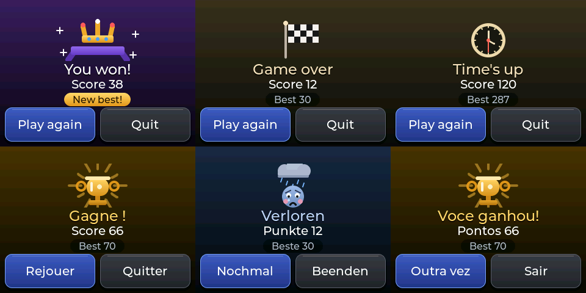

# The game-over screen: a new look

Playground track, 2026-11-19, redone the same day for the display's measured cost (see "The rule this look is judged by"). Owner request: the shared game-over screen (`docs/design/game-over-screen.md`) is bland and needs a real graphical overhaul. This page criticises today's screen, designs a look for four outcomes, and gives the measured verdict against `docs/plan/games-visual-budget.md`. The prototype is patch `UX15d-game-over-look.patch`, a look LEVEL that stays off until the bench says it fits.

*Today's screen (top row) and the new look (bottom row) for a win, a loss and a draw.*

## What is wrong with today's screen

- **One shape for every outcome.** A 56 px disc on black. Won is amber, lost is blue, draw is gray, and nothing else tells them apart at arm's length. A child learns the color, not the moment.
- **No celebration and no comfort.** A win gets the same stillness as a loss. Nothing moves except a 160 ms pop of the disc.
- **The result word is plain.** The same 24 px white on every outcome, with no weight and no color of its own.
- **The score just appears.** A number that counts up is half the pleasure of a score.
- **A new best is one amber line** in the 16 px font. It is the best news the screen can give and it looks like a caption.
- **Flat buttons.** They are the right size (148 by 56 px) but read as boxes. There is no pressed state.
- **Twelve LVGL objects** (about 1.7 KB of internal RAM) for what one draw callback can paint.

## The design

Everything is drawn from rectangles, circles, rings, lines, arcs and text. No bitmaps, nothing per game.

| Outcome | Backdrop (top to bottom, static gradient) | Emblem | Result word |
|---|---|---|---|
| Won | warm brown to near black | A gold trophy (cup, handles, stem, base, shine) over twelve still rays, with a glint that crosses the cup once. It drops in from above with a small overshoot. Confetti falls through the band for 1.7 s and fades. | Gold |
| Lost | dusk blue to near black | A rain cloud over a droopy, kind face: eyebrows slanting up in the middle, a small frown, pink cheeks, one tear. Rain falls from the cloud to the face. | Pale blue |
| Draw | slate to near black | Two arms, one blue and one amber, meeting in a clasp with fingers that squeezes up a few pixels once. | Light gray |
| New best | violet to near black | A gold crown with jewels over a violet ribbon, four sparkles that grow and shrink, gold and violet confetti. A new best takes the emblem from whatever the result was; the result word still says it. | White, with the gold best chip |
| Game over, Time's up | sand to near black | A finish flag (Game over) or a clock with a sweeping red hand (Time's up). Calm, no verdict. | Sand |

The same on every outcome:

- **The result word**, 24 px, with a dark shadow under it so it reads on any backdrop.
- **The score line**, 20 px, counting up from 0 to the number in the game's own text ("Score 66" counts 0 to 66 over 700 ms, starting at 400 ms, easing out). Text with no number does not count.
- **The best chip**, a pill under the score: a dark pill with the best line, or the gold pill "New best!" for a record.
- **Two buttons**, 148 by 56 px as before, with a vertical gradient, a rim, a light along the top edge, and a soft shadow (look 2). **Pressed**: flat and darker, no shadow, the label 2 px lower. `mgo::set_pressed(screen, MGO_BTN_AGAIN or MGO_BTN_QUIT)` sets it, `MGO_BTN_NONE` lets go.
- **Six languages** for every word: English, Spanish, French, German, Portuguese, Italian, in plain ASCII like the games' other texts. "Jogar de novo" was 143 px wide at 20 px, over the 124 px a button label may use, so Portuguese says "Outra vez".

*A new best, Game over, Time's up, then the words in French, German and Portuguese.*

### The rule this look is judged by

The first version of this page was judged on a 30 ms full-screen flush and a K of 200 to 600. The bench measured the unit on 2026-11-19: a flat 100 by 100 box draws and flushes in 8.49 ms, so a full 320 by 240 redraw is about 65 ms, and Four in a Row's richer look (UX26) failed the gap rule on the unit. This look was redone for those numbers, under the rule stated in `docs/plan/games-visual-budget.md` section 4:

- **One full-screen frame, when the screen appears, up to 100 ms.** It is the only frame that draws the gradient backdrop and the buttons with their shadows. A game over is a one-off transition, so it may take one slow frame. This is allowed only at screen entry, never during play and never during a motion.
- **Every motion frame after it is small:** at most 16,000 px in the worst frame and 6,500 px on average, about 13.6 ms and 5.5 ms at 0.85 ms per 1,000 px.
- **Shadows only small and static, drawn once** (the two blur 6 shadows under the buttons, in the entry frame; they are never repainted during the motion). Confetti, rain and sparkles are tiny rectangles, one per piece.

What changed from the first version: the rays no longer turn (a whole-emblem redraw every 60 ms) and the glint crosses the cup instead (a 48 by 48 box, four times); the draw's arms no longer slide in across the band (the clasp squeezes up once, 132 by 46 px, four times); the confetti is invalidated as 18 small rectangles, one per piece, instead of the 208 by 72 band; the count-up starts after the drop (400 ms) so the two never share a frame; the emblem box is 112 px wide (132 for the draw).

### Motion

All motion is arithmetic on the time since the screen appeared (`mgo_*` functions in `maipai_game_over_core.h`), played by the games' existing call to `set_pop` for 1.8 s. No timer, no object, no allocation. It is not the grid games' animation layer: that layer moves pieces of a board, and this screen has nothing to move but its own drawing.

| Moment | What moves | What is redrawn |
|---|---|---|
| 0 to 380 ms | The emblem drops in with a small overshoot. | The emblem's box, every 30 ms step (112 by 72 px, 132 for the draw) |
| 0 to 1700 ms | Won and new best: the confetti, 18 pieces, fading in the last 300 ms | One small rectangle per piece (about 100 px each) |
| 400 to 1100 ms | The score counts up | The score line, every 60 ms (200 by 24 px) |
| 480 to 900 ms | Won: the glint crosses the cup | The cup, every 60 ms (48 by 48 px) |
| 480 to 720 ms | Draw: the clasp squeezes up | The arms and clasp, every 60 ms (132 by 46 px) |
| to 1700 ms | Lost: the rain and the tear. Time's up: the clock's hand. New best: four sparkles (after the crown has landed) | The rain and the tear (48 by 22 and 14 by 24 px); the hand (44 by 44); each sparkle (28 by 28), every 60 ms |
| after 1700 ms | Everything is still | Nothing |

The slow parts move in 60 ms steps: what is on the glass is the moment rounded down to 60 ms, so a 30 ms step between two such moments changes none of their pixels. `mgo_dirty` gives the rectangles of each step from the same arithmetic as the drawing, the screen invalidates exactly them, and the renderer checks that no changed pixel lies outside (0 in every run). The last step redraws the moving parts once in their still pose.

### The flourish

A short run of tones per outcome, in a table in `maipai_game_over_core.h` (`mgo_tones`). Each is at most 600 ms of tone, played 20 ms apart:

| Outcome | Tones (Hz and ms) |
|---|---|
| Won | 523 for 90, 659 for 90, 784 for 90, 1047 for 260 (rising) |
| Lost | 392 for 140, 330 for 140, 262 for 300 (falling, slow) |
| Draw | 440 for 140, 440 for 220 (two equal notes) |
| Game over | 392 for 200, 330 for 320 |
| Time's up | 880 for 80, 880 for 80, 660 for 260 |
| New best | 784, 988, 1175 and 1568 for 70 each, then 2093 for 320 (a glitter) |

The table and its host test are here. Playing it through the unit's tone player, at the sound level the household set, is a firmware-track step: today the games map `mgo_cue` to their own clips, and the table can replace or follow them.

## Measured against the budget

Host renderer, `scripts/virtual-unit/games_cost.py` (K now the unit's measured 0.849 ms per 1,000 px), 60 frames of 30 ms for each outcome after the screen has appeared, and `objcount`:

| Outcome | Dirty area per frame, mean / worst | Cost per frame, mean / worst | Changed pixels outside the rectangles |
|---|---|---|---|
| Won (confetti) | 5,016 / 13,164 px | 4.3 / 11.2 ms | 0 |
| Lost (rain) | 3,889 / 12,948 px | 3.3 / 11.0 ms | 0 |
| Draw | 4,165 / 14,304 px | 3.5 / 12.1 ms | 0 |
| New best | 6,154 / 15,161 px | 5.2 / 12.9 ms | 0 |
| Game over, Time's up | 4,089 / 12,864 px | 3.5 / 10.9 ms | 0 |

| Rule | Today's screen | New look | Verdict |
|---|---|---|---|
| At most 15 objects | 12 added (15 with the game's three) | 2 added (5 with the game's three) | fits |
| One draw callback | no | yes | fits |
| Motion frame, mean at most 6,500 px (5.5 ms) | | 3,889 to 6,154 px | fits |
| Motion frame, worst at most 16,000 px (13.6 ms) | | 12,864 to 15,161 px | fits, with 800 px to spare for a new best |
| Entry frame at most 100 ms, once | one full-screen frame | one full-screen frame: about 65 ms of flush plus the draw of the gradient, the emblem and the two shadowed buttons | fits on paper; the bench's `entry_us` decides |
| Shadows static and drawn once | none | two blur 6 shadows under the buttons, in the entry frame only (13.2 ms for a 100 by 100 box each, but smaller here) | fits (the limit is three) |
| Particles as tiny rectangles | | 18 confetti pieces, one rectangle each; sparkles 28 by 28 px | fits |
| No per-game bitmaps, 56 px buttons | | none, 148 by 56 | fits |
| Alpha at most 3 fills per dirty area | | the chip, the title shadow and two highlight lines at entry; confetti fades in its last 300 ms (18 pieces of at most 6 by 9 px, each its own rectangle) | fits |

**The bench gates, checked against the unit's K.** A full screen is 76,800 px of 2 bytes at about 2.4 MB/s: 64 ms of flush. The entry frame adds the gradient backdrop (a gradient box costs 1.10 times a flat one: about 6 ms over the whole screen), the two blur 6 shadows (a shadow box is 4.7 ms over a flat one for 10,000 px: about 10 ms for both) and the emblem and text (about 3 ms): about 83 ms, so the 100 ms gate for `entry_us` is reachable with about 17 ms to spare. A motion frame is its dirty area at 0.85 ms per 1,000 px (at most 15,200 px, 12.9 ms) plus a few percent for the gradient under it: the 25 ms gate for `us_worst` and the 8 ms gate for `us_mean` (the host says 5.2 ms at most) are reachable. Look 0 and look 1 only repaint the 4,000 px of the old face pop, so their 15 ms gate holds. If `entry_us` comes in over 100 ms, the shadows (the largest extra) go first.

**Verdict:** judged by the rule above, the new look fits on the host. Two things only the unit can settle, and the bench measures them: the entry frame (`entry_us`, the gate is 100 ms) and the draw time of the motion frames on top of their flush (`us_worst`, the gate is 25,000 us). It stays a look level: default 0 until the bench says yes.

## What the patch changes

- `maipai_game_over_core.h`: the six-language word tables, the geometry, the easings, the count-up, the confetti, `mgo_dirty`, the tone table. `MGO_POP_MS` grows to 1800 so the games, which call `set_pop` until `MGO_POP_MS + 40`, keep calling it while the motion plays; the old face pop keeps its 160 ms (`MGO_FACE_POP_MS`).
- `maipai_game_over.h`: the old screen stays as `build_flat` (look 0). The new one is `build_new` and one draw callback. `mgo::build` and `mgo::set_pop` keep their arguments, so `maipai_games.cc`, `maipai_grid.cc` (game code) and `maipai_qa_game.cc` are unchanged. `mgo::build_lang` takes a language 0 to 5, `mgo::set_pressed` the pressed button.
- `maipai_grid.cc`: only the bench tool `self.game.bench_over`.
- The look level is `mgo::g_look`, default `MGO_LOOK_DEFAULT` = 0. **A normal image shows today's screen** until the owner flips that one constant after the bench.

Not wired yet, and not part of this patch: the games passing the household's language (they still pass `es`, so French, German, Portuguese and Italian show only through `build_lang`), calling `set_pressed` on touch down, and playing the tone table. All three are small and belong to the firmware track.

## Proof

- Today's screen is unchanged: all 27 existing `game-over-*` goldens are pixel for pixel the same with the patch in.
- 39 new goldens (`game-over-look-*`): each outcome on three sample games (Four in a Row, Rock Paper Scissors, Tic-Tac-Toe), the neutral ends (Whack, Do It, Color Memory), a win and a new best in all six languages, Lost in German, Time's up in Spanish, six moments of the motion (the landing, the confetti, the rain, the squeeze, the sweep, the glitter), both pressed buttons, and looks 1 and 2.
- `host/tests/test_game_over_look.py` with `host/tests/firmware/game_over_look_core_test.c`: every word exists in every language in ASCII, the easings, the count-up never goes down and ends on the number, every confetti piece stays in its band, the dirty rectangles stay inside the glass and nothing changes after the end, the mean (6,500 px) and worst (16,000 px) dirty area are within the motion rule for every outcome and a new best on any of them, every outcome has a flourish of at most 600 ms. With the renderer built: every word fits (titles 296 px, button labels 124 px, the chip label 200 px), the new look adds two objects, and no pixel changes outside the rectangles.

## Bench

Bench images only (`self.game.bench_over` is in the bench tool block, so `plain` and `gate` images do not carry it).

1. Replay the series with `UX15d-game-over-look.patch` last in `firmware/patches/ORDER` (the last line on the branch `ux/unproven-games`; it applies on the current main series, and on top of UX29 and the other unproven patches).
2. Build the bench image: `bash scripts/fw-build.sh TREE bench`.
3. Flash it, set `build_dir` in `scripts/bench-trains/game-over-look.json` to the new tree (it says `NEWBUILD`), run `python3 scripts/bench-train.py scripts/bench-trains/game-over-look.json`. The train shows each of six outcomes (won, lost, draw, Game over, Time's up, a new best) at look 0, 1 and 2, about two seconds each, and reads the tool's answer.
4. Read `result.json`. For each look and outcome: `entry_us` (the full-screen frame when the screen appears; the gate is 100,000), `us_mean` and `us_worst` (the motion frames after it, one draw and flush per 30 ms step: at look 2 the gates are 8,000 and 25,000), `objects` (2 at looks 1 and 2, about 12 at look 0), `internal_free_before` and `internal_free_during` (the new look takes about 150 bytes of state and two objects; the difference to look 0 should be 1 to 2 KB in the new look's favour).
5. Look at the screen at look 2 for each outcome and say if anything flickers, tears or stutters, and if the buttons read as buttons (the `person` items of the manifest).

By hand, on any bench image: `self.game.bench_over {"look": 2, "result": 1, "new_best": 0, "lang": 3}` shows a win in German, plays its motion and answers `{ok, look, frames, objects, entry_us, us_mean, us_worst, internal_free_before, internal_free_during}`. Result 1 won, 2 lost, 3 draw, 4 Game over, 5 Time's up. Language 0 to 5 is English, Spanish, French, German, Portuguese, Italian.

**To make the new look the default** after a good bench: change `MGO_LOOK_DEFAULT` from 0 to 2 in `maipai_game_over_core.h`, drop the bench tool if the owner wants, regenerate the old `game-over-*` goldens (they will then show the new look), and wire the three small steps above.
