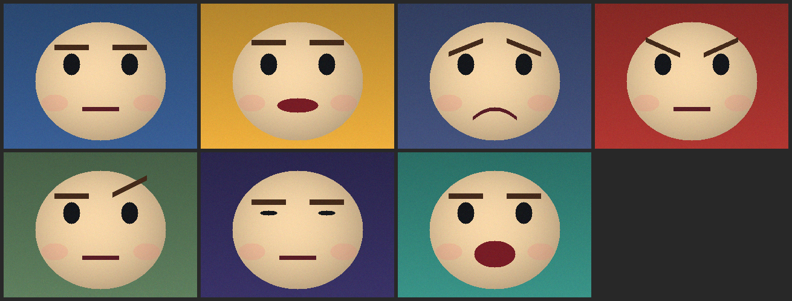
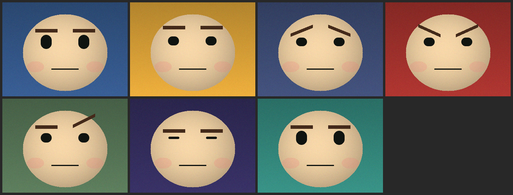
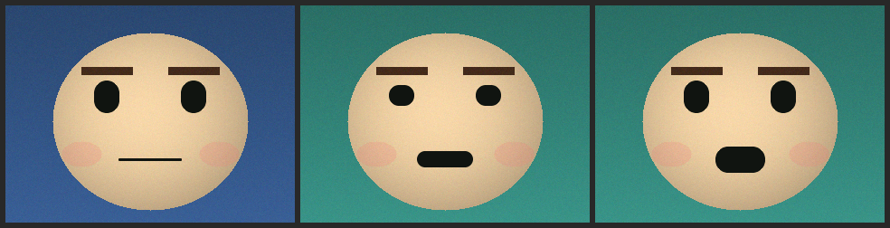
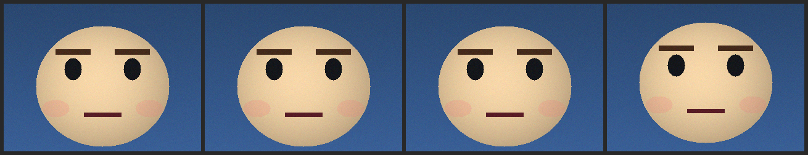

# Fluid faces and picture faces, 2026-11-16

Placement: unit firmware (patches `H01` to `H04`, native lane) and host (`host/maipai_body/picture_faces.py`, `picture_faces_page.py`, `i18n_pictures.py`, a section on the settings page). Tree: `~/esp/stackchan-rebase/train5` (a copy of the Train 7 tree), ESP-IDF 6.1.1. The brief is the "Train 5" section of `.runs/brief-train4.md`.

Where it is: the patches, host code, tests and this note are uncommitted files in the working tree of this repo (not on GitHub `main`, in no release). The plain Train 5 image is flashed on the owned unit on the USB cable (sha256 `ee9cfc37f672d692...a172c9e`, 3,387,776 bytes, read-back equal to the build). The pictures were sent to the unit over the USB cable, not over the paired link (see "Not verified"). Nothing involves the Home hub.

## Bottom line

- **A, fluid faces: built and measured.** The face moves in eased steps, blinks smoothly, drifts its gaze and the mouth follows the loudness of the unit's own voice. The draw rate while the eyes keep moving went from 21.8 refreshes a second (best second 24) to 44.7 (best second 49); while the unit speaks, from 3.7 (best second 6) to 11.4 (best second 21), and the update loop from 8 passes a second to 50. 30 a second is passed whenever something keeps moving; it is not the average, because a face at rest draws nothing, which is the point. Numbers below.
- **B, picture faces: built, sent to the unit and looked at.** Three modes (picture, overlay, sequence), seven expressions, the owner's own pictures, resized on the host, kept in the unit's memory, cross-faded. Every expression in every mode was photographed on the unit's own screen and opened (generated cartoon pictures, no person).
- **The memory gate holds**, with a pack held and drawn (table below).
- **Not done:** the pictures were never sent over the real paired link, and a person has not used the settings page with a real photograph on a real phone. Both are listed under "Not verified".

## A. Fluid faces (patches H01, H02)

### What was wrong

Measured on the unit with the face as it was (patch `H01` counters, `MAIPAI_FACE_FLUID` off):

1. While the unit was not idle (listening, speaking) the update loop slept 100 ms in every pass **with the screen lock held**. The loop ran 8 times a second and the screen could not draw while it slept. That is why a talking face looked slow.
2. Everything moved in steps: a blink was a 200 ms flash to a fixed lid, the gaze jumped to a new place, the mouth opened and shut at random every 180 ms whatever the voice did.
3. The screen redraw timer waited 33 ms, which held the draw rate near 25 a second even when the CPU had room.

### What changed

| Change | Where | Effect |
|---|---|---|
| Eased steps (`a = dt / (tau + dt)`, stable for any frame time) for gaze (70 ms), lid (close 28 ms, open 85 ms), emotion tilt (110 ms), mouth (open 38 ms, close 105 ms) | `maipai_facefx_core.h`, `eyes.cpp`, `mouth.cpp` | a blink is a short fade, not a flash |
| Gaze drift: every 0.7 to 2.2 s a new place within 3 pixels, shared by both eyes, glides in about 260 ms; rests while the eye is shut or hidden | same | the face looks alive when idle |
| Mouth follows the loudness of the unit's own voice: a tap on every block the audio output task plays (every fourth sample, one atomic read when nobody speaks), -48 to -14 dBFS mapped to 0 to 100, a noise gate under 8, an eased curve | `maipai_facefx.cc`, `audio_service.cc` | the mouth opens with the syllable, and closes in the gaps |
| The update loop no longer sleeps 100 ms under the lock | `hal.cpp` | 8 passes a second became 50 |
| Redraw timer 33 ms to 20 ms | `sdkconfig.core.defaults` | the ceiling went from about 25 to about 50 a second |

All of it is behind `MAIPAI_FACE_FLUID` (default `y`). Off, the face moves in steps as before, including the 100 ms sleep. It costs no heap: a few floats per eye and two atomics.

### Draw rate, measured on the unit

Bench build, unit hard muted as saved, linked to nothing, 20 second runs of `self.face.bench_run`. "Refreshes" are screen refreshes that drew something; a refresh that redrew one eye counts as one. "Best second" is the largest count in any whole second of the run. "Update loop" is the passes of the face update loop per second. `talk` is the speaking look (`SetStatus(speaking)`) with a made-up speech level that changes every 90 ms; `move` jumps both eyes every 50 ms (the ceiling); `emotions` goes through the six emotions, 1.5 s each.

| Run | Before: refreshes a second (best second) | After, redraw 33 ms | After, redraw 20 ms (final) | Update loop before and after |
|---|---|---|---|---|
| idle (nothing asked) | 4.6 (9) | 9.8 (19) | 10.7 (23) | 50 and 50 |
| talk | 3.7 (6) | 10.0 (16) | 11.4 (21) | **8.3 and 50** |
| move (the ceiling) | 21.8 (24) | 24.9 (25) | **44.7 (49)** | 49 and 50 |
| emotions | 5.5 (9) | 16.2 (21) | 22.3 (40) | 50 and 50 |

Read it honestly. The target was 30 a second. The face reaches and passes it whenever it keeps moving (`move`: 44.7 a second for 20 seconds). Averaged over a whole run it is lower, because the face at rest draws nothing and a run has rests in it; the idle rate of about 10 a second is the gaze drift and blink, each a small redraw. While the mouth moves in `talk` the best second was 21. That is below 30 because the made-up level changes every 90 ms and the mouth settles between syllables, not because the screen cannot draw faster. A real voice will land between these figures; it has not been heard (the unit is muted, no spoken turn was run).

Cost of one refresh: 3 to 7 ms for the face, 26 to 35 ms for a full-screen picture (the flush of 153,600 bytes), so a full-screen redraw tops out near 30 a second by itself.

## B. Picture faces (patches H03, H04, host)

### What the owner gets

On the settings page, one section per unit: choose a style, then a picture for each of seven looks (neutral, happy, sad, angry, doubtful, sleepy, speaking), then press Send to the unit.

| Style | What shows | Per expression |
|---|---|---|
| Picture only | the picture | one picture |
| Picture with eyes and mouth drawn on top | the picture, with two eyes and a mouth drawn over it that blink, drift and follow the voice. The owner sets where they go (ten numbers and a color) | one picture, ideally without eyes and mouth |
| A short run of frames | the frames in a loop at 1 to 12 a second | up to 6 frames |

Rules the owner meets, in the unit's plain words (English and Spanish, every one says what to do): a pack holds at most 14 frames and 1,000,000 bytes after compression; a neutral picture is required; the speaking picture shows while the unit speaks; an expression with no picture shows the neutral one. Pictures that would not fit are refused on the host before anything is sent, with the same sentence the unit would give.

A mute, vision-off or quiet look, the clock face and a ringing timer always show instead of a picture. A person who muted the robot sees the mute look, never a picture over it.

### Where things live (privacy)

- The picture is chosen in the browser on the owner's own computer. The page draws it into a 640 by 480 canvas and sends that to the host on the same computer (`127.0.0.1`, administrator only, as every settings route). The host resizes it to 320 by 240 (`cover`: it fills the screen and crops the overflow from the middle), turns it into RGB565, compresses it and keeps it in `~/.config/maipai/stackchan-pictures/<unit>/` (folder mode 700, files mode 600). **Nothing from a picture is stored in this repository or sent anywhere but to the owner's own unit over the paired link.** A test fails if a photograph file is ever added to the repository.
- No picture ships with the product. The pictures used for testing here were drawn from plain shapes by `scripts/fw-pictures.py` (a round cartoon face): no person, no photograph.
- On the unit the pack lives in PSRAM only. It is **not kept across a restart**; the host sends it again when the unit connects (`sync`, only when the unit does not already hold the same pack). Keeping it in flash needs a partition decision (open question 1).

### The protocol

`self.facepic.begin` (mode, fps, overlay places), `.frame` (slot, index, bytes, CRC-32, raw or zlib), `.data` (a piece at an offset, base64, 2,048 bytes a piece; the offset must equal what the unit has), `.commit`, `.clear`, `.status`. Every error answers `{ok:false, code, error, error_es}`. `commit` opens every frame once before it promises the pack, so a pack that cannot be decoded is refused there, with a sentence, not later on screen. A bench build adds `self.facepic.bench_force`.

### On the unit

- The pack is kept as sent in PSRAM (zlib, or raw when zlib would not be smaller). One frame at a time is decoded by the ESP32-S3 ROM zlib reader in a low priority task with a 20 KB PSRAM stack into at most **three** 153,600 byte PSRAM buffers (least recently used goes first; what is on screen or fading in is never evicted). Measured decode time: 35 to 44 ms a frame.
- The screen task cross-fades between two image layers in 240 ms (eased). A frame of a sequence replaces the previous one without a fade.
- Overlay mode hides the face's own eyes and mouth and draws two eyes and a mouth over the picture from the values the fluid face already eases (lid, gaze, drift, mouth weight). A blink and lip sync come free.
- Nothing is allocated until a pack is sent: no task, no timer, no PSRAM, no LVGL object. The decode task is created at the first commit and kept (a task with a PSRAM stack cannot end itself).

### Memory

Budget (`maipai_picface_core.h`, checked by the C test): a full pack is 1,000,000 bytes stored plus three decoded frames of 153,600 bytes, 1,460,800 bytes in all, which keeps the PSRAM low-water mark above 6 MB on a unit that starts at 8.1 MB.

Measured on the bench image with a pack held (`self.facepic.status`):

| State | PSRAM free | Internal free |
|---|---|---|
| no pack | 8,117,924 | 45,987 |
| overlay pack held, nothing decoded yet (423,849 bytes) | 7,660,252 | 44,991 |
| the same, with 3 decoded frames cached | 7,193,296 to 6,821,560 (the second figure is with the 797,000 byte sequence pack) | 44,587 to 44,755 |
| after `self.facepic.clear` (the decode task and its 20 KB stack stay) | 8,093,452 | 45,523 |

So a held and drawn pack costs about 1.3 KB of internal RAM (the layers, the shapes, the task control block) and, in PSRAM, the pack plus up to 460,800 bytes of decoded frames. That is under the 4 KB rule for a feature that is off until used.

## Memory gate (every build step)

Bench image (`MAIPAI_SERIAL_TOOLS`, `MAIPAI_MEMORY_LINE`, `MAIPAI_FACE_BENCH` on), overlay pack held and drawn, 11 minutes of serial after a clean boot and the pack upload, with a loop of `talk`, `idle` and `emotions` runs (15 seconds each) and a screen dump every third round.

| Measure | Gate | Observed |
|---|---|---|
| internal_free, steady | at least 25,000 | 41,515 to 44,207 (median 43,115) with the pack held and drawn; 46,187 to 46,219 before it was sent |
| internal_min | at least 15,000 | 35,728 (39,828 at boot; the 4.1 KB step happened once, while the pack was received and committed) |
| int_big | at least 16,000 | 30,720 (31,744 at boot) |
| psram_min | above 6,000,000 | 7,026,448 (including the transient buffer of each screen dump) |
| App slot free | at least 20 percent | 35 percent (plain image), 34.6 percent (bench image) |
| Resets, panics, stalls | none | none during the 11 minutes |

The memory line printed 17 times, not every 10 seconds: the line is printed by the main loop, and a bench tool that runs 15 seconds holds the main loop, so the samples fall between workloads. The lowest and the steady values above are from those samples. The soak ran with the unit hard muted, so the picture was drawn only because the bench tool lets a picture show over the mute look.

The cost of the feature by itself, with no pack held, measured on images with the shipped tool set and the USB reader (`MAIPAI_SERIAL_TOOLS`, `MAIPAI_MEMORY_LINE`; no bench tools), 170 seconds of passive serial each:

| Image | internal_free, steady | int_big | internal_min |
|---|---|---|---|
| picture faces off, fluid face on | 51,771 to 51,867 | 31,744 | 39,828 |
| picture faces on, no pack | 49,731 to 49,799 | 31,744 | 39,828 |

Train 7 measured 51,955 on the shipped tool set, so the fluid face costs about 0.1 KB (a few floats). Picture faces cost **2.1 KB of steady internal RAM while no pack is held**: the six registered tools (each keeps its description and property list on the heap; the four game tools cost 1.2 KB), two semaphores and a few small records. That is over the guideline of about 1 KB for an optional feature that is off and under the 4 KB rule for a step. Reason: the six tools are the protocol, and `MAIPAI_PICTURE_FACES=n` compiles them out (image 21,952 bytes smaller). Merging `begin`, `frame` and `commit` into fewer calls would save about 0.7 KB and was left out to keep every refusal exact.

## What was exercised on the unit

Driven over the serial tool path (`@tool ...` on the cable); every reply read; every screen picture opened.

- `scripts/fw-pictures.py push MODE` builds a pack of generated pictures through the same host code as a page upload and sends it: picture mode 7 frames 428,335 bytes, overlay 423,849, sequence 13 frames 796,762 (4 frames each for neutral and happy, one for the rest), each accepted by `commit`. The full transfer of 428 KB took 45 seconds over the cable (about 9 KB a second, limited by one round trip per 2 KB piece).
- Photographs of the unit's screen (LVGL's own snapshot, written on the cable and turned into a PNG by `scripts/fw-serial.py`; the unit's real screen was not looked at): every expression in picture mode and in overlay mode; the speaking overlay at three speech levels (the mouth stays a slot at level 30, opens tall at 80); two frames of a sequence that differ as built. The pictures are in `docs/images/picture-faces-*.png` (generated cartoon pictures, no person):

- A privacy look wins: with the unit muted (its saved state) the pack was held and nothing was drawn over the mute look. Only the bench tool can show a picture on a muted unit.
- Cross-fade: about 5 full-screen flushes per change, so about 20 frames a second during the 240 ms fade; a sequence at 6 frames a second flushes exactly 6 full screens a second; idle with a still picture flushes nothing. The first bench figure for the decode time (7,178 ms at most) was the wait for an upload that held the mutex, counted by mistake; the decode itself is 33 to 44 ms, and the timer now starts after the wait.
- On a PC: `host/tests/firmware/facefx_core_test.c` and `picface_core_test.c` run under address and undefined-behavior sanitizers (limits, every refusal in two languages, slot choice, fade curve, cache eviction, overlay sizes, CRC against the standard check value, easing never overshoots, the drift stays in range). `host/tests/test_picture_faces.py` (36 tests) covers the host: resize and color, the store, the pack rules against the firmware's numbers, the service against a stand-in unit that follows the protocol byte for byte (reassembly, CRC, refusals, offline, reconnect, old firmware), the page routes and the six-language words.
- The settings page, opened in a browser against a stand-in unit: two pictures chosen through the page's own file input, thumbnails shown, Send to the unit answered "The pictures are on the unit.", the style switched to overlay, the ten numbers saved, an invalid width refused with the plain sentence; the Spanish page reads Spanish.

## Not verified

- **The paired link.** The host module sends the same calls through `voice.call_device_tool` (wired in `app.py` with a connect-time `sync`), but every picture on the unit here went over the USB cable. A 2,732 character tool call over the websocket link, and its timing, were not tried. If the link limits a message to less than that, lower `CHUNK_BYTES` in `picture_faces.py`.
- **A real photograph through the page on a real phone.** The page was driven with generated canvases in a desktop browser; `createImageBitmap` on a camera photo (rotation, HEIC) was not tried.
- **The real screen.** Nobody looked at the unit's glass: the pictures are LVGL's own render of what it sends, so color balance on the panel, the 20 ms refresh looking smooth to a person, and the cross-fade looking good are unjudged.
- **A real voice.** The mouth followed a made-up level. The loudness tap was run only through that path; a spoken turn (muted unit, no host) was not.
- **A packed pack.** Real photographs compress worse than the flat cartoons used here; the byte budget of 1,000,000 may fit fewer than seven photographs. The unit and the host refuse a pack that is too big with a sentence, tested with noise, but a photograph set was not tried.
- **Other languages.** The settings page words in French, German, Portuguese and Italian are written for this item and not checked by a speaker.
- **Power.** The 20 ms redraw and the gaze drift redraw the screen about 10 times a second when idle (tiny areas, 0.3 full screens a second); the battery cost was not measured.

## Open

1. **Keep the pack across a restart.** The assets partition has about 1.7 MB left after the app assets, which will shrink or grow with the stop word model decision, so it is not used. A small dedicated partition (about 1.2 MB) or the tail of the assets partition once the layout is settled would let the pack survive a restart and a Wi-Fi outage. Decide with the partition plan.
2. **Faster full-screen flush.** A full-screen frame costs 26 to 35 ms, which caps cross-fades and sequences near 30 frames a second. The display bus clock and a double draw buffer are the levers; neither was touched.
3. **Per person pictures.** The people list has a face color and caption size per person. A picture pack per person is a small step (the store is already keyed by a name) and was not built.

## Checks run

`scripts/check.sh --pre`, `scripts/hygiene-check.sh` and `scripts/boundary-check.sh` pass. Replaying `H01` to `H04` with `git apply` onto the Train 7 files gives files byte-identical to the Train 5 tree. Firmware builds: bench (FLUID off), bench (FLUID on, redraw 33 ms and 20 ms), bench with picture faces, and the plain image that is flashed; no new warning in the new files. The plain image is 3,387,776 bytes (Train 7 plain: 3,363,248, so +24,528), 35 percent of the 5,177,344 byte slot free, static internal RAM (DIRAM) 165,947 bytes (Train 7: 165,659, so +288).
