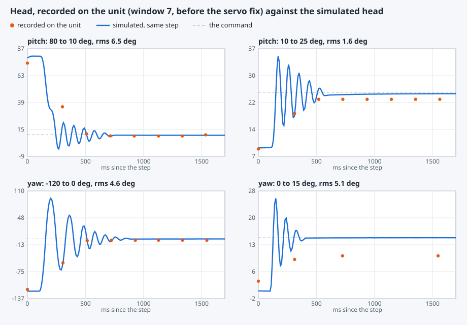

# Recording head moves on the unit (for the physics calibration)

`python3 scripts/fw-head-record.py OUT.csv` on the Mac that holds the cable (bench build). It sends scripted head steps through the tool path and samples `self.robot.get_head_angles` back to back, then `python3 scripts/virtual-unit/physics/calibrate.py OUT.csv --write` fits the servo parameters and marks them measured.

- Before: unit upright on the table, powered. The USB limiter halves every move on a cable, and the unit's `self.motion.status` can say `free` while it still does (bench window 8: 43 to 48 percent of a large step against 92 to 98 with the limit really off). So the script does not trust the status text, which it only prints. It steps the head 60 degrees and reads how much the servo covers (the reach test); under 75 percent it stops and says so. `--usb-limit-off` sets the control explicitly (`self.motion.set` with `usb_limit` off, the only tool that sets it) whatever the status says, proves it by the same reach test, and afterwards puts back the value it found (read from the status's `usb_limit` field) and proves that by the reach test again: exit 5 when the head's reach after the restore differs from before the run by more than 20 points.
- Moves: pitch 10 to 30, 70, 80, 25, 60 and back to 10 each time (inside the maker's 5 to 85); yaw 0 to 15, 60, -60, -15, 120, -120 and back to 0 each time. Small steps show the linear gain, large ones the torque limit and the gravity offset. Each is held 1.8 s, at most 30 a minute (the unit's cap is 40). About 45 seconds for both axes.
- Output: joint, move_id, t_ms, cmd_deg, meas_deg, rtt_ms. Each step has a row at the moment it was sent; samples carry the middle of their round trip. The fit also finds the command delay.
- First thing to read in the output: the first samples after the first step. If get_head_angles reports the last target and not the servo's feedback, the angles jump at once and the recording says nothing about the servo; stop and tell the firmware track.
- Dry runs: `--dry-run` prints the move list; `--link http://127.0.0.1:PORT/` records from the virtual unit's browser view; `host/tests/test_head_record_and_dryrun.py` records a simulated servo and checks the fit recovers its gains.
- The carried and dance-stop check (the bench item that needs hands): the Physics section of the browser view has "Run the carried and dance-stop check". It lifts the simulated robot while it dances, tilts it past 70 degrees, and checks the host's own answers: carried, dance stopped, limiter holding still, moves refused, free again when put down.

## Fits kept side by side (2026-11-18)

The robot description keeps each fit of the real unit under `fits`, and the current parameters follow the one marked in use. `calibrate.py REC.csv --write --measured-on DATE --label NAME` writes the parameters with src `measured` (the shared spec allows only measured or assumed) and a note that starts "Fitted, measured on the unit" and names the date and the CSV and stores the fit under `fits.NAME`.

| Fit | Recording | Unit state | Result |
|---|---|---|---|
| `before_servo_fix` (in use) | `scripts/virtual-unit/recordings/head-w7-before-servo-fix.csv`, bench window 7, 2026-11-18 | servo animation ran at 26 to 31 steps a second instead of the designed 50, in every condition | verdict ok, rms 3.92 deg (pitch 2.76, 3.9 percent of 70; yaw 4.81, 4.0 percent of 120); yaw kp 0.384, pitch kp 0.351, pitch speed cap 536 deg/s, command delay 101.7 ms; reach 93 to 96 percent of each step |
| `after_servo_fix` | to record when the firmware animation runs in real time | | placeholder (null) until then |

The fit describes the slow behavior; when the firmware track fixes the animation, record again and fit as `after_servo_fix`, then compare the two.

`python3 scripts/virtual-unit/physics/compare_recording.py REC.csv OUT.svg --fit NAME` draws the recorded readings against the simulated head for the biggest and the smallest step of each axis (the simulation starts at the angle read before the step and gets the same command):

*Recorded head against the simulated head, before the servo fix. A placeholder drawing, not a real screenshot.*

What the picture shows: the simulated head settles in about 0.7 s and its end points sit on the readings. Between them the simulation rings (a period of about 60 ms) where the recording has no evidence of it: the unit was read about five times a second, so a ring faster than 0.4 s cannot be seen, and the fit left the velocity gain near zero. Read the curve as correct at the settle time and the end point, and unproven in between. The next recording should read faster than 5 samples a second (or log on the unit) before the damping is trusted.

## Servo step rate

The unit's servo animation moves the setpoint `servo_steps_per_s` times a second (designed 50; measured 26 to 31 before the SF28 fix, 24 to 43 after it, noisy). It is a measured parameter of the robot description (28, from bench window 7), not fitted. `calibrate.simulate` takes it as `step_rate` and holds the setpoint between steps; `calibrate.py --steps-per-s N` fits with it, and the fit stores the rate it used. It is off unless asked, so the `before_servo_fix` fit above (made without it) is unchanged. The window 8 fit (rms 4.91, yaw poor, whole-degree readings with a first-sample problem) is not applied; it waits for a re-recording after the firmware loop fix.
