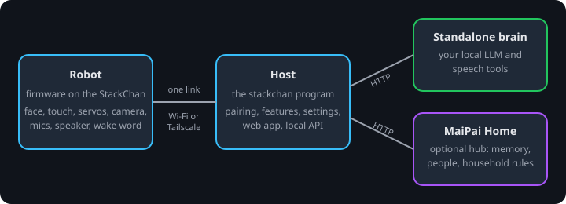

# How MaiPai for StackChan fits together

Start here if you want to build, fix or extend it. Users should read [Getting started](../user/getting-started.md) instead.

## Three layers

1. **Robot (firmware).** The face, touch, motion sensor, servos, camera, microphones, speaker, wake word, clock, timers, settings, Wi-Fi and pairing.
   It speaks one protocol to one host. The robot has about 76 KB of free internal memory (estimate), so it never talks to a language model.
2. **Host (the `stackchan` program).** The protocol server, pairing, discovery, the feature modules, config, the local API and the web app.
   It runs on a Mac, a Linux machine or a Raspberry Pi 5.
3. **Brain.** Everything that thinks or remembers sits behind interfaces the host calls: speech to text, the language model, text to speech, voice match, memory, vision, tools and notifications.

## Two brain adapters

- **Standalone (default).** Chat-completions style HTTP for the model, `stt_url` and `tts_url` for speech, each falling back to a built-in local engine when blank.
- **MaiPai Home (optional).** Turns, identity, memory and household rules over the hub's published HTTP API. It does nothing unless configured.

Both use the same record shapes, so a persona or face pack made for one works in the other. The seam is `transcribe_stream`, `run_turn`, `speak` and `cancel`.

## Every feature has two halves

- **Body half:** the trigger, the face and servo behavior, the sound, the light and the screen cue. It always lives here and is the same in every setup.
- **Brain half:** the part that needs knowledge or judgement, such as understanding "set a pasta timer for ten minutes".

A feature is complete on its own when its body half works with the built-in brain half. A richer brain upgrades the brain half and leaves the body half alone.
If a brain half is missing, the feature hides itself. It never shows a raw error.

## What the host publishes at connect

A list of capabilities from the active brain: `stt`, `llm`, `tts`, `vision.describe`, `face.recognize`, `speaker.id`, `memory`, `calendar`, `lists`, `announce`, `notify.phone`, `music.id`, `home.control` and `schedule`.
A feature turns on only when every capability it needs is present.

## Rules that keep it simple

- No dependency on any other MaiPai repository. A person never clones another repo to run this one.
- Host code never imports a hub. The hub adapter talks over HTTP and is an optional module. Tests fail the build if standalone code imports hub code.
- A vendored schema snapshot carries the shared record shapes, with a drift check.
- Compatibility is additive. Unknown fields are ignored, and a `contract_version` mismatch is refused politely and names the side to update first.

## Where to read next

- [Host and brains](host-and-brains.md): the host in more detail.
- [Build from source](build-from-source.md): how to build the firmware.
- [Contributing](contributing.md): how to send a change.
- `docs/design/`: the design record, including the memory gate and the performance targets.
- [Today's manual setup](stackchan-setup-today.md): how the robot is set up today, before the finished flow ships.
