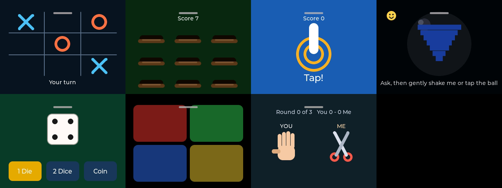

# The data-pack games: which can take a richer look

Playground track, 2026-11-18. Critique only, no art. **Re-read on 2026-11-19:** the bench measured the unit (a full 320 by 240 redraw is about 65 ms, not 30; Four in a Row's richer look failed the gap rule), so every "fits" below is judged by the motion rule of `docs/plan/games-visual-budget.md` section 4: a pack screen may draw its backdrop and shadows once, at entry, and move only small rectangles after. The seven packs (`firmware/games/*.json`) are drawn by one engine, `maipai_games_draw.h`, from a table of shapes, so a look is decided once for all of them. The rules are those of `docs/plan/games-visual-budget.md`: one draw callback, at most 15 LVGL objects (about 2 KB of internal RAM), static gradients and shadows only, dirty rectangles, no per-game bitmaps.

*One typical screen of each pack as the unit draws it now (left to right, top row first: Tic-Tac-Toe, Whack-a-Mole, Do It, Magic 8 Ball; bottom row: Dice and Coin, Color Memory, Rock Paper Scissors).*

## The finding that comes first

The pack engine builds **one LVGL object for every shape**, and the parts of a mole, an icon or a die as more objects, for every state of the pack at once (a state only hides what is not its own). Counted on the renderer (`python3 scripts/virtual-unit/games_pack_sheet.py --counts`):

| Pack | Shapes it draws | LVGL objects | Labels | Internal RAM, about | Against the rule (15 objects, 2 KB) |
|---|---|---:|---:|---:|---|
| Tic-Tac-Toe | fill, 7 boxes, 18 lines, 9 rings, 9 texts | 46 | 9 | 5.9 KB | 3 times over |
| Whack-a-Mole | fill, 27 boxes, a mole (many parts), 14 texts | 64 | 17 | 8.6 KB | 4 times over |
| Do It | 15 fills, an icon, 16 texts | 44 | 16 | 6.3 KB | 3 times over |
| Magic 8 Ball | 6 circles, 7 boxes, 5 lines, a ring, 25 texts | 47 | 25 | 7.4 KB | 3 times over |
| Dice and Coin | 3 dice (pips), a coin, 6 boxes, 10 texts | 49 | 10 | 6.3 KB | 3 times over |
| Color Memory | fill, 8 boxes, 4 texts | 15 | 4 | 2.0 KB | at the limit |
| Rock Paper Scissors | 7 fills, 5 boxes, 6 icons (hand, scissors), 24 texts | 87 | 24 | 11.7 KB | 6 times over, 74 percent of the 15.8 KB worst-case headroom |

(The internal RAM column is the budget's assumption, 110 bytes an object and 200 a label, flagged there; the object counts are measured.) One pack on screen is alone on screen, so these are not added up, but Rock Paper Scissors alone is most of the worst-case headroom, and every pack but Color Memory is already over the rule **before** it gets a richer look. The pack screens are the largest screens of any game in internal RAM.

The consequence for the look: **a richer look on the packs is not a style change, it follows an engine change.** If the engine draws a state's shapes in one draw callback (the pattern the board games use, and Dice Poker after UX18b), each pack falls to 2 objects with the root, saves 2 to 11 KB of internal RAM, and a gradient, a rim or a highlight on a box then costs draw time only, not objects. Without it a richer look would add objects to screens that are already too heavy. So the order is: (1) the engine to one draw callback per state (a firmware change in `maipai_games_draw.h`, display only, the pack format unchanged, so the seven `.mpk` files and their tests do not change); (patch UX29 is that change, written and proven pixel for pixel on the host: `docs/plan/games-pack-engine.md`); (2) the look, once, in the shared shape handlers (fill, box, ring, circle, line, text) and the three composed parts (die, coin, mole, icon).

## Per pack (after the engine change)

| Pack | What looks rudimentary today | What the same primitives allow | Fits? |
|---|---|---|---|
| Tic-Tac-Toe | Thin hairline grid, flat rings and crossing lines; the board is a drawing on black. | A rounded board plate with a light edge, cells that light softly under the last move, marks with a darker rim. All boxes, lines and rings. | **Fits** |
| Whack-a-Mole | Nine flat dark ovals on a green field; the mole is a cluster of parts that pops up with little weight. | A gradient field, holes with a dark inner floor and a light lip, the mole with a rim and a highlight, a squash and a small star on a hit (one mole at a time, scaled for 200 ms). | **Fits with a limit**: only one mole animates; the mole's parts are the heaviest piece and become one drawn composition |
| Do It | A flat blue screen with a ring, a bar and one word: it has no look to speak of. | A gradient background that changes with the cue, a glow ring (an outline, drawn for the one cue shown), a larger score chip. | **Fits**, cheapest of all |
| Magic 8 Ball | The ball is a dark disc with a stepped blue triangle that reads as a pixel staircase; the answers are 25 text shapes of which one shows. | A shaded sphere (one gradient disc and a highlight), a smooth triangle, the answer text drawn only when it is its turn (the other 24 are never drawn: zero objects once drawn by the callback). | **Fits** |
| Dice and Coin | A felt color field, a plain white die, three flat buttons; the die's pips are 9 objects each. | A felt gradient, a die with a rim, a highlight and a soft shadow (static), pips from the callback, the coin as a disc with a rim and a face. The roll is an animation of one die at a time. | **Fits** (the die's shadow only while it rests) |
| Color Memory | Four flat tiles; the lit tile is a brighter flat tile. | A glossy highlight on every tile and a glow (an outline) on the lit one; nothing else moves. | **Fits**, already near the object rule |
| Rock Paper Scissors | Flat icons made of many small parts (a hand of rounded bars, scissors of lines and rings), a text row of scores. | A gradient table, icons drawn from the callback (they are fixed shapes, the natural candidate for the shared asset bank of decision 17 if drawing them costs too much), a score chip. | **Fits only after the engine change** (87 objects today); the icons are the work |

## What every pack would share

- The same title strip and score chip (a rounded chip with the number), drawn by the engine, so a pack only names its title and counter.
- One palette per family (board and table games, reflex games, the oracle): `docs/design/games-look.md` holds the rules and the measured numbers once the bench has reported.
- Dirty-rectangle redraw by the engine: a state change redraws its changed shapes' rectangles only (a tap on a cell, one mole, one die), never the screen.

## Not decided here

The look itself (colors, the exact highlight) waits for the Four in a Row bench numbers (`docs/plan/games-richer-look-bench.md`). The engine change needs a firmware patch and a bench pass (heap before and during, tick gaps) like any other game screen: `docs/dev/measure-a-game.md`.
