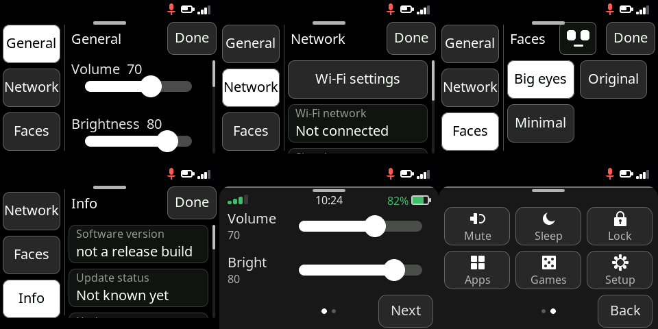
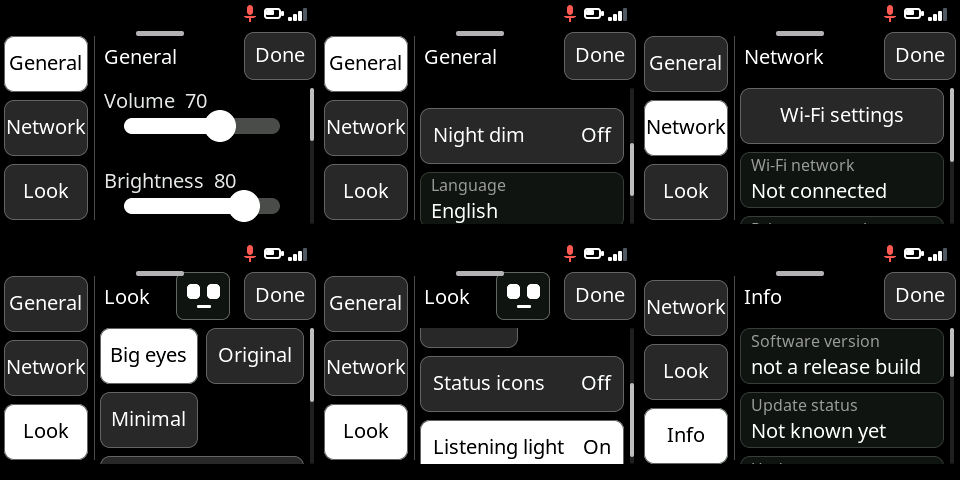

# The robot's own settings, simpler

Playground track, 2026-11-19. Owner feedback: the settings are too complicated everywhere. The app track is simplifying the host dashboard (5 tabs, at most 6 visible controls a page, a More fold, 3 first-run questions). This page does the same for the screens of the unit itself: the Settings app, the quick sheet, the first run and the Brain step. It counts what is there, proposes the minimum, says what each removal means, and lists the patches. One patch is written and proven on the renderer (UX30, header only); the others need a change in a `.cc` file or an owner decision and are listed for the firmware track.

The rules it follows: the finger-size standards of `docs/design/screen-style.md` stay (56 px targets, 8 px gaps, text 16 px and up); a setting is removed from the front only if it is reachable on one other screen or the host dashboard; nothing changes what a switch does; the host's choices rule (`docs/dev/settings-justification.md`: one row per key with who needs it and why the default is not enough) is applied to the unit: a control stays in front only when a new owner needs it on day one, otherwise it sits one level in, or is automatic.

*Before (the goldens of main): General, Network, Faces and Info of the Settings app, then the two pages of the quick sheet.*

## What is there now

Counts are controls a person can touch (sliders, switches, choices, buttons, tiles) and information rows, as the unit draws them; the Settings app scrolls, so only two or three rows show at once and the rest is reached by scrolling.

| Screen | Controls | Information rows | Notes |
|---|---:|---:|---|
| Settings app, always on screen | 5 (four tabs and Done) | 0 | General, Network, Faces, Info |
| Settings, General | 9 with the code lock built in (7 without): Volume, Brightness, Night dim, Status icons, Listening light, Auto lock, Lock now, Language, More settings | 0 | the longest list: about four screens of scrolling |
| Settings, Network | 1 (Wi-Fi settings) | 4: Wi-Fi network, Signal, Private network (when built in), Home hub | |
| Settings, Faces | 3 style tiles (4 with a picture pack) | 0 | the preview sits in the header |
| Settings, Info | 0 | 8: version, update status, update copy, memory, host name, Wi-Fi network, Signal, uptime | Wi-Fi network and Signal are also on Network |
| More settings (opened from General) | Time zone, Version, Games, Network test | | Version repeats Info, Games repeats the sheet tile |
| Quick sheet, page 1 | 3: Volume, Brightness, Next | 3 (signal, clock, battery) | |
| Quick sheet, page 2 | 7: Mute, Sleep, Lock, Apps, Games, Setup, Back | 0 | Lock does nothing until a code is set |
| First run | 28 targets over 7 screens (language 6 and Skip, name 7 and Back and Skip, the Wi-Fi cover, brain 2 routes then 3 ways with Back and Skip, privacy, done, what now) | | up to 9 taps before the robot is usable; 3 of them are questions |

## The minimum, and what each change means

### Settings app (patch UX30, written, header only)

*After (the goldens of this branch with UX30): General, the end of General, Network, Look, the end of Look and Info.*

| Change | Now | After | What it means for a person |
|---|---|---|---|
| General keeps what a new owner touches | 9 rows | **5 rows** (6 with the lock built in): Volume, Brightness, Night dim, Language, Auto lock, More settings | nothing is lost: the other three moved or are on another screen |
| Status icons and Listening light move to the third tab | in General | in the tab now called **Look** (face styles with the preview, then the two switches) | they are about how the screen looks; the switches work as before, one tab over |
| Lock now leaves General | a button | the Lock tile of the quick sheet is the one place | one fewer way to the same thing; a person who set a code uses the tile as before |
| Network loses the Signal row | 4 information rows | 3 (network name, private network when built in, home hub) | the signal bars are in the status bar at the top of every screen; the words weak, fair and good are no longer written out |
| Info stops repeating the Wi-Fi rows | 8 rows | 6 | the network name is on Network only |

Each list is now at most 6 rows. Every row keeps its size: 56 px high, 8 px apart, sliders with the same room under the knob (`mac_row_height` is untouched).

### Quick sheet (proposed; the defaults live in `maipai_pages_core.h`, the tiles in `maipai_pages.cc`)

- **Lock appears only once a code is set.** Today a new owner sees a padlock tile that answers "set a code on the settings page". Page 2 goes from 7 controls to 6 and the first screen a person sees has only tiles that do something. Needs the tile list to follow the lock state (a `.cc` change in `maipai_pages.cc`) or the host to add `lock` to the sheet when it saves a code (the item list is already configurable: `mpg_sheet_by_name`).
- The rest stays: Mute, Sleep, Apps, Games, Setup and Back are the six things the sheet is for.

### More settings (proposed; `maipai_more.cc`)

- Remove **Version** (the Info tab shows the same line) and **Games** (the quick sheet and the Apps wall open it). What stays is **Time zone** and the network test: two buttons instead of four.

### First run (proposed; the step rules are `maipai_firstrun_core.h`, the screens `maipai_firstrun.cc`)

The questions are already three (language, a name, where the brain lives); the screens around them are what adds taps.

- **Skip the brain question when a hub is known.** The step already pre-selects MaiPai Home in that case; asking anyway is a tap with a foregone answer. Steps: language, name, Wi-Fi, done. The core change is in the step order (`mfr_next`) and its test `host/tests/firmware/firstrun_core_test.c`.
- **Fold the privacy screen into the brain step as its hint** ("Your voice stays in your home either way." is already there; add "Nothing goes to the internet unless you turn it on."). The screen "Private by design" with a Got it button becomes one sentence. **This one needs the owner's word:** the privacy promise in plain words is one of the basics the first run was built to say (`docs/design/first-run-flow.md`, placement), so it is proposed, not written.
- **Name step stays but is skippable by Skip as now**; the six names are tiles because there is no keyboard.
- The two-level brain question (hosted or custom, then three ways) stays as decided (owner decision 34, two equal routes); nothing is proposed against it.

With these, a person who has a hub answers two questions (language, name) and joins the Wi-Fi; a person without answers three and reads one hint.

## The patch set, for the firmware track

| Patch | What | Files | State |
|---|---|---|---|
| `UX30-settings-fewer-rows.patch` | the rows above: General 9 to 5, Faces becomes Look with the two switches, Lock now and Signal and the repeated Info rows leave | `maipai_apps_core.h` only | written, last in ORDER on `ux/unproven-games`, renderer goldens (`screen-settings-*`, `es-settings-*`, two new) |
| Quick sheet without Lock until a code is set | Lock tile follows the lock state | `maipai_pages.cc` (or the host's sheet item list) | proposed |
| More settings without Version and Games | two buttons fewer | `maipai_more.cc` | proposed |
| First run: skip the brain question when a hub is known | step order | `maipai_firstrun_core.h`, its C test | proposed |
| First run: privacy as a hint, not a screen | one sentence moves | `maipai_firstrun.cc`, `maipai_firstrun_core.h` | needs the owner's decision |

## Proof

- The renderer draws every Settings tab with the patch (`scripts/virtual-unit/scenarios.py`): the six pictures above are goldens, and the existing `screen-settings-*` and `es-settings-*` goldens are regenerated for the new rows. `scripts/virtual-unit/settings_look_sheet.py` makes the two pictures from the goldens (the before row from main).
- Row sizes are unchanged (`mac_row_height` is untouched), and the screen audit (`scripts/virtual-unit/screen_audit.py`, run by `host/tests/test_screen_audit.py`) passes for the four tabs in both languages. The two pictures of a scrolled list (the end of General and the end of Look) are left out of the audit like the other scrolled copies: a row passing under the header is what scrolling looks like.
- Not proven on a unit: the patch is header only but the unit reads these row lists to draw and to hit-test, so a flash and a tap through the four tabs is the check (the same as the first one for UX13).
