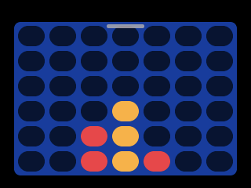
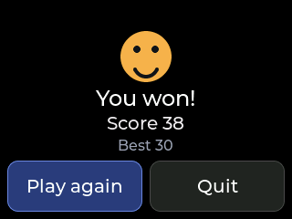
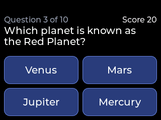

# Games and sounds

The robot has games on its screen. A game never starts when the robot is in full quiet, and it never moves the head.

**Sounds.** The robot makes its game sounds from a tiny table of tones, so they cost almost no space. You can hear them as WAV files in `docs/dev/game-sounds/on-the-robot/`. Next to them are twenty sketches in `docs/dev/game-sounds/` that show what richer sounds could be, with what each would cost. Nobody has judged the sketches by ear yet.

Back: [Start here](start-here.md).

## The games and where each one stands

*Four in a Row, drawn by the robot's own game code: the board is one drawing, the discs fall and the last four light up.*

| Game | On the robot | In the playground |
|---|---|---|
| Four in a Row, Match, Hangman, Mine Finder, Snake, 2048 | yes | frames, a game played by script, the frame cost |
| Tic-Tac-Toe, Whack-a-Mole, Do It, Color Memory, Rock Paper Scissors, Dice and Coin, Magic 8 Ball | yes (small packs) | the packs' click areas are audited |
| Riddles, jokes, trivia, 20 Questions | yes | the question screens in English and Spanish |
| Dice Poker, Higher or Lower, Reversi, Battleship-lite, Pong, a flying game | Planned waiting for the bench | the rules, the screen, the frames and the tests are done, so the game can be judged before it is flashed |

*The one screen every game ends on: a face for the result, the words, the score, and Play again or Quit.*

*A question game: the question on top and the answers as large buttons.*

## Is a game light enough for the robot?

A game is only added when it fits what the robot can spare. The playground measures that before anything is flashed: how much of the screen changes each tick, how many drawing objects it makes, how big its code is. The numbers and the rule are in `docs/plan/games-visual-budget.md` and the how-to is [how to measure a game](../dev/measure-a-game.md).

## 2048 and Snake

Both are steered by swiping, as on the robot: a swipe of at least 60 pixels in under half a second slides every tile of 2048 or turns the snake. In Mine Finder a tap opens a cell and a touch held for half a second plants a flag. The pictures of these games are drawn by the robot's own game code (`host/tests/golden/screens/game-slide-*`, `game-snake-*`, `game-mines-flagged`).
