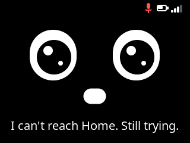

# Scenarios and recording

A scenario is a short script of things the robot does: touches, tool calls and waits. You can play one, record your own, and run them all with the test suite. This page is for anyone using the playground.

## Play a scenario

1. Open the playground window and find **Scenarios** in the side panel.
2. Pick one from the list. The built-in ones are named for what they show, such as `face-happy` or `dance-3-sway`.
3. Press **Play**. The robot does it in real time, and the log at the bottom lists each step.

You'll know it worked when the screen, the head and the lights move as the name says.

## What the list holds

The names say what they show. Groups you will find:

- **Faces and dances:** `face-happy`, `dance-3-sway` and the other emotions and dances.
- **Screens:** the pages, the control sheet, settings, the lock keypad, the first run in six languages (`first-run-1-en` and so on).
- **Games:** `game-c4-playing`, `game-slide-2048`, `game-trivia-ask` and the others, one frame per moment worth seeing, and `game-over-...` for the end screen of each game.
- **The robot that talks with no host:** `offline-line-<situation>-<language>`. With no host and no model the robot picks a short line for what just happened (a head pat, a pick up, good night, the host is gone, the host is back), shows it as a subtitle and moves its mouth to the code-made mumble. There are six situations in six languages. The picture of one is below.
- **The brain route:** the notice the robot shows after it leaves the hosted brain is the frame `brain-removed-<language>`, and `scripts/virtual-unit/brain_route.py` models what is saved: leaving the hosted brain wipes its saved link (the `cl_` settings) and keeps the pairing with your host.

*The offline line for "the host is not there", in English: one line in the subtitle strip, the mouth open as the mumble plays.*

**A scenario for a screen that is not in the robot's firmware yet does not appear.** The scenarios of a patch that is still waiting for its bench proof are listed in `scripts/virtual-unit/scenarios.py` under `REQUIRES`, and they join the list when the patch is on the firmware list (`firmware/patches/ORDER`). Their pictures wait with the patch.

## Record what you do

1. Press **Record** in the **Record what you do** section.
2. Tap and swipe the screen, press the buttons, or call tools. Every one is kept with the wait before it.
3. Press **Stop**, type a name, and press **Save**.

Your recording is saved as `scripts/virtual-unit/recordings/<name>.json`. It then appears in the scenario list as `rec:<name>`, and you can play it like any other. A recording keeps taps, swipes and tool calls. It does not keep camera moves in the 3D view or changes to the power panel.

## Run them without the window

All scenarios also run in the test suite, where each one ends in a picture that is compared with a saved one (a "golden"). If you change a screen on purpose, the developer pages tell you how to save the new pictures: [Tools, scenarios and goldens](dev-tools-and-goldens.md).

## Troubleshooting

- **The list has no recordings.** Recordings are read when the playground starts. Restart it after saving a new one.
- **A recording plays a different screen.** The screen depends on the robot's firmware version. Record again after an update.

Back: [index](index.md).
