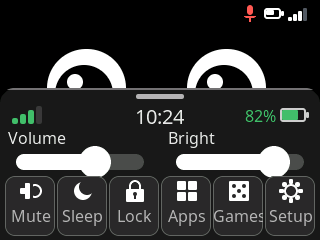
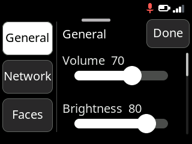
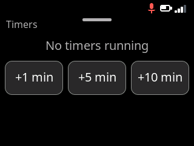
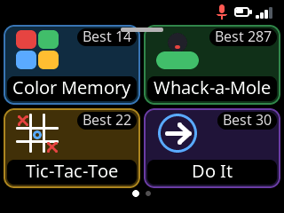
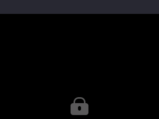
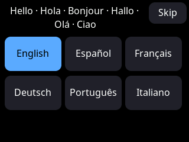

# The screen tour

These are pictures of the robot's real screens, drawn by the playground.

| Screen | What it is for |
|---|---|
| The face | The robot's eyes and mouth. It shows moods, speaks and blinks. |
|  The control sheet | Swipe up from the bottom. Volume, brightness and the quick tiles. |
|  Settings | Tabs on the left, a scrolling list on the right. |
|  Timers and alarms | Start a timer, see it count down. |
|  Games | The games wall. |
|  The lock | A passcode keeps visitors out. |
|  First run | Language, then where the robot's brain lives. |

Every screen follows one standard: targets are about one finger wide (see [standards and the audit](dev-standards-and-audit.md)). The screens that do not yet meet it are listed in `docs/dev/screen-audit.md`.

Back: [Start here](start-here.md).
