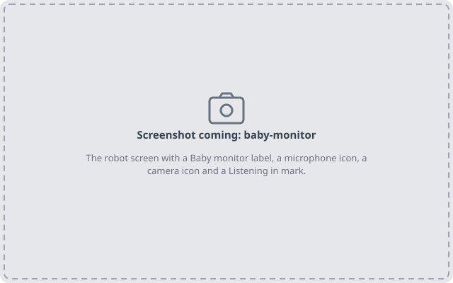

# Use the robot as a baby or pet monitor

Needs MaiPai Home

This is a MaiPai Home feature. MaiPai for StackChan on its own stays a simple, private voice robot, and extras like this run with MaiPai Home. See [Use MaiPai Home as the brain](with-maipai-home.md).

The robot can watch and listen in a nursery or a pet's room and tell you when something needs you. It always shows on its own screen that it is doing this.

## Choose baby or pet

When you start it, pick a profile. The robot changes what it listens for and how it comforts.

| | Baby | Pet |
|---|---|---|
| **Listens for** | Loud sounds, such as crying | Loud sounds, such as barking or meowing |
| **Comforts with** | A lullaby, a soft sound, or your voice | Your voice, calming music or a soft sound |
| **Plays by itself** | Only if you turn that on | Only if you turn that on |
| **Label on the screen** | **Baby monitor**, with a baby icon | **Pet monitor**, with a paw icon |

The robot alerts on how loud a sound is and how long it lasts. It does not know the kind of sound, so it says "loud sound", not "cry". Telling a cry or a bark apart may come later, once we have tested it on real recordings.

## Read this first

The robot is a helper, not a certified baby monitor and not a medical device. It can miss a cry, a sound or a movement, or lose its Wi-Fi.
Do not rely on it to keep a baby safe. Check on your baby in person, and follow the safe sleep advice from your doctor.
For a pet, it does not replace care. Keep its cable out of a pet's reach, and ask your vet before leaving a pet alone for a long time.

## Start it on the robot

Baby monitor starts only on the robot itself. Say "baby monitor on" or "pet monitor on", or tap **Baby monitor** or **Pet monitor** on its screen. It cannot be started from the web app or from far away.
That is on purpose. This is the one mode where the robot sends its microphone to your phone, and the robot will only do that while its own monitor mode is on. Your host cannot turn it on. It stops when the last phone disconnects, or when you touch the robot.

While it runs, the screen shows a calm **Baby monitor** or **Pet monitor** label with a microphone icon and a camera icon, and a small **Listening in** mark while your phone is connected. These cues stay on and you cannot turn them off.
You stop it the same way, by voice or on the screen, or from your phone.

## What it does

- **Alerts when the room gets loud.** A loud sound that lasts sends an alert to your phone.
- **Alerts on movement.** The camera notices motion and sends an alert with a snapshot. The robot's camera is small and low resolution, so you see shapes, not detail.
- **Listen in.** Open the web app on your phone to hear the room live.
- **Look in.** Live view shows a low-resolution picture. In a dark room the picture is dark, so use a night light.
- **Soothe.** You can play a song or a soft sound, or talk to your baby or pet through the robot. A familiar voice often calms a pet. Your phone shows a clear **Playing** or **Talking** mark, and the robot shows the same on its screen. Talking plays no tone first, so it does not wake anyone.

The robot dims its screen and keeps its voice low. At night the light bars stay off, and the dim screen carries the label, the icons and **Listening in**. By day the light bars can show a dim, steady amber. It does not flash red and blue or sound a siren in baby or pet monitor mode.

## Songs and soft sounds

Pick something for the robot to play from the web app on your phone, or ask by voice: "play a lullaby".

- **Soft sounds.** A few built-in sounds, such as a steady hush or gentle waves.
- **Your own songs.** Add music files you own, or have the right to play, to your MaiPai Home library, and they appear in the list.

You can set the robot to start a song by itself when it hears crying. That is off by default. When it does, it plays softly, shows **Playing** on its screen, and sends you an alert, so you always know.
A timer ends the song after 30 minutes unless you change it, and the volume stays low. The robot has a small speaker, so it sounds soft and thin, not like a music player.

Songs play from your own MaiPai Home hub. The robot does not stream from an outside music service.

## What it keeps

Nothing is recorded by default, and nobody can start listening from the app. Sound and pictures stay on your MaiPai Home hub and go only to your own phone, over your home network or your private network. An alert carries a time, what it noticed and a snapshot.

## Tell the people in your home

Tell residents and visitors that the robot can watch and listen. Laws about recording and monitoring differ by place, and some need everyone's consent. The robot records nothing by default. It is not a replacement for a real alarm or a medical baby monitor. This is not legal advice.

## Set it up

1. Put the robot where the camera can see the crib or the pet's bed, and a little out of reach, so a baby or a pet cannot touch it.
2. Plug it in. A monitor that runs out of battery stops watching.
3. Tell the other adults in the house, and open the web app on your phone to check the sound and the picture.
4. Say "baby monitor on" in the room. You'll know it worked when the screen shows **Baby monitor** or **Pet monitor**.

## If it stops working

| What you see | What went wrong | What to do |
|---|---|---|
| The screen says **Offline** | The robot lost Wi-Fi or your hub | Check the room in person, then see [Troubleshooting](troubleshooting.md). Your phone also tells you the monitor went offline |
| No alerts, but it says Baby monitor | The sound or motion limit is too high | Lower it in the web app, and test with a sound |
| Too many alerts | The limit is too low, or a fan is making noise | Raise it, or draw an area to ignore |

## Still need help?

Run `stackchan check`, then read [Troubleshooting](troubleshooting.md). If that does not fix it, open an issue on the Issues tab and tell us what you saw.
