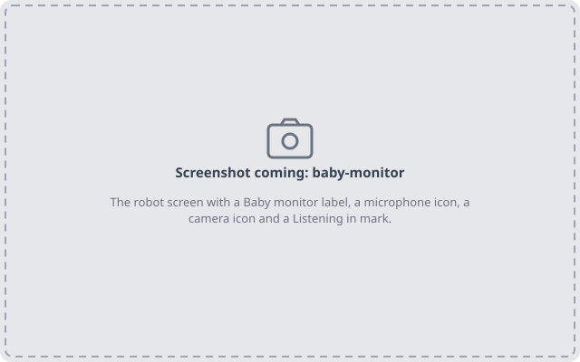

# Use the robot as a baby monitor

Planned

The robot can watch and listen in a nursery and tell you when something needs you. It always shows on its own screen that it is doing this.

## Read this first

The robot is a helper, not a certified baby monitor and not a medical device. It can miss a cry, a sound or a movement, or lose its Wi-Fi.
Do not rely on it to keep a baby safe. Check on your baby in person, and follow the safe sleep advice from your doctor.

## Start it on the robot

Baby monitor starts only on the robot itself. Say "baby monitor on", or tap **Baby monitor** on its screen. It cannot be started from the web app or from far away.
That is on purpose: it is the one mode where the robot sends its microphone to your phone, so a person in the room must start it.

While it runs, the screen shows a calm **Baby monitor** label with a microphone icon and a camera icon, and a small **Listening in** mark while your phone is connected. These cues stay on and you cannot turn them off.
You stop it the same way, by voice or on the screen, or from your phone.

## What it does

- **Alerts when the room gets loud.** A cry or a loud sound sends an alert to your phone. Cry detection is planned. Needs MaiPai Home MaiPai Home can tell a cry from other noise.
- **Alerts on movement.** The camera notices motion and sends an alert with a snapshot. The robot's camera is small and low resolution, so you see shapes, not detail.
- **Listen in.** Open the web app on your phone to hear the room live.
- **Look in.** Live view shows a low-resolution picture. In a dark room the picture is dark, so use a night light.
- **Soothe.** You can play a song or a soft sound, or talk to the baby through the robot. Your phone shows a clear **Playing** or **Talking** mark, and the robot shows the same on its screen.

The robot dims its screen and keeps its voice low. It does not flash red and blue or sound a siren in baby monitor mode.

## Songs and soft sounds

Pick something for the robot to play from the web app on your phone, or ask by voice: "play a lullaby".

- **Soft sounds.** A few built-in sounds, such as a steady hush or gentle waves.
- **Your own songs.** Put your own music files in the robot's music folder on your host and they appear in the list. Use music you own or have the right to play.
- **Your MaiPai Home music** Needs MaiPai Home. Play songs from your household library.

You can set the robot to start a song by itself when it hears crying. That is off by default. When it does, it plays softly, shows **Playing** on its screen, and sends you an alert, so you always know.
A timer ends the song after 30 minutes unless you change it, and the volume stays low. The robot has a small speaker, so it sounds soft and thin, not like a music player.

Songs play from your own host. The robot does not stream from an outside music service.

## What it keeps

Nothing is recorded by default. Sound and pictures stay on your host and go only to your own phone, over your home network or Tailscale. An alert carries a time, what it noticed and a snapshot.

## Set it up

1. Put the robot where the camera can see the crib, and a little out of reach, so the baby cannot touch it.
2. Plug it in. A monitor that runs out of battery stops watching.
3. Tell the other adults in the house, and open the web app on your phone to check the sound and the picture.
4. Say "baby monitor on" in the room. You'll know it worked when the screen shows **Baby monitor**.

## If it stops working

| What you see | What went wrong | What to do |
|---|---|---|
| The screen says **Offline** | The robot lost Wi-Fi or your host | Check the room in person, then see [Troubleshooting](troubleshooting.md). Your phone also tells you the monitor went offline |
| No alerts, but it says Baby monitor | The sound or motion limit is too high | Lower it in the web app, and test with a sound |
| Too many alerts | The limit is too low, or a fan is making noise | Raise it, or draw an area to ignore |

## Still need help?

Run `stackchan check`, then read [Troubleshooting](troubleshooting.md). If that does not fix it, open an issue on the Issues tab and tell us what you saw.
