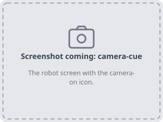
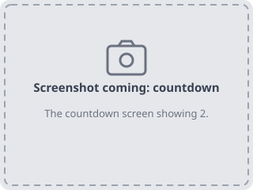
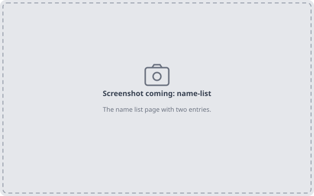

# Use the camera

The camera is off until you turn it on. Frames stay on the host and never go to an outside service.
The robot's camera has a low resolution, so these pages call the pictures **snapshots**.

## Turn it on

Set `camera = true` in `robot.toml`, or switch it on in the web page. Choose how long the host keeps snapshots with `camera_retention`.
A camera-on cue shows whenever the camera streams. You cannot turn that cue off.

When it takes a picture, the light bars flash pink twice and stay pink , and you hear a double click . The pink never dims, even at night. [All lights and sounds](lights-and-sounds.md).

## What is this

Needs MaiPai Home

Hold something up and say "what is this". The robot sends one snapshot to your MaiPai Home hub, which describes it out loud.
Without MaiPai Home, this feature is hidden. See [Use MaiPai Home as the brain](with-maipai-home.md).

## What do you see

Planned

Ask "what do you see" and the robot lists the people and objects in view, such as "a table and a person", straight away, while a fuller look runs in the background.

## Take my picture

Say "take my picture". The robot counts down, plays a shutter tone and saves the snapshot to a folder on the host.

## Face follow, wave and mirror

- **Face follow.** The head turns to keep you in view. It uses a small detector that runs on the host.
- **Wave.** Wave at the robot and it waves back.
- **Mirror.** Say "mirror me". The robot copies your head tilt.

## Names and alerts

Add people to a local name list from the web page. The robot can then say who it sees, and the host can send an alert such as
"Atlas is at the door". The list lives in a file on the host.

## Keep and delete

Snapshots are deleted after `camera_retention`. Press Delete all in the web page, or run `stackchan camera delete`, to clear them now.

## Still need help?

Run `stackchan check`, then read [Troubleshooting](troubleshooting.md). If that does not fix it, open an issue on the Issues tab and tell us what you saw.
