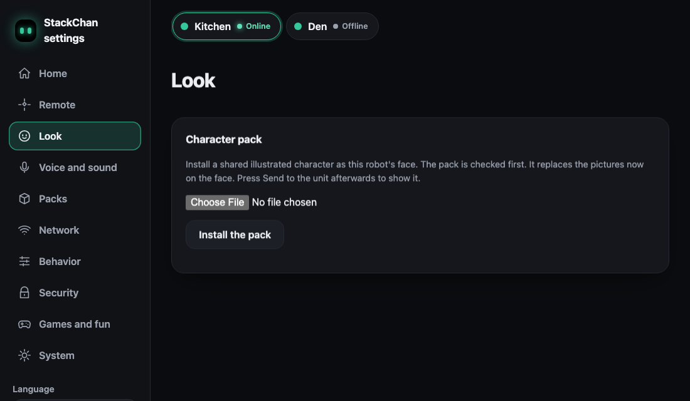

# Character packs

A character pack is one ZIP file with pictures of a character. When you install it, the robot's face shows those pictures.

*The Character pack card on the Look page, with a file chooser and an Install button.*

## Install one
1. Open the settings page and go to **Look**.
2. Find the **Character pack** card.
3. Choose the ZIP file and press **Install the pack**.
4. The pack is checked first. A bad pack is refused and the message says what is wrong.
5. Press **Send to the unit** to show it on the robot.

An installed pack replaces the pictures now on the face.

## Make one
Put pictures named `neutral.png`, `happy.png` and so on in a folder. Then run `stackchan character build FOLDER pack.zip --name NAME --author YOU --license "own work"`. Check it with `stackchan character check pack.zip`. The full format is in `docs/design/character-pack-format.md`.
