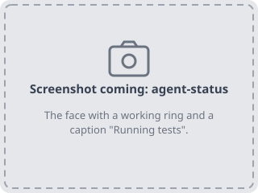
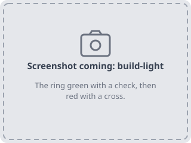

# Use the robot as a coding companion

<span class="home-tag">Needs MaiPai Home</span>

This is a MaiPai Home feature. MaiPai for StackChan on its own stays a simple, private voice robot, and extras like this run with MaiPai Home. See [Use MaiPai Home as the brain](with-maipai-home.md).


The robot sits on your desk and shows what your coding agent is doing.

## Agent status

The face and the light bars show the agent's state: thinking, working, waiting for you or done. Each state has its own shape and motion.
The robot can also speak a short update, or show it as a caption.



## Build light

Add this to the end of a build script:

```
stackchan notify --status pass
```

Use `--status fail` when the build fails. The light bars turn green on pass and red on fail, with a check or a cross, so it reads without colour.



## Dictation

Hold the button and speak. MaiPai Home turns your words into text and sends them to the agent. Release the button to finish.

## Approvals

When the agent asks permission, the robot shows the request and waits. Touch the screen to approve or refuse.
Voice alone never approves. This is on purpose, so a stray sentence cannot allow an action.

## Let an agent drive the robot

MaiPai Home offers an MCP endpoint. An agent can use it to show a face, speak or play a cue. It is off by default. Turn it on with
`mcp = true` and give the agent the token from `stackchan token`.

## Still need help?

Run `stackchan check`, then read [Troubleshooting](troubleshooting.md). If that does not fix it, open an issue on the Issues tab and tell us what you saw.
