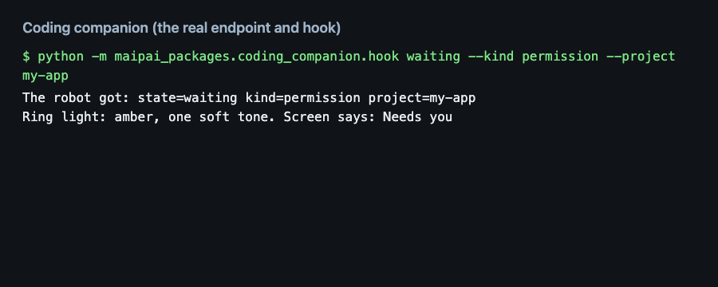

# Use the robot as a coding companion (optional package)

Off by default. The robot sits on your desk and shows what a coding agent on your computer is doing. It is local only and sends nothing back to the agent.



*The hook tells the robot the agent needs you.*

## What you see
- Blue ring light: the agent is working.
- Amber ring light and one soft tone: the agent needs you. The tone plays at most once a minute.
- Green ring light: the agent finished.
- Red is never used for this: red means an alarm or a low battery.
- The screen shows only "Working", "Needs you" or "Finished". If you set `show_request_text = true`, it may show a short cleaned version of the request, and never one that looks like a password, key, file path or web address.

Mute, sleep, quiet hours and a remote cue all win: when one holds, the robot shows nothing.

## What it says
Ask "what is my coding agent doing?" The robot answers from a fixed sentence and the project name ("Your coding agent needs you on my-app."). It never reads out the agent's own words, and the agent's text never goes to your model.

## Turn it on
1. In `robot.toml` set `enabled = true` under `[packages.coding_companion]`. Restart the host.
2. Run `stackchan coding-token`. It makes a private token file and prints where it is. It never prints the token.
3. Have the agent run the hook when its state changes. The hook reads the token from that file and sends only the state, the kind and the project name:

```
python -m maipai_packages.coding_companion.hook working --project my-app
python -m maipai_packages.coding_companion.hook waiting --kind permission --project my-app
python -m maipai_packages.coding_companion.hook finished --project my-app
```

   Use the Python that `pipx` installed for the host (`pipx runpip maipai-bot` shows where it is). The hook never fails the agent: if the robot cannot be reached it prints one line and exits cleanly. To post from another tool, send JSON such as `{"state": "waiting", "kind": "permission", "project": "my-app"}` to `http://127.0.0.1:8052/status` with `Authorization: Bearer <token>`.

The token is not your settings token. The endpoint answers only on this computer and refuses web pages.

## What it does not do
No dictation, no approvals (a touch or a spoken word never approves anything for the agent), no commands to the agent, no MCP endpoint, and no tools for your model. The agent's status text is not logged.
