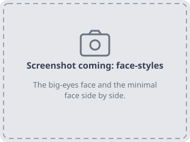
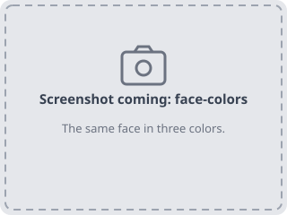
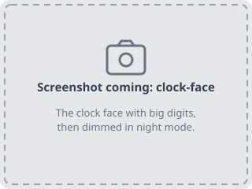
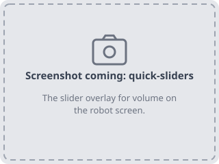

# Change how the robot looks

You can change every item here at any time. None of it needs a reflash.

## Face style

Eight styles ship: **big eyes**, **minimal**, **round**, **cat**, **robot**, **sleepy**, **retro pixel** and **heart eyes**. Pick one in the settings page on your host or set `face_style` in `robot.toml`.
The page shows a live preview that uses the same drawing code as the robot.

## Extras on the face

The robot can add a small drawn extra for a few seconds: sweat, shy, dizzy, heart, anger, tears, sparkles, stars or zzz. One shows at a time. None shows while it is muted, has the camera off, is in quiet mode or a timer is ringing. Not yet seen on a robot screen.

## Word reactions

When you say a word such as "hello", "thanks", "love", "sorry" or "good night", the robot answers with a face, a quiet sound and an extra. 33 reactions come built in, in English, Spanish, French, German, Portuguese and Italian. Edit the list on the settings page, up to 40 rows. It reacts to a phrase at most once every 20 seconds. Not yet seen on a robot screen.

## Per person

On the settings page, keep a name, face colour and caption size for up to 12 people, and press **Use on this unit** to apply one. A saved wake phrase per person is stored but not matched yet.

## Face colour

Set `face_color` to none, a named colour or a custom colour. The default is neutral, with no colour until you pick one.
Colour never carries meaning alone. Every state also has a shape or an icon, so the robot reads well if you cannot tell colours apart.

## Captions

Captions show the spoken words on the screen. They are off by default. Turn them on with `captions = true`, or in the settings page on your host.
The screen is small, so long answers are spoken, not shown in full on the robot.

## Clock face

The clock shows big digits or a ring. It dims at night. It keeps working if the host is off, once the host has set the time.

## Expressions

The face shows what the robot is doing. It has a listening face and a thinking face, a happy, joyful, content and wink face, and a surprised face.
It has an offline look for when it cannot reach your host, and a link screen while it pairs.

## Time zone

Pick your time zone from 31 zones, with summer time, on the robot (swipe up, More, Time zone) or on the settings page. The host sets the clock when the robot connects, and the clock face keeps it.

## Night mode

Night mode dims the screen and the lights and softens the clock. Set it by hand, say "night mode", or set `quiet_from` and `quiet_to` so it starts by itself.

## Thinking cue

While the robot thinks, animated dots show on every face, with a quiet tone. Set `thinking_cue` to change the tone.

## Quick sliders

Slide your finger along the head strip to open a small overlay. It shows volume and brightness. Add more with `quick_sliders`.
If you prefer petting on the strip, leave `strip_mode` at `petting`. Set it to `control` to use the sliders.

## Planned faces

Two things are in progress and not finished. We have no date.

**Fluid faces** Planned make the eyes and mouth move more smoothly: eased eye motion, a smooth blink, a drifting gaze and a mouth that follows how loud you speak. The aim is 30 frames a second. We will measure it and report the real number.

**Your own picture faces** Planned let you upload your own pictures on the settings page, one for each expression: neutral, happy, sad, angry, doubt, sleepy and speaking. Your host resizes them and sends them to the robot. Nothing ships with the project and nothing leaves your home. Each set can show:

- the picture only,
- the picture with animated eyes and mouth drawn over it, or
- a short sequence of frames.

The robot keeps at most three pictures ready at a time, because each one takes a lot of memory.

## Still need help?

Run `stackchan check`, then read [Troubleshooting](troubleshooting.md). If that does not fix it, open an issue on the Issues tab and tell us what you saw.
