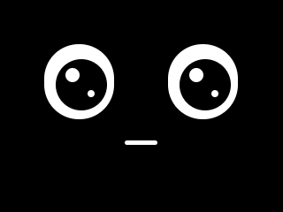
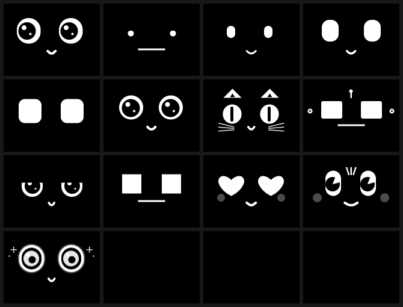
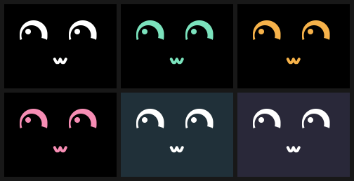

# Change how the robot looks

You can change every item here at any time. None of it needs a reflash.

## Face style

The robot offers big eyes, stock and minimal. **Big eyes** is the default, **stock** is the original StackChan face as it came, and **minimal** is a quiet face for the night. Classic and eyes only are set aside to return as installable styles; a robot that had one saved shows big eyes with its colors and captions kept. Pick one in the settings page on your host or set `face_style` in `robot.toml`. The older styles (round, cat, robot, sleepy, retro pixel and heart eyes) are gone: a robot that had one now shows big eyes.
The page shows a live preview that uses the same drawing code as the robot.

*The clock page: big white digits, the day and AM or PM, and three small page dots.*

*The big-eyes face on the robot.*

*Every face style at rest, drawn by the robot's own face code: Big eyes, Stock, Minimal, Classic, then Eyes only, Round, Cat, Robot, Sleepy, Pixel, Heart eyes, Rubber hose and Neon anime.*

## More faces (Planned)

The robot comes with three styles: Big eyes, Stock and Minimal. Ten more are planned as small downloads (each is 44 bytes) from the catalog: Classic, Eyes only, Round, Cat, Robot, Sleepy, Pixel, Heart eyes, Rubber hose and Neon anime. A style you have not installed uses no memory. Install one on the settings page, then pick it in the Look tab. Remove it and the robot goes back to the style you had before.

Rubber hose is a 1930s cartoon look: tall eyes with a wedge cut from the dark middle, a wide grin, round cheeks and a small tuft. Neon anime has big glowing ring eyes with a bright middle and small sparkles.

Every style works with every face color and every background color, and in every mood.

## Smoother eyes and mouth

The eyes ease from place to place, blink smoothly and drift while the robot is idle. The mouth follows how loud the robot speaks.

## Extras on the face

The robot can add a small drawn extra for 1 to 60 seconds (6 by default): dizzy, heart, anger, tears, sparkles, stars, zzz or notes. One shows at a time. None shows while it is muted, has the camera off, is in quiet mode or a timer is ringing.

## Word reactions

When you say a word such as "hello", "thanks", "love", "sorry" or "good night", the robot answers with a face, a quiet sound and an extra. 33 reactions come built in, in English, Spanish, French, German, Portuguese and Italian. Edit the list on the settings page, up to 40 rows. It reacts to a phrase at most once every 20 seconds.

## Per person

On the settings page, keep a name, face color and caption size for up to 12 people, and press **Use on this unit** to apply one. A saved wake phrase per person is stored but not matched yet.

## Your own pictures as the face

On the settings page, pick a style and one of your own pictures for each look: neutral, happy, sad, angry, doubtful, sleepy and speaking. Press **Send to the unit**.

- **Picture only** shows the picture.
- **Picture with eyes and mouth drawn on top** adds eyes that blink and drift and a mouth that follows the robot's voice. You set where the eyes and mouth go. Use a picture without eyes and a mouth for this style.
- **A short run of frames** plays up to 6 pictures in a loop for each look, at 1 to 12 frames a second.

The robot keeps up to 14 pictures, 1,000,000 bytes after they are made smaller. If your pictures do not fit, the page says so in plain words before it sends anything: use fewer or simpler pictures. A look with no picture shows the neutral one. While the robot speaks it shows the speaking picture.

Your pictures stay on your computer and go only to your robot, over your own network. Nothing is shipped with the product and nothing is uploaded anywhere else. The mute look, the camera-off look, quiet mode, the clock and a ringing timer always show instead of a picture. The robot keeps at most 3 pictures ready at a time. It keeps them in memory, so your host sends them again after a restart. The page refuses a picture over 12 million pixels before it uses your host's memory. Shrink big photos first.

## Face color

The eyes are white until you pick a color. Set the color on the settings page, or run `stackchan face set UNIT --color mint`. Use none, a named color or a custom color for the eyes. The screen color behind the face is separate: pick one of the seven names (shown dark, so white eyes still read) or your own dark color, for each person. A color too bright for white eyes is refused, with a note on what to pick instead.
The eyes also lean a little toward a color for some feelings: warm red when angry, cool blue when sad, pink for love, and dim when sleepy or tired. This is on by default and is one switch on the settings page. The shapes change too, so the face reads the same without color.
Color never carries meaning alone. Every state also has a shape or an icon, so the robot reads well if you cannot tell colors apart.

*The same happy face in four colors on black, then white on two background colors.*

## Captions

Captions show the spoken words on the screen. They are off by default. Turn them on in the settings page on your host, or run `stackchan face set UNIT --captions on`.
The screen is small, so long answers are spoken, not shown in full on the robot.

Where the words appear: as subtitles at the bottom of the screen (the default when captions are on), in the banner row at the top,
or nowhere. Choose it under **Look**, **Captions**.

## The top row

One row at the top of the screen carries messages: remote cues, "Here I am!", game scores, a lost connection and the captions.
The face does not move for it: the screen has a fixed top row, a face area and a subtitle area. One solid violet row shows for as long as something is controlling the robot, and says where it came from: "Remote: Settings", "Remote: Phone", "Remote: Home hub" or "Remote". It is always on and you cannot turn it off.
The control sheet has a **Status icons** switch, off by default. Off, the robot tells you it woke or is listening with a sound and the ring light instead of icons. On, small icons show the microphone, the camera and battery and Wi-Fi problems.

## Sleepy and sleeping

Sleepy is a robot nodding off: heavy eyes, slow blinks, no Z. Sleeping is eyes shut, a snoring mouth, a little drool and a Z.

## Clock face

The clock shows big digits or a ring. It dims at night. It keeps working if the host is off, once the host has set the time.

*The clock face with big digits, then dimmed in night mode. A placeholder drawing, not a real screenshot.*

## Expressions

The face shows what the robot is doing. It has a listening face and a thinking face, a happy, joyful, content and wink face, and a surprised face.
It has an offline look for when it cannot reach your host, and a link screen while it pairs.

## Time zone

Pick your time zone from 31 zones, with summer time, on the settings page. The host sets the clock when the robot connects, and the clock face keeps it. A robot with no host paired still lists the zones on its own screen (swipe up from the bottom, More, Time zone).

## Night mode

Night mode dims the screen and the lights and softens the clock. Set it by hand, say "night mode", or set quiet hours on the settings page (Behavior, Quiet hours) so it starts by itself.

## Thinking cue

While the robot thinks, three animated dots show where the mouth is, on every style, with a quiet tone. Change it on the settings page under "While it thinks": none, a tone or a phrase.

When the battery is low the robot looks tired, not sad: half-closed eyes and a slow blink at 20 percent, more droop at 10 percent and the sleepy face at 5 percent. A cable clears it. When it goes to sleep its eyes close slowly, stay shut with a thin curved line, and open again with a stretch when it wakes.

## Scenes

Planned Scenes are built on the host but not flashed on the robot yet.

A scene sets the whole look in one go: the face, an effect on the screen (rain, snow, balloons), the light ring and a quiet sound. There are ten: rainy day, snowy day, sunny day, bedtime, party, birthday, cozy, spooky, focus and celebrate.

The robot only shows a scene when it is told to. Your language model can ask for one with a tag at the start of a sentence, like `[scene rainy_day]`, and `[scene off]` ends it. The tag is never spoken. Home can ask for one too. The robot never picks a scene from the words it hears.

To change a scene, open the settings page, then Look, then Scenes. Pick a scene, change its face, effect, light, sound or how long it lasts, and press Save. "Test on the robot" shows the saved scene. "Back to the shipped scene" undoes your changes.

A scene never moves the robot, takes a picture or changes a privacy setting. Quiet hours, sleep, mute and a remote control that is in use all win over a scene, and the robot still speaks. Light ring colors from a scene need a later ring update, so for now a scene changes the face, the effect and the sound.

## Quick sliders

Swipe up from the bottom of the screen to open the control sheet. It has volume and brightness sliders. See [Swipe pages and the control sheet](swipe-pages.md). The head strip is for petting.

*The slider overlay for volume on the robot screen. A placeholder drawing, not a real screenshot.*

## Still need help?

Run `stackchan check`, then read [Troubleshooting](troubleshooting.md). If that does not fix it, open an issue on the Issues tab and tell us what you saw.
