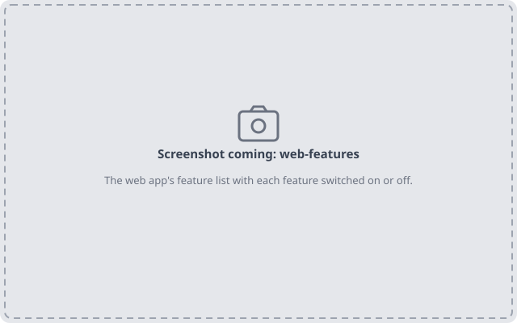

# What the robot can do

A tour of everything the robot does, grouped by what you want to do. Each group has its own page.

A feature that needs something you have not set up hides itself. You never see a raw error for it. The web settings page names what is missing.

## Make it look the way you like

Two face styles, any colour or none, a clock face, night mode and optional captions. Slide the head strip for quick sliders.
Page: [Face and look](face-and-look.md).

## Talk to it

Wake word, follow-up questions, interrupting, voice commands, personas and offline phrases.
Page: [Voice](voice.md).

## Keep time

Timers with a ring that empties, alarms with snooze, an hourly chime and quiet hours.
Page: [Timers and alarms](timers-and-alarms.md).

## Mute, camera off, full quiet

Three switches, each a tap on the face. Mute the microphone, stop the camera, or hold still and silent.
Page: [Mute, camera off and full quiet](mute-and-camera-off.md).

## Find it and control it remotely

Find the robot, make it beep and flash, and control its lights and voice from the web app. Planned
Page: [Find the robot and control it remotely](find-and-remote.md).

## Watch and alert

Watch for motion and loud sounds, get an alert, and, if you want, flash red and blue and sound a siren. Planned
Page: [Watch your room and get alerts](watch-and-alerts.md).

## Baby monitor

Watch and listen in a nursery, get alerts, and play lullabies, with a clear sign on the robot's screen. Planned
Page: [Use the robot as a baby monitor](baby-monitor.md).

## Let it react

Pickup, shake, tilt and petting, breathing, quiet mode, privacy sleep and the low-battery steps.
Page: [Moves and moods](moves-and-moods.md).

## Dance

Dance on request, dance to music by itself, and name the song Needs MaiPai Home.
Page: [Music and dance](music-and-dance.md).

## Let it see (opt-in)

Snapshots, face follow, wave and mirror mode, "take my picture" and a local name list. "What do you see" Planned. "What is this" Needs MaiPai Home.
Page: [Camera](camera.md).

## Play

A colour-memory game, an action game, a pet mood that depends on care, and music dance.
Page: [Games and pet](games-and-pet.md).

## Code with it

Agent status on the face and light bars, a build light, dictation and touch approvals.
Page: [Coding companion](coding-companion.md).

## Connect it to your tools

A local API, an event stream, MQTT, a home-automation bridge and metrics. All off by default.
Page: [Home tools](home-tools.md).

## Take it on the go

Join your phone's hotspot or any Wi-Fi, reach your host or hub over Tailscale on an encrypted link, and remember several Wi-Fi networks.
Page: [Use it anywhere](use-it-anywhere.md).

## Keep it current

Checking for updates is on. Installing is off until you turn it on.
Page: [Updates](updates.md).

## Add a household brain

MaiPai Home can add memory across days, per-person voices, calendars and household rules. The robot is complete without it.
Page: [With MaiPai Home](with-maipai-home.md).

## Keep it secure

Pairing with a code, revocable tokens, signed updates, and an encrypted link over Tailscale.
Page: [Keep the robot secure](security.md).

## Lights and sounds

What each light colour, pattern and tone means.
Page: [Lights and sounds](lights-and-sounds.md).

## Switch or go back

Move to MaiPai for StackChan and return to the factory firmware.
Page: [Switch from the factory firmware, or go back](switch-from-the-factory-firmware.md).

## Pick hardware and a model

What depends on your model, and what size of computer to start with.
Page: [Pick hardware and a model](hardware-and-models.md).

## Answers

Common questions, which setup to pick, a glossary and the release notes.
Pages: [Questions people ask](faq.md), [Which setup is right for me?](which-setup.md), [Glossary](glossary.md), [Release notes](release-notes.md).

## Install, update and remove

Install the host, start it at boot, update it, remove it, and set up a firewall.
Page: [Install, update and remove the host](install-the-host.md).

## No stealth

Every monitoring mode shows on the robot's screen.
Page: [The robot never monitors in secret](no-stealth.md).

## Compare

See how MaiPai for StackChan compares with the factory firmware, with your own LLM, and with MaiPai Home.
Page: [Compare MaiPai for StackChan](compare.md).

## Not included

Sound direction, Bluetooth, a phone app and anything that calls an outside service by itself.

## Still need help?

Run `stackchan check`, then read [Troubleshooting](troubleshooting.md). If that does not fix it, open an issue on the Issues tab and tell us what you saw.
