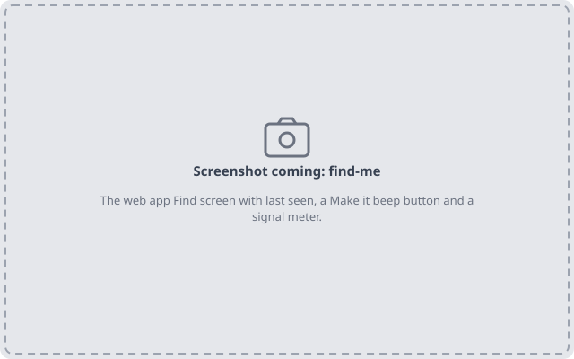
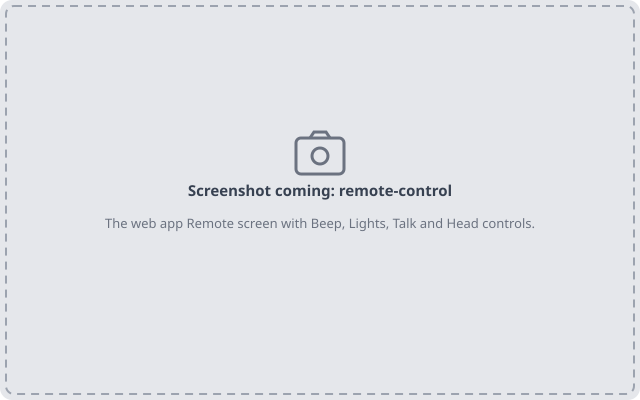

# Find the robot and control it remotely

Remote controls are built and flashed and work without MaiPai Home: beep, flash, find my robot (it works even when muted), say something, pan and tilt, head pad, nod, shake, dance, start a game and take a photo, from the settings page on your host. They are off until you turn on remote access, and every action shows a violet cue on the robot that cannot be turned off. Live view is planned. Not yet checked on a robot.

Open the web app to find your robot, make it beep, turn its lights on, or talk through it. This works from your phone or computer, at home.
Remote control is off until you turn it on, and the robot always shows when someone is using it.

## Find my robot

Press **Find** in the web app. The robot answers in three ways:

- **Last seen.** The app shows when the robot was last online, which Wi-Fi network it was on, and its battery. This comes from the regular check-in the robot already sends.
- **Beep and flash.** Press **Make it beep** and the robot plays a loud, repeating tone and flashes its light bars, even in quiet hours and when it is muted. Tap the robot to stop it.
- **Warmer or colder.** If Bluetooth is on, the app shows a signal meter you can follow as you walk toward the robot. This depends on whether we keep Bluetooth, which is still under review, so it may not ship.

## Where is it

The robot has no GPS chip, but it can still tell you roughly where it is, by the Wi-Fi network it is on.

- **Place names, private by default.** You name the Wi-Fi networks you use, such as "Home", "Office" or "Mia's house". Find shows the name of the place it was last seen, and nothing leaves your network.
- **Your phone's hotspot.** If the robot is on your phone's hotspot, the app can show your phone's own position, because the two are together. This uses your phone's location, and it stays in the web app.
- **A map, if you choose.** You can turn on a location lookup that finds the robot's position from the Wi-Fi networks around it, the way a website finds you. It is off by default, because it sends the names of nearby Wi-Fi networks to an outside location service, which breaks the rule that nothing leaves your home. The app says so before you turn it on. The result is about a street or a building, not a room.

There is no ultra-wideband chip, so there is no arrow like the one on a lost phone. The place name, the beep and the meter get you close.

*The web app Find screen with last seen, a Make it beep button and a signal meter. A placeholder drawing, not a real screenshot.*

## Remote control

Turn on `remote_control` in the settings. Then, from the web app, you can:

| You can | What the robot does |
|---|---|
| **Beep** | Plays a tone you pick. |
| **Turn the lights on** | Lights the light bars in a color you pick. They stay on until you turn them off or touch the robot. |
| **Talk** | Speaks what you type, or what you say into a push-to-talk button. The talking goes one way, to the robot. |
| **Pan and tilt** | Turns the head left and right, and nods it up and down, with arrow buttons or a joystick. A **Home** button brings it back to center. |

There is no remote listening in remote control. You can talk to the robot, but you cannot listen in through it. There is no exception.

## Pan and tilt

Use the arrows or the joystick in the web app, or tap a saved spot, such as "the door". Panning turns all the way around. Tilting stays within a safe range of about 5 to 85 degrees up and down, which protects the motors.
With live view, you can look around the room the same way.

Every pan or tilt writes one line to the activity log. A remote head move follows the same limits as any other move. It is refused while the robot is being carried or is blocked, and it is rate limited, so it cannot be used to wear out or jam the motors.

*The web app Remote screen with Beep, Lights, Talk and Head controls. A placeholder drawing, not a real screenshot.*

## You always know

The robot shows every remote action. One solid violet row at the top of the screen shows while anything is controlling it, and says where it came from: "Remote: Settings", "Remote: Phone", "Remote: Home hub" or "Remote". It is always on and never blinks, because blinking is reserved for the camera cue. The robot also plays a short tone before it speaks a remote message.

Every remote action writes one line to the robot's activity log, which anyone in the household can read.
Remote lights do not use the colors that carry a meaning, such as green for listening, so they never look like a warning.
You cannot turn these cues off, and remote control needs your token, so only you can use it.

## Where it works

Remote control works only from your home network or your private network. It never goes through an outside relay.

If you lose the token, set a new one from the robot's own settings. The web app cannot replace it, so a stranger with web access cannot take over.

## Turn it off

Set `remote_control` to false, or tap the robot's face to mute it. Remote talk is blocked while the robot is muted or in full quiet, but Find still works, because finding it is your call.

## Still need help?

Run `stackchan check`, then read [Troubleshooting](troubleshooting.md). If that does not fix it, open an issue on the Issues tab and tell us what you saw.
