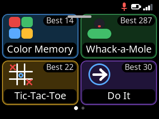
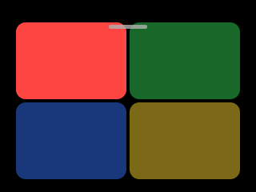
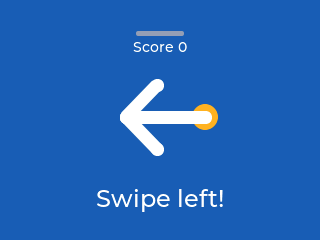
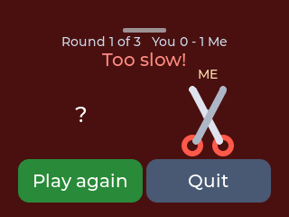
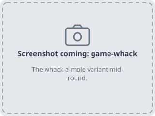

# Play games and care for your pet

The robot plays the games itself, so they work with your own LLM and with MaiPai Home.

## Games

Every game is full height. Swipe down on the bar at the top to leave. Game sounds are at chime level and follow the system volume. Reaction Time is gone.

*The Games wall: a colored tile per game with its best score.*

*The Games wall on the robot: big colored tiles with a picture and a best score for each game.*

The robot has seven touch games. Talk games use your connected model, and the robot has screens and touch controls for them. The robot can also tell jokes, riddles and trivia from the optional content package when the model cannot answer. These features work with your own LLM or MaiPai Home.

*Color Memory on the robot: four colored tiles.*

- **Color memory.** The robot shows a pattern with lights and sounds. Tap the colors back in the same order. Each round adds one step. Your score is the number of rounds you got right.
- **Whack-a-mole.** Funny moles pop up in a grid of nine holes: a grinning one, one with its tongue out, a startled one and one in a helmet. Tap each one before it hides. A hit gives a dazed mole with stars and a bonk or a squeak. A tap on the wrong hole and a mole that gets away each have their own funny sounds. There are 15 moles.
- **Tic-Tac-Toe.** Pick a level by tapping a row: Easy plays random moves, Medium takes a win and blocks yours, Hard never loses. You are X and go first. The robot plays its O and tells you its move, "I played row 2 column 3". A win scores 10, 20 or 30 by level, a draw 3, 6 or 9.

*Do It on the robot, calling "Swipe left!".*

- **Do It.** Wait for the screen to change color. Then it shows a move in big words and a big picture: tap, swipe left, swipe right, gentle shake, pet my head or tilt. Do the move, or press the big button (the whole screen), as fast as you can. Every round is faster, and the color and the tone change as it speeds up. A wrong move, a tap too early or a late answer ends the run. Your score is the rounds you got right, and a new best gets confetti.

*Rock Paper Scissors on the robot, with Play again and Quit.*

- **Rock Paper Scissors.** A best of three match. The robot bumps its fist three times, "Rock, paper, scissors", with a beat each time while the three choices are dim. At "SHOOT" they light up and you tap one within a second and a bit. A tap too early starts the round again. No tap is a loss. Both hands are shown, yours on the left, then the result and two buttons, **Play again** and **Quit**. After the match press **Rematch** or **Quit**. Your score is the matches you won, saved when you press **Quit**.
- **Magic 8-Ball.** Ask a question, then gently shake the robot or tap the ball for an answer.
- **Dice and Coin.** Tap or gently shake to roll one die, two dice or flip a coin.

To start one by touch, swipe left on the face to open the Games page (or swipe up from the bottom and press **Games**), then press the game you want. Each tile shows your best score, and **More games** shows the rest. To start one by voice, say "play memory", "play do it" or "play whack-a-mole". In Spanish, say "juega a memoria" or "juega a los topos". Say "what games do you have" to hear the list.

To stop a game, swipe down from the bottom edge of the screen, or say "stop". A game you stop early does not save a score.

In the settings page, **More**, then **Games**, then **Games and best scores** keeps the best five scores of each person on your computer. A score goes under a name only when MaiPai Home or the notes passphrase says who is playing; otherwise it goes under Someone. Delete scores removes one person's list. The robot keeps your best five scores for each game. Open the robot's settings page and press **Show games and best scores** to see them.

A few rules keep games polite:

- In full quiet, a game will not start, and one that is running ends.
- If the robot is muted, the game still plays, with no sound.
- Games never move the robot's head.
- The edges of the screen still work while you play: a swipe that starts at the very side edge changes the volume, and the stop swipe ends the game. The page swipes and the control sheet wait until the game is over.

Colors always sit in a fixed place on the screen, so you can play without telling colors apart.

*The color-memory game with four shapes. A placeholder drawing, not a real screenshot.*

*The whack-a-mole variant mid-round. A placeholder drawing, not a real screenshot.*

To start one by voice, say "play tic tac toe", "play do it", "play rock paper scissors" or "play whack a mole".

Every game is a small data file that one built-in game engine plays. Signed game packs can be added to the robot. An unsigned pack is refused.

More games are built and on the way. See [New games: what works and what is coming](more-games.md).

## Talk games

These games are played by talking, and the robot's language model plays them. You need a model connected (your own, or MaiPai Home).

Say one of these to start:

- "Play twenty questions" (you think of something; the robot asks yes or no questions)
- "Tell me a riddle"
- "Play jokes"
- "Let's play trivia"
- "Word chain"
- "Would you rather"
- "Tell me a bedtime story"

Spanish works too: "juguemos a veinte preguntas", "dime una adivinanza", "juguemos a los chistes", "juguemos a la trivia", "cadena de palabras", "qué prefieres", "cuéntame un cuento".

The robot starts with a fixed line, with no model needed. After that the model plays and reacts with faces and effects when you are right or wrong. A game ends when you say "stop the game", "I'm done" or "that's enough", when it reaches its round limit, or after five quiet minutes. Then chat is normal again. The games follow the same child and content rules as ordinary chat. The settings page lists them under **Talk games** on the Games page.

See also [Twenty Questions, riddles, jokes and trivia](question-games.md). If the model stops answering in the middle of jokes, riddles or trivia and you turned on the [jokes and games content](jokes-and-games-content.md) package, the robot keeps playing from its saved library.

## Pet mood

The robot has a mood that depends on how you care for it. Petting, talking and playing lift it. Being ignored for days lowers it.
The mood is saved across days and shows in the face and the idle moves. It never affects what the robot can do for you.
It lives on the robot and works with the host off. There is no switch for it on the host; it is a build option when you [build from source](../dev/build-from-source.md).

*Three mood faces: happy, bored and lonely. A placeholder drawing, not a real screenshot.*

## Still need help?

Run `stackchan check`, then read [Troubleshooting](troubleshooting.md). If that does not fix it, open an issue on the Issues tab and tell us what you saw.

## Ask for a game by voice

You do not need a model for these. The robot answers with fixed phrases, in every language it speaks.

| You say | The robot |
|---|---|
| "Play a game", "Let's play", "I'm bored" | Picks a game on this robot, never the one it just played, and starts it. Games you play more come up a little more often. |
| "Another one", "Play something else" | Stops the game that is on and picks a different one. |
| "Play memory" (or another game's name) | Starts that game. |
| "What games do you have?" | Lists the games on this robot, out loud and on its screen. |
| "Stop" | Stops the game. |

The same asks work in Spanish ("Estoy aburrido", "Otro juego"), French ("Jouons", "Un autre jeu"), German ("Lass uns spielen", "Ein anderes Spiel"), Portuguese ("Vamos jogar", "Outro jogo") and Italian ("Giochiamo", "Un altro gioco").

If you ask for a game that is not on this robot, it says so and leaves a note on your dashboard ("On my robot") so you can add it. It never installs anything by itself. In full quiet, or while the robot is locked, it says it cannot start a game. A muted robot plays the game without sound.

When a model is answering, "play a game" can also pick a talking game, such as riddles or twenty questions. The host keeps the game state and the model gets no tools.
