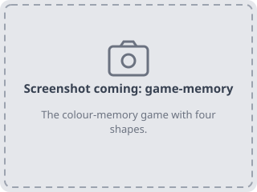

# Play games and care for your pet

The games and the pet mood run on the robot itself, so they work with your own LLM and with MaiPai Home. No finger, screen or sound has been checked on a robot yet.

## Games

The robot has three games built in. They run on the robot itself, so they work even when MaiPai Home is off.

- **Colour memory.** The robot shows a pattern with lights and sounds. Tap the colours back in the same order. Each round adds one step. Your score is the number of rounds you got right.
- **Reaction time.** The screen is red. When it turns green, tap as fast as you can. Three rounds. Your score is your average in milliseconds, and lower is better.
- **Whack-a-mole.** Moles pop up in a grid of nine holes. Tap each one before it hides. There are 15 moles.

To start one by touch, swipe up on the screen, then press **More**, then **Games**, then the game you want. Each button shows your best score. To start one by voice, say "play memory", "play reaction" or "play whack-a-mole". In Spanish, say "juega a memoria" or "juega a los topos". Say "what games do you have" to hear the list.

To stop a game, swipe down from the bottom edge of the screen, or say "stop". A game you stop early does not save a score.

The robot keeps your best five scores for each game. Open the robot's settings page and press **Show games and best scores** to see them.

A few rules keep games polite:

- In full quiet, a game will not start, and one that is running ends.
- If the robot is muted, the game still plays, with no sound.
- Games never move the robot's head.
- The edges of the screen still work as usual while you play: the swipe up opens quick settings and the side swipes change the volume.

Colours always sit in a fixed place on the screen, so you can play without telling colours apart.

Every game is a small data file that one built-in game engine plays. A game from outside the robot's firmware must be signed with the update key, and an unsigned one is refused with a plain message. Loading outside games is not switched on yet.

## Pet mood

The robot has a mood that depends on how you care for it. Petting, talking and playing lift it. Being ignored for days lowers it.
The mood is saved across days and shows in the face and the idle moves. It never affects what the robot can do for you.
Turn it off with `pet_mood = false`.

## Still need help?

Run `stackchan check`, then read [Troubleshooting](troubleshooting.md). If that does not fix it, open an issue on the Issues tab and tell us what you saw.
