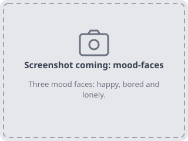

# Play games and care for your pet

Needs MaiPai Home

This is a MaiPai Home feature. MaiPai for StackChan on its own stays a simple, private voice robot, and extras like this run with MaiPai Home. See [Use MaiPai Home as the brain](with-maipai-home.md).

## Games

Say "let's play" to see the list, or name a game.

- **Colour memory.** The robot shows a pattern. Repeat it by touch. Each round adds one step.
- **Action game.** Quick taps. Includes a reaction variant and a whack-a-mole variant.

Colours always come with a shape, so you can play without telling colours apart.

New games arrive as signed packs for one built-in game engine. You can add a pack in the web page. An unsigned pack is refused.

## Pet mood

The robot has a mood that depends on how you care for it. Petting, talking and playing lift it. Being ignored for days lowers it.
The mood is saved across days and shows in the face and the idle moves. It never affects what the robot can do for you.
Turn it off with `pet_mood = false`.

## Music dance

Play music near the robot and say "dance". It sways to the beat and shows a mood face that fits the music.
It listens through its own microphone and keeps nothing.

## Still need help?

Run `stackchan check`, then read [Troubleshooting](troubleshooting.md). If that does not fix it, open an issue on the Issues tab and tell us what you saw.
