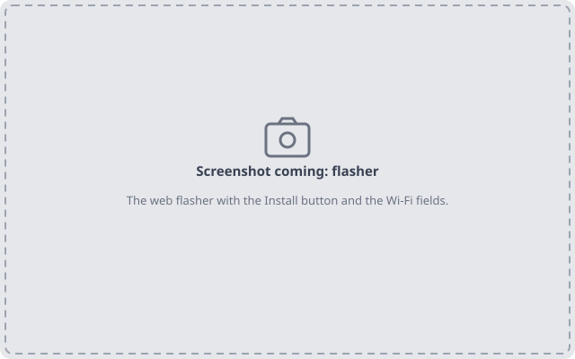
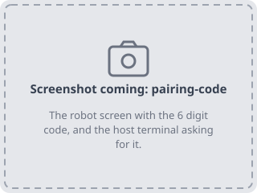
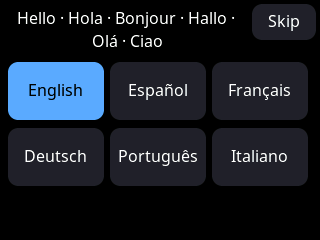
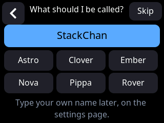
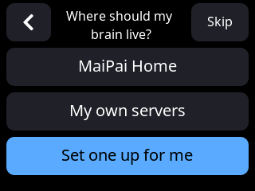

# Getting started with MaiPai for StackChan

About 20 minutes the first time. You do this once.

**First:** if your robot has been used with the factory app, read [Switch from the factory firmware, or go back](switch-from-the-factory-firmware.md). Do not force the head or arms by hand: the motors can be damaged.

## What you need

- A StackChan robot and a USB cable. New to the robot? See the [official docs](https://docs.m5stack.com/en/StackChan).
- A computer for the host program: a Mac, a Linux machine or a Raspberry Pi 5. Leave it on while you use the robot.
- Wi-Fi that the robot and the host share.

You do not need a language model yet. The host can install a small one for you.

## Steps

1. **Install the host.** Run `pipx install "git+https://github.com/getmaipai/stackchan#subdirectory=host"`, then `stackchan service install`. The host starts at login and restarts itself if it stops. More: [Install, update and remove the host](install-the-host.md), [Keep the host running](run-as-a-service.md). You will know it worked when `stackchan status` says everything is running.
2. **Choose a brain.** Open `http://127.0.0.1:8777/brain` on the host computer and pick one of three ways: MaiPai Home, your own model, or a small one the host installs. No terminal needed. See [Choose a brain](choose-a-brain.md).
3. **Flash the robot.** Open the [web flasher](web-flasher.md), plug the robot in by USB and press Install. You can type your Wi-Fi in the same box, or later on the robot's own screen.

   

   *The web flasher with the Install button and the Wi-Fi fields. A placeholder drawing, not a real screenshot.*

4. **Pair.** On the host computer run `stackchan pair`. It prints a 6 digit code that works for 10 minutes. Type the code on the robot's setup page. You will know it worked when the robot shows its face and the host page "On my robot" lists it.

   

   *The robot screen with the 6 digit code, and the host terminal asking for it. A placeholder drawing, not a real screenshot.*

5. **Check.** Run `stackchan check`. It tests each address and says in plain words what is wrong. You will know it worked when every line says ok.

   

   *The terminal after `stackchan check`, every line marked ok. A placeholder drawing, not a real screenshot.*

6. **Talk.** Say the wake word, then ask a question. The face shows dots while it thinks, then it answers. If nothing happens, see [Troubleshooting](troubleshooting.md).

   

   *The robot face with thinking dots. A placeholder drawing, not a real screenshot.*

If the light bars pulse cyan slowly  and you hear two rising notes, the robot needs you: it is waiting for Wi-Fi details or for the pairing code.

## First start on the robot

The first time it starts, the robot asks three things on its own screen: your language, a name for it, and how it should think. Then it says "All set!"

*First start, step 1: pick a language. Six buttons: English, Español, Français, Deutsch, Português and Italiano.*

*First start, step 2: What should I be called? Six names to pick from.*

*First start, step 3: How should I think? Pair with MaiPai Home, or Use my own model. Both stay in your home.*

## If the robot cannot join Wi-Fi

It opens a setup page. Connect your phone to the network named `stackchan-` and four letters or digits. The robot's screen shows a six-digit setup code. Open the page, pick your Wi-Fi, enter the password, the host address and the code. The page stays open after, so you can add more networks.

If you will take the robot away from home, also type a one-time key for your private network: see [Use the robot away from home](use-it-anywhere.md).

*The setup page with a list of networks. A placeholder drawing, not a real screenshot.*

## Good to know

- `stackchan forget` removes the pairing. Use it before you give the robot away.
- With your own model, the robot adds no content filter. The model you connect decides what is said.

## Next

Take the tour in [Features](features.md), or change how the robot looks in [Settings](settings.md).

## Still need help?

Run `stackchan status` and `stackchan check`, then read [Troubleshooting](troubleshooting.md). If that does not fix it, open an issue on the Issues tab and tell us what you saw.
