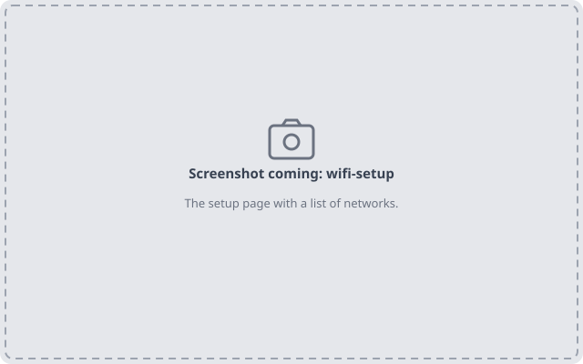

# Getting started

About 20 minutes the first time. You do this once.

## What you need

- A StackChan robot and a USB cable.
- A small always-on computer for the host program: a Mac, a Linux machine or a Raspberry Pi 5.
- Wi-Fi that the robot and the host share.
- A language model you run yourself, reached by a web address. Speech tools are optional, because the host has built-in ones.

## Steps

1. **Install the host.** Run `pipx install git+https://github.com/getmaipai/stackchan`.
2. **Flash the robot.** Open the web flasher, plug the robot in by USB and press Install. You can enter your Wi-Fi in the same dialog.

   

3. **Pair.** Run `stackchan pair` on the host. A two minute window opens. The robot shows a 6 digit code. Type it on the host.

   

4. **Point at your model.** Open `robot.toml` and set `llm_url` to your model address, for example `http://192.0.2.10:8080`.
5. **Check.** Run `stackchan check`. It tests each address and says in plain words what is wrong.

   

6. **Talk.** Say the wake word, then ask a question. The face shows dots while it thinks, then it answers.

   

## If the robot cannot join Wi-Fi

It opens a setup page. Connect to its network, pick your Wi-Fi, enter the password and the host address.

## Optional

- `stackchan install-service` starts the host when the computer starts. It is off until you run it.
- Take the robot anywhere: join your Tailscale network. See [Use it anywhere](use-it-anywhere.md).
- `stackchan forget` removes the pairing. Use it before you give the robot away.
- To use MaiPai Home as the brain, see [With MaiPai Home](with-maipai-home.md). You do not need it.

## Content safety

In standalone mode the robot adds no content filter. The model you connect decides what is said. Pick a model and persona that suit your home.

## Next

Take the tour in [Features](features.md), or change how the robot looks in [Settings](settings.md).
