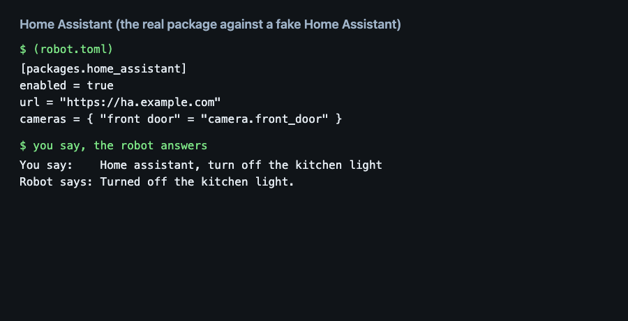

# Home Assistant (optional package)

Off by default. Lets you talk to Home Assistant through the robot and ask about one camera picture. Everything stays on your home network.

## Turn it on
1. In Home Assistant, create a long-lived access token (your profile page, Security).
2. Put it in the environment of the host program as `STACKCHAN_HA_TOKEN`. It is never written in `robot.toml`.
3. In `robot.toml` fill the `[packages.home_assistant]` block (`enabled = true`, `url`, and optionally `cameras`). Restart the host. `stackchan check` tests the address.

## What you say
- "Home assistant, turn off the kitchen light." The words after the trigger go to Home Assistant's own voice endpoint. Home Assistant decides what they mean and the robot says its answer. The model never makes the call and never sees the token.
- "Home assistant, what do you see on the front door camera?" Only for cameras you list in `cameras`. The host takes one picture and asks your model about that one picture. Use a model that accepts images.

## Who can use it
The robot does not recognize voices on its own, so by default nobody can: a turn with no named speaker is refused. Set `allow_unidentified = true` to let anyone in the room use it, or let MaiPai Home name the speaker and list the adults in `speakers`. It is never used while a child is near (when MaiPai Home says so). An `http://` address sends your token in clear text: use `https://`, or set `allow_plain_http = true` if you accept that on your home network.

## Limits
Requests that do not start with the trigger go to your model as usual. A camera you did not list cannot be fetched. Pictures are not kept.
