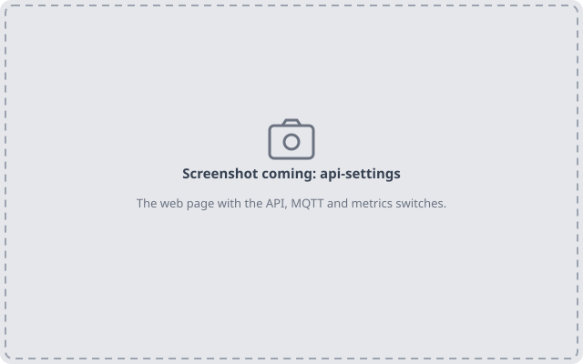

# Connect the robot to your own tools

Needs MaiPai Home

Planned These are MaiPai Home features, and none of them is built in this repository. The host's `robot.toml` has no keys for them. See [Use MaiPai Home as the brain](with-maipai-home.md).

Everything here runs in MaiPai Home. All of it is off by default, and every one needs a token. None of it calls an outside service.

| Tool | What it is for | Where you turn it on |
|---|---|---|
| Local API | Start a timer, show a face or speak, over REST and WebSocket. | MaiPai Home settings |
| Event stream | Get a message when the robot hears you, is picked up or finishes a timer. | MaiPai Home settings |
| MQTT | Send the same events to your own MQTT broker. | MaiPai Home settings |
| Home-automation bridge | Show the robot as a device in your home-automation system. | MaiPai Home settings |
| Metrics | A page with counts and timings for your own dashboard. | MaiPai Home settings |

MaiPai Home creates the token. Run `stackchan check` to test your host's addresses.

*The web page with the API, MQTT and metrics switches. A placeholder drawing, not a real screenshot.*

## Ideas

- A status light for your server: the light bars change color when a job fails.
- A busy light: the light bars show a color while you are on a call.

## Safety

Tokens can be revoked at any time. The link between MaiPai Home and your other tools is as private as your network.
Use a network you trust until the encrypted link ships.

## Still need help?

Run `stackchan check`, then read [Troubleshooting](troubleshooting.md). If that does not fix it, open an issue on the Issues tab and tell us what you saw.
