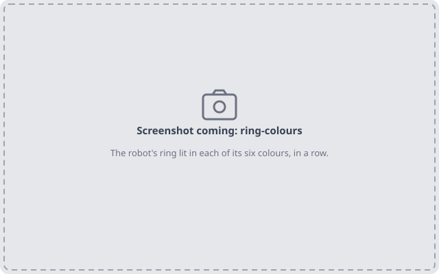

# Lights and sounds

The robot has a light ring and a set of soft bell tones. The ring is off most of the time. It lights only when something needs you right now, and each colour has one meaning.
The screen's face shows moods. The ring never does.

## The ring

| Colour and pattern | What it means | Sound with it |
|---|---|---|
| **Green**, steady | Your voice is being sent to your host or hub | None |
| **Pink**, two quick flashes, then steady | The camera is taking a picture | A short double click |
| **Cyan**, a slow pulse every 2 seconds | The robot needs you: Wi-Fi setup, waiting to be paired, or a timer ringing | Two rising notes for setup. The notification tone for a timer |
| **Amber**, one short pulse every 10 seconds | Look at the screen: offline, a fault, or low battery | Two falling notes when it goes offline. A chirp for low battery |
| **Blue**, steady | It is your turn to talk | A short rising pop |
| **White**, a fast pulse every second | Updating. Do not unplug | None |
| **Dark** | Everything else: idle, thinking, speaking, asleep, charging | None |

Green and pink never dim, even at night or in the quietest setting, because they tell you about your privacy. The other colours get softer at night.
While the robot charges, a small red light at the back is on. It comes from the charger, and the ring does not repeat it.

## The tones

All tones are soft bells. A rising tone is good news and a falling tone is bad news.

| Tone | Sounds like | When |
|---|---|---|
| Needs you | Two rising notes, insistent | Wi-Fi setup or pairing is waiting |
| Plug in | Two quick rising notes | You plugged in the charger |
| Charged | Three rising notes | The battery is full and the cable is in |
| Unplug | One falling note | You pulled the cable out |
| Offline | Two falling notes | The link to your host or hub dropped, once for each outage |
| Goodbye | Three slow falling notes | You turned the robot off with the power key |
| Shutter | A short double click | The camera took a picture |
| Back online | A rising chime | The robot connected, or an update finished |
| Listening | A short rising pop | The wake word or a tap opened your turn |
| Low battery | A chirp | The battery reached 20 percent |
| Error | A low, short tone | Something you asked for failed |

The robot chimes only for something you need to notice or something you just did. It never chimes for something it chose to do by itself.

## At night

At night and in quiet hours the tones go silent, except three: the first-setup tone, the shutter click and the goodbye tone. Those matter for safety or privacy.
Timers and alarms you set still ring. Every tone follows the volume setting, and mute silences all of them except the privacy click.

## Where each light and tone is explained

- [Talk to the robot](voice.md), [Use the camera](camera.md), [Set a timer or alarm](timers-and-alarms.md)
- [How the robot reacts](moves-and-moods.md), [Update the robot](updates.md), [Mute, camera off and full quiet](mute-and-camera-off.md)
- [Getting started](getting-started.md), [Take the robot on the go](use-it-anywhere.md), [Music and dance](music-and-dance.md)

## Still need help?

If a light or tone does not match this page, run `stackchan check`, then read [Troubleshooting](troubleshooting.md). If that does not fix it, open an issue on the Issues tab and tell us the colour, the pattern and what you were doing.
