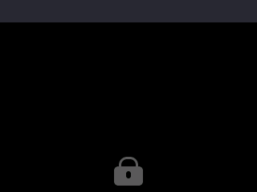
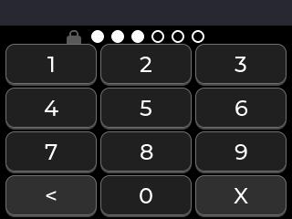
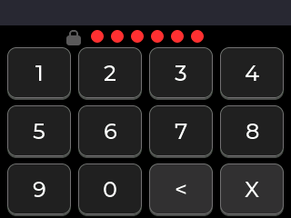

# Lock the robot with a code

A code keeps other people from using the robot. The robot keeps the code itself and checks it by itself. The settings page never stores the code and cannot unlock the robot. Only the keypad on the robot does.

## Set a code
1. Open the settings page and go to **Security**.
2. In the Passcode lock card, type a code of 4 to 6 digits and type it again.
3. Press Save. Press **Lock now** to try it.

## Unlock
Touch the lock screen. A keypad opens. Type your digits. A dot fills in for each digit.

A wrong code turns the dots red.

After several wrong codes in a row the robot makes you wait before you can try again.

## Lock by itself
Pick an **Auto lock** time: off, or 1, 5, 15, 30 or 60 minutes without a touch, a wake word or a remote action.

## What the lock stops
A locked robot keeps its saved Wi-Fi networks: nothing can add or remove one until it is unlocked. Your voice model can never set or change the code.

## If you forget the code
The code cannot be read back. The two-step physical reset on the robot erases the code along with all other data.
