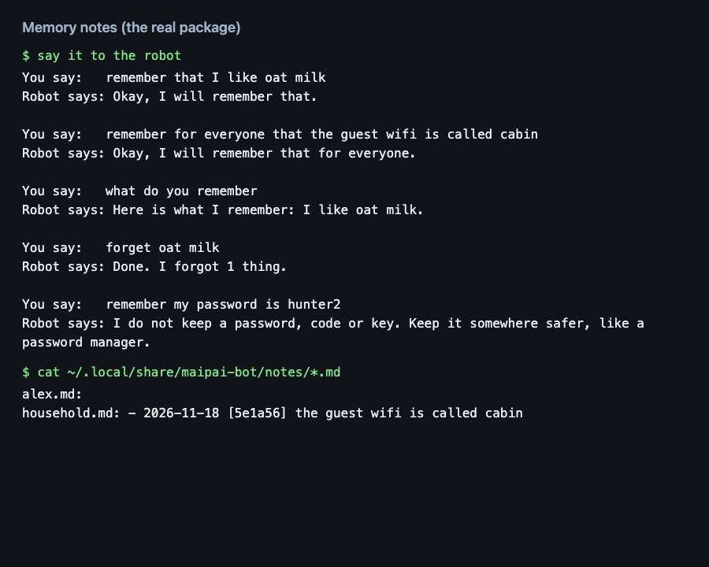

# Memory notes (optional package)

Off by default. When you turn it on, the robot keeps short notes for each adult you list, as plain text files on the host computer. Nothing goes to the internet.

## Turn it on
In `robot.toml` add the block under `[packages.memory_notes]`: `enabled = true`, the names of the adults in `people`, and `default_person`. Restart the host.

## What you say
- "Remember that I like oat milk." Stores the note for the person speaking.
- "Remember for everyone that the guest Wi-Fi is called cabin." Every listed adult hears it.
- "What do you remember?" Reads back the last five notes.
- "Forget oat milk." Removes the notes that contain those words. "Forget everything about me." Removes all of that person's notes.

## What it will not keep
Passwords, codes and keys, card and account numbers, government id numbers, and anything over 300 characters. It says why, and nothing is stored.

## Who can read what
A person's notes go only into that person's own turns. The robot does not recognize voices on its own. It uses, in this order: the person a recognizer named (when MaiPai Home or another source supplies one), the person who said "this is Sam" in the last 30 minutes, then `default_person`. "Who is speaking?" tells you which it is using. Saying a name is a claim, not a check: anyone in the room can say it, so do not rely on it to keep notes private between people who share a room. A child or teen is never a notes person; a child's robot needs MaiPai Home.

## Where the files are
One file per person in the `notes` folder beside the pairing file (`~/.local/share/maipai-bot/notes/alex.md`). One note per line. You can read, edit or delete them by hand.
