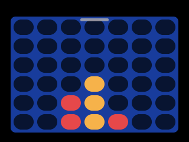
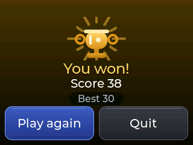

# New games: what works and what is coming

Besides the [seven games on the robot today](games-and-pet.md), more games are built and tested on the virtual robot. Most are **coming**: the game is finished, and the robot's menu, touches and sounds are not yet wired to it. This page says which is which.

## On the robot now

- **Four in a Row.** Tap a column to drop your disc. The robot plays the other color and thinks about its move before it drops. Four in a line wins. A drawn board is a draw. The firmware holds this game and it appears on the Games wall.

*Four in a Row: a blue board with amber and red discs.*

## Coming

Each game below passes its tests and its screens on the virtual robot. None has been seen on a real robot screen. The robot's Games wall does not list them yet.

| Game | How you play | Status |
|---|---|---|
| Higher or Lower | A card is shown. Guess if the next card is higher or lower. Each right guess adds to your streak. | Coming |
| Dice Poker | Five dice, two re-rolls. Tap dice to hold them, then roll. The best hand wins. | Coming |
| Reversi | 8 by 8 board. You play black and the robot plays white. Tap a square to flip lines of discs. | Coming |
| Battleship-lite | A 6 by 6 sea with a small fleet the robot hides. Tap squares to find and sink the ships. | Coming |
| Pong | Drag the paddle to bounce the ball past the robot's paddle. | Coming |
| Flyer | Tap to hop through gaps in a scrolling wall. | Coming |
| Balance | Tilt the robot to keep a ball on a plate. | Coming, needs a firmware update for smooth tilt |
| Maze | Tilt the robot to roll a marble through a maze to the goal. | Coming, needs a firmware update for smooth tilt |

## What happens when one arrives

A new game appears as a tile on the Games wall, with its best score. It ends on the same game-over screen as the others, with **Play again** and **Quit**. A game with no real winner says "Game over" and never "You won!". Balance and Maze only start when you ask for them, never from a bump.

*The shared game-over screen with Play again and Quit.*

Back to [Play games and care for your pet](games-and-pet.md).
