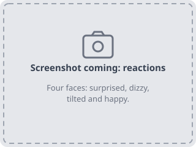

# Moves and moods

## Reactions

| You do | The robot does |
|---|---|
| Pick it up | Looks surprised, then settles. |
| Shake it | Looks dizzy. |
| Tilt it | Tilts its head to match. |
| Pet its head | Looks happy and may purr. |

Petting uses the head strip. If you set `strip_mode = "control"`, the strip opens quick sliders instead.

## Idle life

When nothing is happening the robot breathes, blinks and looks around. When it speaks, its head wobbles a little with the words.
Turn the idle moves off with `idle_motion = false`.

## Quiet mode

Say "quiet". The robot moves slowly and gently, speaks softly and keeps its lights low. Say "normal" to end it.

## Privacy sleep

Say "sleep" or press the privacy button. The robot turns away, the screen goes dark and the microphone and camera stop.
Touch it to wake it.

## Wake cue

A short light and tone confirm it heard the wake word. Set the light and tone for each state in `cues`.
The camera-on cue is the one cue you cannot turn off.

## Low battery

| Battery | What happens |
|---|---|
| 20 percent | A chirp. |
| 10 percent | It asks you out loud to plug it in. |
| 5 percent | It goes to sleep before the power runs out. |

