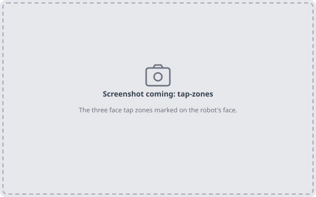
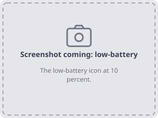

# How the robot reacts

## Reactions

| You do | The robot does |
|---|---|
| Pick it up | Looks surprised, then settles. |
| Shake it | Looks dizzy. |
| Tilt it | Tilts its head to match. |
| Pet its head | Looks happy and may purr. |

Petting uses the head strip. Volume and brightness sliders are on the control sheet: swipe up from the bottom of the screen.

*Four faces: surprised, dizzy, tilted and happy. A placeholder drawing, not a real screenshot.*

## Tap the face

You touch the screen, not the head strip. Each tap has its own screen so you always know what you did. Details: [Mute, camera off and full quiet](mute-and-camera-off.md).

| Tap | What happens |
|---|---|
| The mouth | Mutes or unmutes the robot. |
| The eyes | Turns the camera off, or back on. |
| Above and between the eyes | Full quiet: no moving, no talking and no listening. Tap again to wake it. |

The screen shows a calm icon for each state, not an X on the eyes.

*The three face tap zones marked on the robot's face. A placeholder drawing, not a real screenshot.*

## How you hold it

The robot knows which way up it is. Upright is normal. On its side it looks curious. Face down or on its back it looks sleepy.
Upside down, the screen turns 180 degrees so you can still read it. The robot will not move when turned over, so it is safe to turn it over.

## How much it moves

On USB the robot moves gently. On battery it moves freely, and more gently as the battery runs low (steps at 50, 30, 15 and 8 percent). It will not move when carried or turned over. Tilted, it moves less, and on its side it does not move. The strictest limit wins. A Settings card that shows the current limit is not built yet. Built and flashed, not yet checked on a real robot.

## Head pats and shakes

A slow stroke along the head makes it happy, with a small heart. The heart is rare, so it means something.
A shake gets a spoken line and a dizzy face.

## Idle life

When nothing is happening the robot breathes, blinks and looks around. When it speaks, its head wobbles a little with the words.
The idle moves have no switch yet.

## Mood from care

The robot's resting face reflects how much you pet it. A head pet adds a little care, up to 12 a day. A whole day with no pet takes some away. It starts in the middle and never goes below a calm face. It is saved across restarts.

## Hourly chime

A soft tone at the top of each hour. It is off until you turn it on in the settings page. It stays silent in quiet hours, when the room is dark and while the robot is busy.

## Quiet mode

Say "quiet". The robot moves slowly and gently, speaks softly and keeps its lights low. Say "normal" to end it.

## Privacy sleep

Say "sleep" or press the privacy button. The robot turns away, the screen goes dark and the microphone and camera stop.
Touch it to wake it.

## Wake cue

A short light and tone confirm it heard the wake word. Set the light and tone for each state in `cues`.
The camera-on cue is the one cue you cannot turn off.

## Low battery

| Battery | What happens |
|---|---|
| 20 percent | A chirp. |
| 10 percent | It asks you out loud to plug it in. |
| 5 percent | It goes to sleep before the power runs out. |

Below 15 percent, the light bars pulse amber once every 10 seconds  and the screen says "Battery low". A small red light at the back shows while it charges . Two quick rising notes play when you plug in and one falling note when you unplug. [All lights and sounds](lights-and-sounds.md).

*The low-battery icon at 10 percent. A placeholder drawing, not a real screenshot.*

## Still need help?

Run `stackchan check`, then read [Troubleshooting](troubleshooting.md). If that does not fix it, open an issue on the Issues tab and tell us what you saw.
