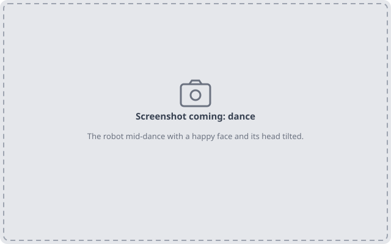

# Music and dance

The robot dances on request, and it can sway to music. It listens through its own microphone and keeps nothing.

Not yet heard or seen on a robot: real music, the mood faces and the dances. The test robot was muted.

## Ask it to dance

Say the wake word, then "dance". Name one to pick it: **sway**, **nod yes**, **shake no**, **wiggle**, **bow** or **groove**. Each is a short routine of 8 seconds or less that ends with the head centered. Say "stop" any time and it stops where it is.

## It sways to your music

Turn on **Dance to music** Built, not flashed (not tested with a real track) on the Behavior page of the settings page on your host. It is off by default. The page shows a status line: off, waiting for the unit, listening, dancing, paused (muted or quiet) or the unit needs an update.
The unit measures sound levels and tempo only. No audio is kept or sent.
When music plays near the robot, it finds the tempo and sways to it, and shows a mood face that fits the music.

- It will not dance to speech, and it pauses when the music pauses.
- It does nothing while the robot is muted or in full quiet.
- Away from your hub, the robot still sways on its own.

## What song is this

Needs MaiPai Home

Say "what song is this" while music plays. The robot sends a short clip to your MaiPai Home hub, which names the song and the artist, and the robot says it out loud.
Without MaiPai Home, this feature is hidden. See [Use MaiPai Home as the brain](with-maipai-home.md).

## Still need help?

Run `stackchan check`, then read [Troubleshooting](troubleshooting.md). If that does not fix it, open an issue on the Issues tab and tell us what you saw.
