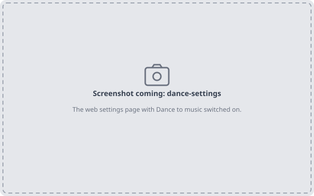

# Music and dance

The robot hears music, likes it, and dances. It dances on request too. Everything here runs on the robot and your host, and the robot keeps no recordings.

## Ask it to dance

Say the wake word, then "dance". The robot does a short routine of about 12 seconds: a happy dance, a wink, a robot-style move, a surprised look, a second happy dance, then it settles back to level.
Say "stop" any time and it stops where it is.

## It dances to your music

Turn on **Dance to music** in the web settings page. It is off by default.
When music plays near the robot, it first shows a small "I like this" face. If the music keeps going, it builds up into a dance that follows the beat.

- It will not dance to speech, and it stops when the music stops.
- It saves its battery. On low battery it only sways.
- It listens through its own microphone and keeps nothing.

## What song is this

Needs MaiPai Home

Say "what song is this" while music plays. The robot sends a short clip to your MaiPai Home hub, which names the song and the artist, and the robot says it out loud.
Without MaiPai Home, this feature is hidden. See [Use MaiPai Home as the brain](with-maipai-home.md).

## Mood faces

The face changes to fit the music: calm, happy or lively. The mood faces are in [Change how the robot looks](face-and-look.md).

## Lights and sounds

| What you see | What you hear | When |
|---|---|---|
|  A light show on the light bars, in time with the dance |  A rising chime when the dance starts | The robot is dancing |
| Lights off, a small "I like this" face | Nothing | The robot has noticed music |

There is no light show at night. The robot dances with its head and face only.

See [Lights and sounds](lights-and-sounds.md) for every light and tone.

## Still need help?

Run `stackchan check`, then read [Troubleshooting](troubleshooting.md). If that does not fix it, open an issue on the Issues tab and tell us what you saw.
