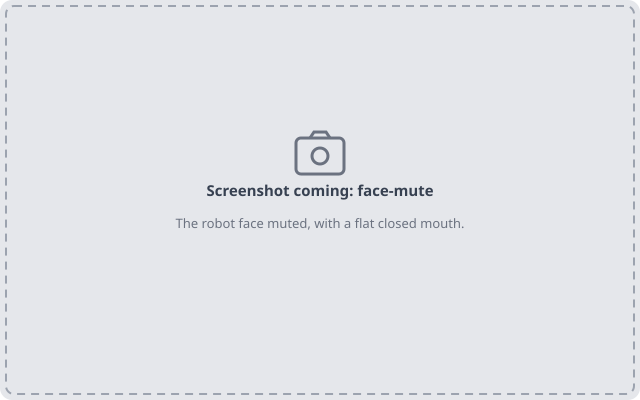
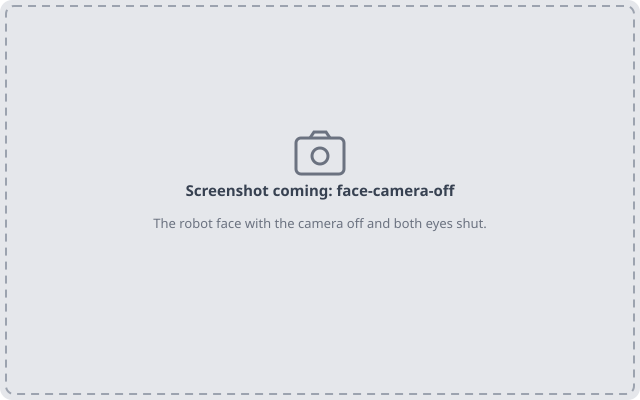
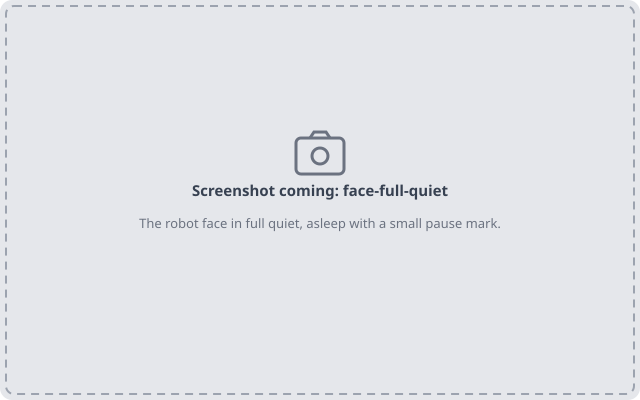

# Mute, turn off the camera, or go fully quiet

You have three switches, and each one is a tap on the robot's face. They are independent, so you can use any mix. The robot remembers them after a restart.

## The three switches

| Switch | How | What stops | The face shows |
|---|---|---|---|
| **Mute** | Tap the mouth | The microphone, the wake word and the stop word. The robot hears nothing and says nothing | A flat, closed mouth |
| **Camera off** | Tap either eye | The camera. No picture is taken, sent or looked at, and "what is this" and face follow stop | Calm, half-closed eyes that look down |
| **Full quiet** | Tap above or between the eyes | Listening, talking and moving. The head holds where it is | The sleeping face with a small pause mark |

Tap the same spot again to turn the switch off. Each tap makes no sound. The eyes blink once and the new face appears.

## Mute

Mute powers the microphone chip down, so the robot cannot hear you, not even the wake word. That also means you cannot unmute by voice.
To unmute, tap the mouth, use the web app, or ask from MaiPai Home. The host asks you to confirm before it unmutes the robot from far away.
While muted, the robot says nothing, and spoken announcements wait.

## Camera off

Camera off stops the camera at the source. The host also drops any frame that still arrives, so nothing is kept or looked at.
Your saved camera settings stay as they were. Tap the eye again and the camera comes back.
The camera-on cue is separate: whenever the camera is streaming, the screen shows it and you cannot turn that cue off.

## Full quiet

Full quiet is mute plus no talking and no moving. Use it when you want the robot to do nothing at all, for example during a meeting or when someone is asleep.
It leaves the camera as it was, so turn the camera off too if you want both.

## If you only want it to stop talking

Say "stop", or swipe down on the screen. That ends the current reply and leaves everything else alone.

## Who can unmute

By default the robot's own face can mute and unmute itself. If you set `local_unmute` to false, the face can still mute, but only MaiPai Home can unmute. Use that when the robot is somewhere you do not control.

## How sure can you be

The robot checks its own microphone chip after muting, and reports whether the check passed. If it cannot confirm, the host tells you the mute is unconfirmed and warns you after a minute.
The host also watches for a leak: if the robot reports listening or camera activity while muted or camera off, it raises an error and the face shows it for 30 seconds.
To be honest about the limit, mute is a hardware power-down plus a software lock. It is not a cut wire. If you need certainty, unplug the robot.

<strong>Lights and sounds</strong>

| What you see | What you hear | When |
|---|---|---|
| A flat, closed mouth. Lights off | Nothing | Mute is on |
| Calm, half-closed eyes. Lights off | Nothing | The camera is off |
| The sleeping face with a small pause mark. Lights off | Nothing | Full quiet is on |
| The eyes blink once | Nothing | You tapped a switch. Switching makes no sound on purpose |
| A red error face for 30 seconds | Nothing | The host saw activity it should not, such as listening while muted |

See [Lights and sounds](lights-and-sounds.md) for every light and tone.

## Still need help?

If a switch does not seem to work, run `stackchan check`, then read [Troubleshooting](troubleshooting.md). If that does not fix it, open an issue on the Issues tab and tell us what you saw.
