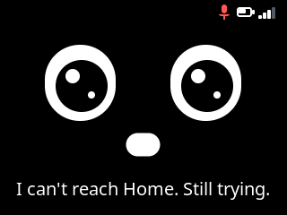

# What the robot says when it cannot reach home

When the robot loses Wi-Fi, or your host is off, it does not go silent. It says a short line of its own, shows it as a subtitle, and keeps its face. This page lists when that happens and how to change the lines.

Built, not flashed The lines come from the optional [jokes and games content](jokes-and-games-content.md) package. The host keeps them today. The robot does not read them from its own shelf until a firmware update that is not built yet.

*The robot says "I can't reach Home. Still trying." as a subtitle, with its mouth open.*

## When it speaks on its own

The robot picks a line for what just happened. There are 20 situations:

- **Greetings:** morning, daytime, evening, and goodnight.
- **Touch and movement:** a touch on the head, a touch on the face, being picked up, being put down, being shaken, and a loud noise.
- **Link:** you said the wake word and nobody answered, home cannot be reached, and home is back.
- **Care:** a timer is done and the battery is low.
- **Mood:** thanks, bored, sleepy, happy and curious.

A line is short, warm and plain, with no exclamation points. Every line is safe for a six year old. Lines that must keep their recorded voice, such as the low-battery warning, still use it. The line is added, not swapped in.

## Sound

When the robot has no voice for a line, it can mumble it. See [The offline mumble](offline-mumble.md). With the mumble off, you see the subtitle and the mouth moves, with no sound. Mute, full quiet and quiet hours silence the mumble like any other sound.

## See and change the lines

1. Open the settings page and go to **Games and fun**.
2. Find **Jokes and games content** and pick the kind **line**.
3. Each situation shows how many lines it has. Press **Delete** to remove a line (it may come back), or **Never again** to keep it away for good.

The model does not write lines. They come with the built-in set, in English, Spanish, French, German, Portuguese and Italian.

## If you use MaiPai Home

When the robot is paired with MaiPai Home, Home answers and the robot does not need these lines. They are only for the time when no host or model answers.
