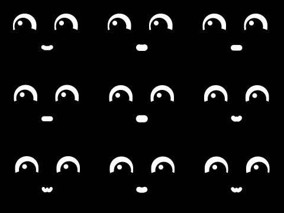

# The offline mumble

When the robot has words to show but no voice to say them, it can mumble them. It plays one short note for each letter of the subtitle, and its mouth moves with the notes. You cannot understand words, but you can hear a question rise and a statement fall.

The mumble is in the firmware as an option and is **off by default**.

*Nine steps of the mouth opening and closing as the robot mumbles "Hello! I am".*

## When it plays

- The robot has a subtitle to show and no voice for it, because it is offline or the speech service did not answer in time.
- Subtitles (captions) are on.
- The sound rules allow it. Mute, full quiet and quiet hours silence it, and the volume is the system volume.

With a real voice, nothing changes. With the sound off, the subtitle and the mouth still show.

## How it sounds

- A vowel is a low note. Each vowel has its own pitch.
- A consonant is a short, higher note.
- A space, a comma or a full stop is a rest.
- A question rises at the end. A statement falls.

The same text always gives the same notes. It works in every language the robot speaks, and in other scripts too.

## Turn it on

The setting is called **mumble** and the host sends it to the robot with the other unit settings. It is off until you turn it on. The robot keeps almost nothing in memory while it is off, and the mumble uses a small buffer only while it plays.

## Related

[What the robot says when it cannot reach home](offline-lines.md) · [Lights and sounds](lights-and-sounds.md)
