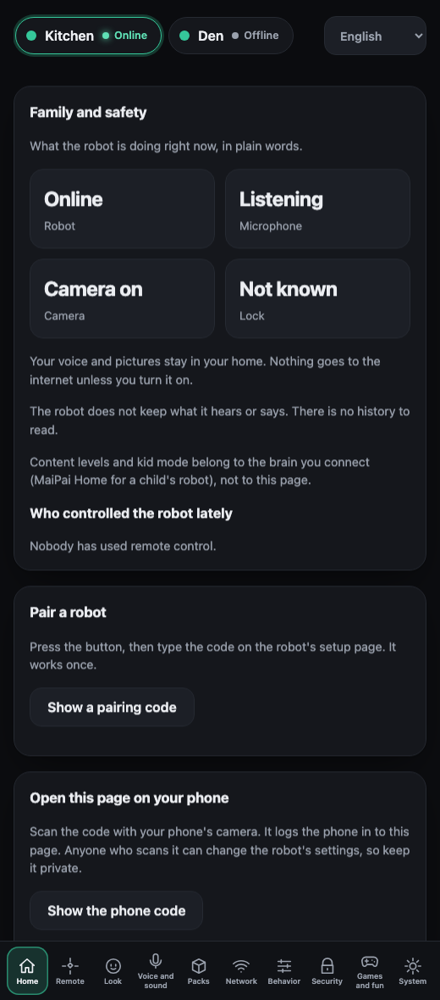

# Check on the robot from your phone

The settings page has a **Family and safety** card on the Home page. It tells you what the robot is doing in plain words.

## What you see
- **Robot:** online or offline.
- **Microphone:** listening or muted.
- **Camera:** on or off.
- **Lock:** locked or not.
- **Who controlled the robot lately:** the last few remote actions, or "Nobody has used remote control."

The card also says what the robot does not do. Your voice and pictures stay in your home. The robot does not keep what it hears or says, so there is no history to read.

## Pair a robot without a terminal
1. Open the settings page on the host computer.
2. Press **Show a pairing code**. A 6-digit code appears.
3. Type the code on the robot's setup page. It works once and for 10 minutes.

## Open the page on your phone
1. In `robot.toml`, set `lan = true` under `[settings]`. Restart the host.
2. On the host computer, press **Show the phone code**. A square code appears.
3. Scan it with your phone's camera. The phone is now logged in.

Keep that code private. Anyone who scans it can change the robot's settings. The pairing button and the remote-access controls stay on the host computer, even for a logged-in phone.
