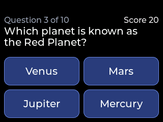

# Twenty Questions, riddles, jokes and trivia

These games are played by talking. They work with your own model and with MaiPai Home. If your model stops answering in the middle of one, some of them keep going from a saved library.

Built, not flashed The host side works and is tested. The robot's own screens for these games are built and not flashed yet, and no live model has played them.

*A trivia question with four answers on the robot's screen.*

## Start a game

Say one of these:

- "Play twenty questions"
- "Tell me a riddle"
- "Play jokes"
- "Let's play trivia"

Say "stop the game" to end it. After five quiet minutes it ends by itself.

## When the model does not answer

If you turned on the [jokes and games content](jokes-and-games-content.md) package, the host keeps a library and plays from it:

| Game | Without a model |
|---|---|
| Riddles | Asks the next riddle, checks your answer, keeps the score |
| Trivia | Asks the next question, checks your answer, keeps the score |
| Jokes | Tells the next joke and never repeats one |
| Twenty Questions | Keeps playing from a built-in list of animals and things |
| Word chain, would you rather, bedtime stories | Need a model. The robot says it cannot think right now |

A riddle or a question is never told twice in the same game. When the library runs out, the robot says so and the game ends.

## How Twenty Questions works without a model

You think of an animal or a thing. The robot asks yes or no questions from a fixed list of 12, such as "Is it alive?" and "Can it fly?". Each answer removes objects that do not fit. When the questions are done, it guesses. If the guess is wrong, it tries again, up to three guesses. If all three miss, it says "I give up. What was it?"

The built-in list has 106 objects, in English, Spanish, French, German, Portuguese and Italian. The list is made for kids and holds no sensitive topics.

## Rules

The games follow the same child and content rules as ordinary chat. What your model says in a chat is between you and your model.
