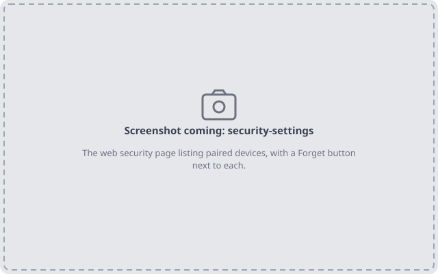

# Keep the robot secure

Privacy keeps your data in your home. Security keeps other people out. This page lists what stops someone from controlling or reaching your robot, and the one gap to know about.

## What protects the robot

- **Pairing needs you in the room.** The robot shows a 6 digit code, and you type it on the host. The window closes after two minutes, and five wrong codes close it early.
- **Revocable access.** Pairing creates a long random token, stored hashed on the host. Run `stackchan forget` and that token stops working.
- **Tailscale encrypts the link.** Over your Tailscale network, traffic between the robot and your host is encrypted end to end. Only your own devices can join.
- **Tokens on everything that is on.** The local API, event stream and metrics are off by default. When you turn one on, every read and write needs a token.
- **Signed updates.** The robot installs only signed images. A bad signature is refused, and a failed update rolls back.
- **Remote control is off by default.** When you turn it on, every remote action needs your token and shows a Remote icon on the robot. There is no remote listening. Planned
- **The camera cue cannot be switched off.** When the camera streams, the screen always shows it.
- **No open ports on your router.** You never forward a port. Over Tailscale, only your own devices can reach the robot and host.

## Known gaps

We audited the design and found these. Each has a fix planned before release.

- **The link on your home network is plain.** Without Tailscale, anyone already on your Wi-Fi could read it, and the robot does not yet check that it is talking to your host. Use a network you trust, or turn on [Tailscale](use-it-anywhere.md), which encrypts it.
- **The Wi-Fi setup page is open.** It appears if the robot cannot join Wi-Fi for 60 seconds. Use it only when you are present.
- **Someone with the robot in hand can read its memory over USB.** Reset the robot before you give it away.

We have not yet captured the robot's network traffic to prove nothing else leaves your home. We will publish that capture before release.

## Reset the robot

A reset clears the robot's saved Wi-Fi networks, its Tailscale key, its pairing and its settings. Your host keeps its own files.

1. On the robot, open **Settings**, then **Reset**.
2. Read what will be cleared and press **Reset**.
3. Confirm by holding the button for three seconds. The robot asks twice on purpose, so a stray touch cannot wipe it.

You'll know it worked when the robot restarts and shows the setup page.

If you cancel, nothing changes. If the reset stops partway, the robot says so and starts the setup page anyway. Run the reset again.

## If you lose the robot or sell it

1. Run `stackchan forget` on the host. The robot can no longer reach it.
2. If you have the robot, [reset it](#reset-the-robot).
3. In the Tailscale admin page, remove the robot and delete its auth key.

You'll know it worked when `stackchan check` no longer lists the robot.

## Found a security problem?

Please don't post it publicly. Tell us privately and we will fix it before anyone else sees it. We will add the contact to this page before release.

## Still need help?

Run `stackchan check`, then read [Troubleshooting](troubleshooting.md). If that does not fix it, open an issue on the Issues tab, without any private details.
