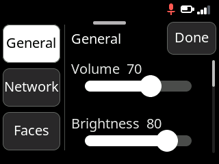
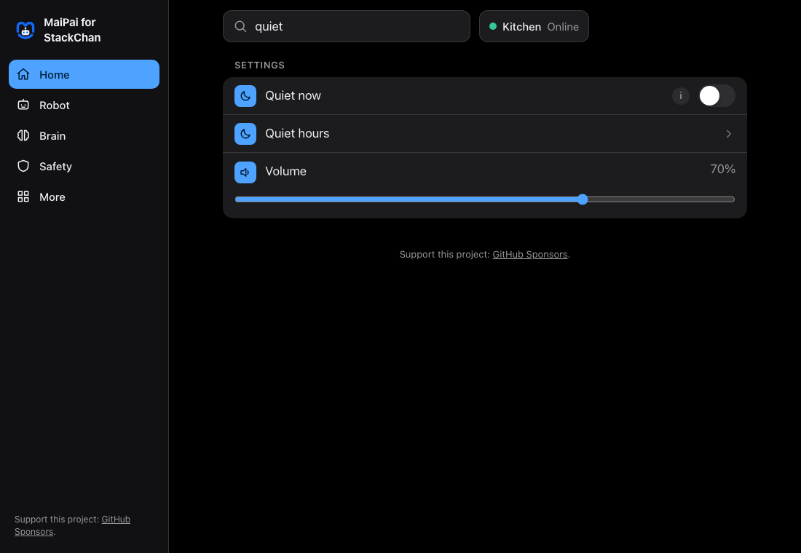
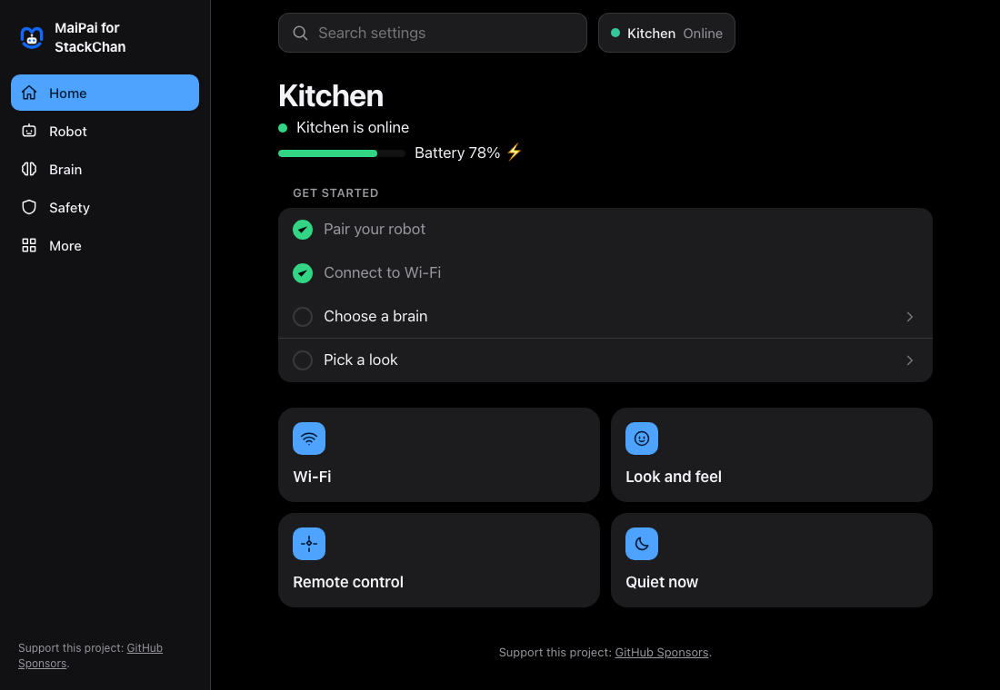
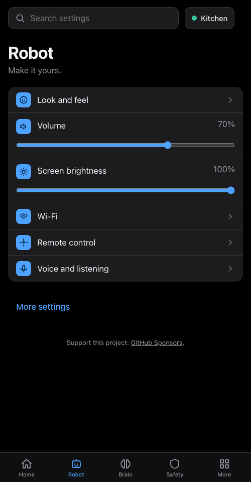
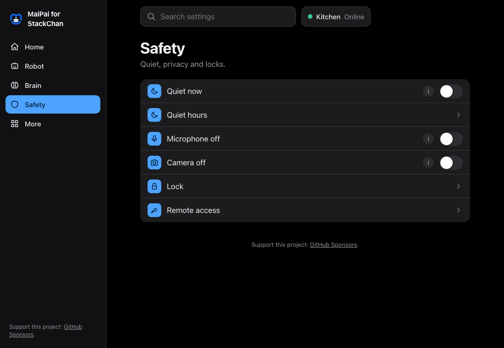
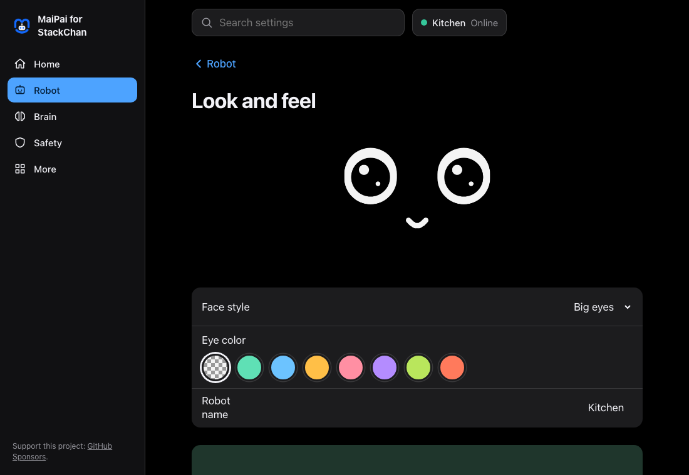

# Change a setting

Settings live in three places: the `robot.toml` file, the settings page on your host and the robot itself. Wi-Fi is set on the robot's own setup screen, not on the host's page.
Changing a setting never needs a reflash.

*The on-robot settings, General page, with Volume and Brightness sliders.*

## Find a setting

The search box is at the top of every page of the dashboard. Type a plain word such as "quiet", "volume", "wifi", "name", "camera" or "update". Each result is the setting itself, so you can change it right there.

*Search for "quiet": each result is a real control, with no page to open first.*

## Face style (`face_style`)

Picks the look of the face: big eyes, stock or minimal. The settings page on your host shows a preview.

## Face color (`face_color`)

Choose none, a named color or a custom color. The default is neutral and has no color until you pick one.
Color never carries meaning alone. Every state also has a shape or an icon.

## Captions (`captions`)

Shows spoken words on the screen. It is off by default. You can turn it on for any face.

## Night mode (`night_mode`)

Dims the screen and the lights, and the clock face gets softer. Quiet hours are a separate setting.

## Quiet hours

On the settings page, Behavior tab, **Quiet now** keeps the robot's own sounds quiet until you turn it off. **Quiet on a schedule** does the same between two times, on the days you pick. It is off until you turn it on. Alarms and timers you set still ring, and the privacy and safety cues never stop.

## Language (`language`)

One of six languages. See `languages.md`. The robot changes at once with no file edit.

## Other keys

- `brain`: `llm` (your own LLM, the default) or `home`.
- `url`, `stt_url`, `tts_url` under `[llm]` in `robot.toml`: your model and speech addresses. A blank speech address uses the built-in engine, which also needs its model folder (`stt_model_dir`, or `tts_model`, `tts_tokens` and `tts_data_dir`). The [Brain page](choose-a-brain.md) can download small speech models for you.
- `voice`: the voice to speak with.
- `thinking_cue`: dots always, plus a quiet tone by default.
- `strip_mode`: `petting` (default) or `control` for quick sliders.
- `update_*`: the updater. Checking is on and installing is off until you turn it on.

Run `stackchan check` after any change to your addresses. Environment variables override secrets in the file.

## Open the settings page from your phone

The page is for the host computer only until you turn this on. In `robot.toml` add `lan = true` under `[settings]` and restart the host. Run `stackchan settings-token`, then open `http://<the host's address>:8051/settings?token=<the token>` on your phone once; the phone stays logged in. Anyone on your Wi-Fi who learns the token can change the robot's settings, so keep it private. The page is plain web (not encrypted) inside your home network, so do not turn this on for a network you do not trust.

## All settings at a glance

| Setting | What it does | Default |
|---|---|---|
| `brain` | Who answers: your own LLM (`llm`) or MaiPai Home (`home`) | `llm` |
| `[llm] url` | Your model's OpenAI-compatible address | blank |
| `[llm] stt_url`, `tts_url` | Your speech tools. Blank uses the built-in engines when their model folders are set | blank |
| `[home] url` | Your MaiPai Home hub address | blank |
| `language` | English, Spanish, French, German, Portuguese or Italian | English |
| `voice` | The voice the robot speaks with | built-in voice |
| `speech_speed` | How fast it talks, 0.75 to 1.5 | 1 |
| `speech_pitch` | Pitch, -12 to 12 semitones | 0 |
| `hourly_chime` | A soft tone at the top of each hour | off |
| `persona` | A short text that tells the model how to behave | none |
| `face_style` | Big eyes or minimal | big eyes |
| `face_color` | None, a named color or a custom color | none |
| `captions` | Show spoken words on screen | off |
| `night_mode`, `quiet_from`, `quiet_to` | Dim and quiet at night | off |
| `thinking_cue` | The tone while it thinks | quiet tone |
| `strip_mode`, `quick_sliders` | Head strip behavior and its sliders | petting |
| `hourly_chime`, `idle_motion` | Small behaviors | off, on |
| `local_unmute` | Whether the robot's own face can unmute it | on |
| `update_channel`, `update_source`, `update_check`, `update_install` | Updates | stable, official, weekly, ask |

The settings page on your host has a Remote controls section: beep, flash, find my robot (it works even when muted), say something, head pad, nod, shake, dance, start a game and take a photo. Camera, watching and home tools are opt-in packages with their own pages; some also need MaiPai Home. See [Compare](local-vs-home.md).

## What goes on the settings page

The dashboard has five items in the sidebar. On a phone they sit in a bar at the bottom.

- **Home.** Your robot at a glance: its name, whether it is online and its battery. A short checklist (Pair your robot, Connect to Wi-Fi, Choose a brain, Pick a look) shows what is done and what is next, and goes away when everything is done. Four big buttons are below it: Wi-Fi, Look and feel, Remote control and Quiet now.
- **Robot.** Look and feel, Volume, Screen brightness, Wi-Fi, Remote control, and Voice and listening. Less common things sit behind **More settings**.
- **Brain.** Where your robot thinks. See [Choose a brain](choose-a-brain.md).
- **Safety.** Quiet now, Quiet hours, Microphone off, Camera off, Lock and Remote access.
- **More.** Packs, Games, Network, Updates, About and System.

*Home: the robot at a glance, what to do next, and four big buttons.*

*The Robot page on a phone. Volume and brightness change as you drag.*

*The Safety page: the switches that matter most are on top.*

Tap a row with an arrow to open it. Tap the back arrow at the top to return. A small **i** next to a switch explains it. Changes apply to the robot at once, or the next time it connects.

- **Look and feel** (see [Change how the robot looks](face-and-look.md)): face style, eye color and the robot's name, with a live picture. Every other look setting is behind **More settings**. The same changes work from a terminal: `stackchan face set UNIT --style big_eyes --color mint --captions on`.
- **Language**: one of six. See [Switch the language](languages.md).
- **Remote control**: say something, look around, dance, start a game and take a photo.

Night mode dims the screen and the lights and softens the clock. Quiet hours are a separate window in which the robot stays quiet.

*Look and feel: pick a style and a color and the face changes at once.*

## What goes on the robot

Swipe up from the bottom of the screen for the control sheet: volume, brightness, Mute, Quiet, Lock, Apps, Games and Settings. The Settings screen has General, Network, Faces and Info tabs. See [Swipe pages and the control sheet](swipe-pages.md).

*The host's settings page: robot status, the settings tabs, the pairing code, mute and update in one place. This is a drawn picture, not a screenshot.*

## Reset the robot

Clears Wi-Fi networks, pairing and settings, after a confirmation. See [Keep the robot secure](security.md).

## More keys

- `persona`: a short text that tells the model how to behave.
- `quick_sliders`: which sliders the head strip opens. The default is volume and brightness.
- `hourly_chime`: a soft tone each hour. Quiet hours are set on the settings page (Behavior), not in the file.
- `idle_motion`: turn the idle moves off.

*The settings page on the host with robot status, settings, the pairing code, mute and update. A placeholder drawing, not a real screenshot.*

## Still need help?

Run `stackchan check`, then read [Troubleshooting](troubleshooting.md). If that does not fix it, open an issue on the Issues tab and tell us what you saw.
