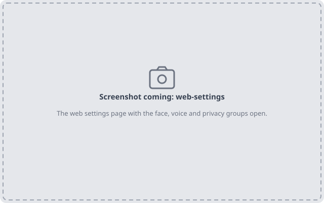

# Change a setting

You will find the same settings in three places: the `robot.toml` file, the web settings page and the robot itself.
Changing a setting never needs a reflash.

## Face style (`face_style`)

Picks the look of the face. Packs: big eyes and minimal. The web page shows a preview.

## Face colour (`face_color`)

Choose none, a named colour or a custom colour. The default is neutral and has no colour until you pick one.
Colour never carries meaning alone. Every state also has a shape or an icon.

## Captions (`captions`)

Shows spoken words on the screen. It is off by default. You can turn it on for any face.

## Night mode (`night_mode`)

Dims the screen and the lights, and the clock face gets softer. Quiet hours are a separate setting.

## Language (`language`)

English or Spanish. See `languages.md`. The robot changes at once with no file edit.

## Other keys

- `brain`: `standalone` (default) or `home`.
- `llm_url`, `stt_url`, `tts_url`: your model and speech addresses. Blank speech addresses use the built-in engines.
- `voice`: the voice to speak with.
- `thinking_cue`: dots always, plus a quiet tone by default.
- `strip_mode`: `petting` (default) or `control` for quick sliders.
- `update_*`: the updater. Checking is on and installing is off until you turn it on.
- Privacy keys: camera, retention and presence.

Run `stackchan check` after any change to your addresses. Environment variables override secrets in the file.

## Reset the robot

Clears Wi-Fi networks, the Tailscale key, pairing and settings, after a confirmation. See [Keep the robot secure](security.md).

## More keys

- `persona` and `persona_lock`: the personality, and whether a spoken request can change it.
- `quick_sliders`: which sliders the head strip opens. The default is volume and brightness.
- `hourly_chime`, `quiet_from` and `quiet_to`: a soft tone each hour, and a window when the robot dims and stays quiet.
- `idle_motion` and `pet_mood`: turn idle moves and the pet mood off.
- `camera`, `camera_retention` and `vision_url`: the opt-in camera, how long snapshots stay, and your vision model.
- `prefer_tailnet`: minutes the robot tries Tailscale first. The key itself is pasted on the Network page.
- `api`, `events`, `mqtt_url`, `ha_bridge`, `metrics` and `mcp`: the home tools. All are off by default.

## Still need help?

Run `stackchan check`, then read [Troubleshooting](troubleshooting.md). If that does not fix it, open an issue on the Issues tab and tell us what you saw.
