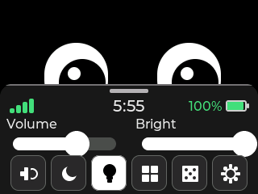
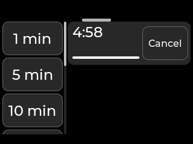
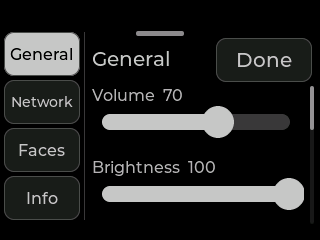
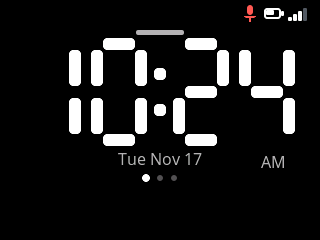
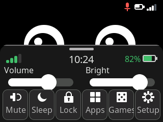
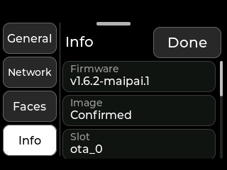
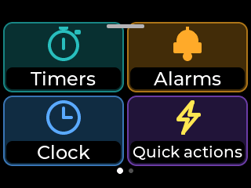
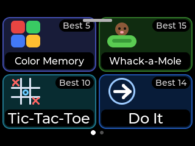

# Swipe pages and the control sheet

> Built and flashed. Not yet checked by a person on the glass: how the swipes feel.

The face is home. You swipe on the screen to reach other things, and the robot goes back to the face by itself. All of it runs on the robot, so it works with your own LLM, with MaiPai Home, and with no host at all. A swipe has not been tried on a real robot yet: the first check is listed in [the design note](../design/pages-2026-11-17.md).

## The swipes

| You do this | The robot does this |
|---|---|
| Swipe up from the bottom of the screen | Opens the control sheet over the lower part of the screen. |
| Swipe left or right on the face | Moves to the next page. The first page on the left shows when you swipe right; the first page on the right shows when you swipe left. |
| Swipe down | Stops talking or ends a game. On a page or the sheet it closes it. |
| Swipe from the very side edge | Changes the volume, as it always did. It never changes a page. |
| Tap above the open sheet | Closes the sheet. |

A swipe is a quick, clear move of at least a thumb's width. A slow drag, such as moving a slider, is not a swipe. A touch that only wakes a dim screen or ends a ringing timer does nothing else.

The robot returns to the face when:

- you say the wake word, or it starts to speak;
- you touch its head;
- a timer rings;
- nobody touches it for 20 seconds on a page, or 6 seconds on the sheet. You can change both times.

## The pages

You choose up to three pages on each side of the face. A page appears once. Until you choose, the clock is on the left and the games are on the right.

- **Clock.** Big digits or a ring, dimmed at night. It shows a dash until the robot knows the time.
- **Timers.** Your running timers with a cancel button, and three buttons to start 1, 5 or 10 minutes.
- **Games.** Each game with your best score. Press a row to play.
- **Quick actions.** Four to six big buttons: find me, beep, dance, games and say hi. In full quiet the ones that make sound or move are dim, and a tap says why.
- **Pictures.** The pictures from your picture face pack, one at a time, changing every 8 seconds. It holds still at night and in full quiet.
- **Dashboard.** Up to six tiles, each with a small picture, a label and a value, for example the weather or the garage door. The robot has no source for these: MaiPai Home or your own host sends them. Tiles older than an hour are dim and say how old they are.

The banner row at the top and the subtitles at the bottom stay where they are while a page shows. The weather effects pause while a page is up.

## The control sheet

It shows volume and brightness sliders, a line with the Wi-Fi signal, the time and the battery, and one row of six buttons: Mute, Quiet, Lock, Apps, Games and Settings. The listening light switch is in Settings, on the General tab. Settings also has the Network tab (saved Wi-Fi networks; the network test is on the host), the Faces tab, and an Info tab that shows the firmware version and other details directly, with no hidden taps.

## The Apps and Games walls

Apps and games show as big colored tiles, each with its own picture: a stopwatch for Timers, a bell for Alarms, a clock face, a bolt for Quick actions, four colors for Color Memory, a mole for Whack-a-Mole, a grid for Tic-Tac-Toe and an arrow for Do It. Swipe for the next page; the dots are below the tiles. Only one screen shows at a time. Pressing a tile and the pop animation are not yet checked by a person.

## The Timers app

A column of presets on the left (1, 5, 10, 15, 30, 45 and 60 minutes, and Custom) scrolls. Each running timer is a tall row with a progress bar and a big Cancel.

## Choose them on the settings page

Open the robot's settings page, then **Behavior**, then **Swipe pages**. You can:

1. Add, remove and drag pages in order on each side.
2. See a picture of the screen for the face, each page and the sheet.
3. Pick what the control sheet shows (up to 2 sliders, 7 buttons and 4 status lines) and which quick actions you want.
4. Set how long a page and the sheet stay (a page: 5 to 300 seconds; the sheet: 5 to 15 seconds).
5. Press **Show on the robot** to show the page you are looking at, and **Send sample tiles** to fill the dashboard.

If the robot has not had the update that brings the pages, the page says "Coming with the next unit update", keeps your choice, and sends it when the robot has the update.

## For developers

The tools are `self.pages.status`, `self.pages.get`, `self.pages.set`, `self.page.show` and `self.page.tiles`. The choice is one text line in the robot's flash under `pages_cfg`; the dashboard tiles are saved under `page_tiles`, at most once in ten minutes. Details and the memory numbers are in [the design note](../design/pages-2026-11-17.md).
