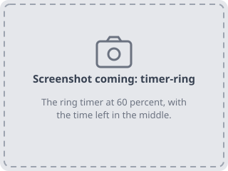
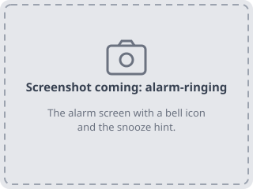

# Timers and alarms

## Set a timer

Say the wake word, then "set a timer for ten minutes". The screen shows a ring that empties as time runs out.
When the time is up the robot plays a tone and shows a pulsing icon. Say "stop" or touch the robot to end it.

## Several timers

Ask for another timer and give it a name: "set a pasta timer for nine minutes". Ask "how long is left" to hear them all.
Timers are saved on the host, so they survive a robot restart.

## Alarms and snooze

Say "wake me at seven". When it rings, say "snooze" for a short delay. If you ignore it, it gets louder in steps.
Each kind of alarm has its own tone, so you know a kitchen timer from a wake-up alarm without looking.

## Hourly chime

Turn on `hourly_chime` for a soft tone on the hour.

## Quiet hours

Set `quiet_from` and `quiet_to` to a start and end time. In that window the robot dims, keeps its voice low and skips the chime.
Alarms you set still ring.

## Offline

Timers and alarms run without the language model. They need the host only to be set. The clock needs the host once, to learn the time.
