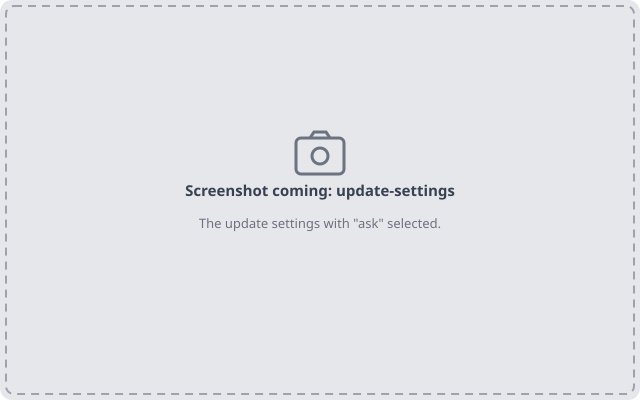

# Update the robot

## The default

The update path is built: the robot checks a signature and rolls back by itself if the new version does not start. It has not yet run with a real release key, because no release key exists yet. Until the first release is signed, treat updates as untested.

The host checks for a new version. It does not install anything. You decide when to install.

The check is one small request to your chosen update source. It sends only the firmware version.

## Settings

| Key | Choices | Default |
|---|---|---|
| `update_channel` | stable, beta, pinned | stable |
| `update_source` | the release manifest, your own server or folder, off | the release manifest |
| `update_check` | never, daily, weekly, manual | weekly |
| `update_install` | ask, auto, auto within a window | ask |

The same keys appear in `robot.toml`, in the settings page on your host and on the robot.

## Install an update

1. The robot or the settings page on your host tells you a version is ready.
2. Read the release notes, then press Install.
3. The robot downloads the image and checks its signature. An image with a bad signature is refused.
4. It restarts. If it does not pass its health check in 60 seconds, it rolls back to the old version by itself. You'll know it worked when the robot shows the new version on its settings page.

## Updates over Wi-Fi

You don't need a cable. The robot downloads the update over Wi-Fi, checks its signature, and shows an animated updating icon while it installs. It runs on battery, so keep it plugged in for a big update.

While it installs, the light bars pulse white fast  and an animated icon shows on the screen. Do not unplug it. A rising chime plays when it is back online.

## Your own images

Build your own image with `stackchan firmware build` and sign it with your key. Developers: see `docs/dev/build-from-source.md`.
The flasher accepts the official image or a local file. `stackchan firmware verify` compares a downloaded image with a local build.

## If an update fails

See [Troubleshooting](troubleshooting.md).

## Still need help?

Run `stackchan check`, then read [Troubleshooting](troubleshooting.md). If that does not fix it, open an issue on the Issues tab and tell us what you saw.
