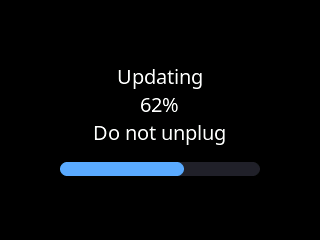
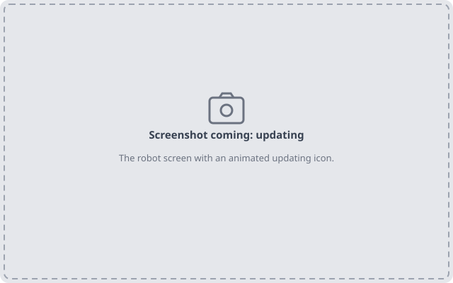

# Update the robot

## The default

The update path is built: the host checks a signed release, sends it to the robot, and the robot checks the signature again before it installs. If the new version keeps crashing, the robot rolls back by itself. It has not yet run with a real release key, because no release key exists yet. Until the first release is signed, treat updates as untested. It has not been tried on a robot.

Nothing installs by itself. The host does not look for new versions on the internet. It reads a release folder that you point it to, and you decide when to install.

## Settings

Put the folder in `robot.toml`:

| Key | What it does | Default |
|---|---|---|
| `[update]` `source` | The folder that holds the signed release. You can also pass `--source FOLDER` to a command | none |
| `[update]` `trusted_key` | The public key that signs your releases | none |
| `[update]` `preset` | `core` or `home`. A release for the other build is refused | `core` |

*The update settings with "ask" selected. A placeholder drawing, not a real screenshot.*

## Install an update

1. Run `stackchan update --dry-run`. It checks the signature, the build, the chip and the free space, and changes nothing.
2. Run `stackchan update`, or press Update on the settings page on your host.
3. The host serves the image to the robot once, over your own network. The robot refuses it if the address is not your paired host, if the version is the same as the one it runs, or if the image would leave under 20 percent of the spare slot free. It checks the signature while it writes. A bad signature is refused.
4. The robot restarts into the new version. If it keeps crashing, it goes back to the old version by itself: a second crash after the camera starts rolls back, and so does a start that is still not healthy after 120 seconds. You'll know it worked when the robot shows the new version on its settings screen.

*The update screen at 62 percent, with the words "Do not unplug".*

*The update-ready card with Install and Release notes buttons. A placeholder drawing, not a real screenshot.*

## Updates over Wi-Fi

You don't need a cable. The robot downloads the update from your host over Wi-Fi and shows an animated updating icon while it installs. Keep it plugged in for a big update.

*The robot screen with an animated updating icon. A placeholder drawing, not a real screenshot.*

While it installs, the light bars pulse white fast  and an animated icon shows on the screen. Do not unplug it. A rising chime plays when it is back online.

## Only newer, signed updates

Each release carries a build number that only goes up, and a small signed header with that number and a fingerprint of the image. The host checks the signature, the fingerprint and the number before it hands the update to the robot. The robot is meant to refuse any update whose number is not higher than its own, so an old release cannot be put back. Planned The host half is built and tested. The robot's half is not built yet, so for now only the host refuses an older release.

## Your own images

Build your own image from a clone and sign it with your key. Developers: see `docs/dev/build-from-source.md`.

## If an update fails

The host says why in plain words, and the robot stays on its old version. See [Troubleshooting](troubleshooting.md).

## Still need help?

Run `stackchan check`, then read [Troubleshooting](troubleshooting.md). If that does not fix it, open an issue on the Issues tab and tell us what you saw.
